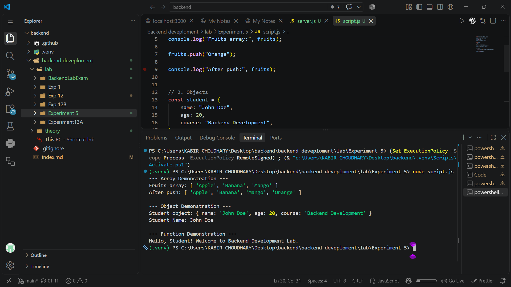
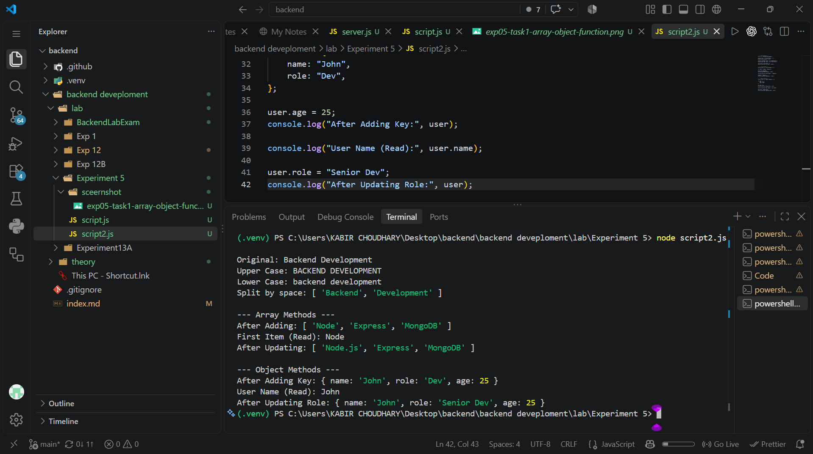
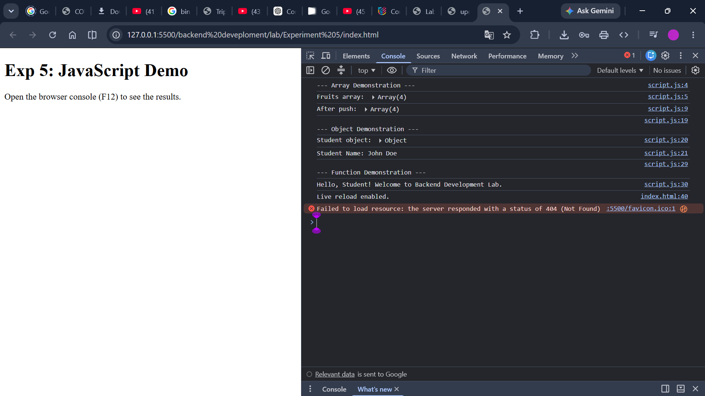
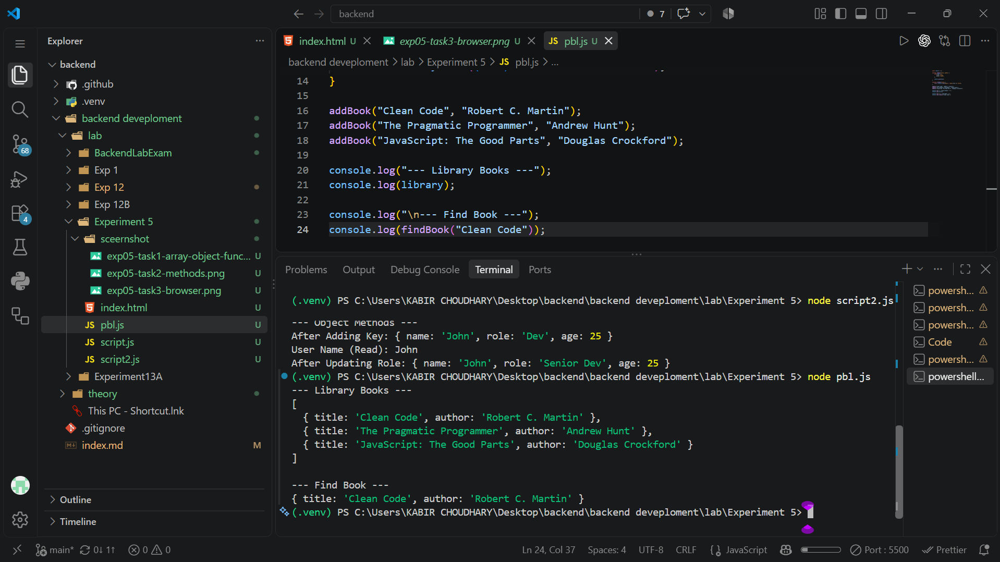

# Experiment 5: JavaScript Fundamentals and Methods

**Course:** Backend Development

**Student:** Kabir Chaudhary

**Roll number:** 590015728

**Experiment:** JavaScript arrays, objects, functions, methods, and a small library program

## 1. Aim

To practice JavaScript fundamentals by creating and updating arrays and objects, defining and calling a function, applying common string/array/object operations, and writing a small in-memory library program that can add and find books.

## 2. Learning objectives

- Declare values with `const` and `let`.
- Create arrays and objects and read their values.
- Use `push()` to append an array item.
- Define and invoke a function with a parameter and return value.
- Use string methods to change letter case and split text into words.
- Read and update array elements.
- Add and update object properties.
- Store structured records in an array and search with `find()`.
- View output in the browser developer console and the Node.js terminal.

## 3. Files and execution

- `index.html` is a small browser page that loads `script.js`.
- `script.js` demonstrates an array, a student object, and a greeting function. Open `index.html` in a browser and use the developer console (F12) to view its output.
- `script2.js` demonstrates string, array, and object operations. It is a standalone Node.js script and is not loaded by `index.html`. Run it from this folder with `node script2.js`.
- `pbl.js` demonstrates an in-memory book library and a title search. It is also standalone; run it with `node pbl.js`.
- `sceernshot/` contains the screenshots placed in the sections below, each next to the exercise it illustrates.

## 4. Task 1: Arrays, objects, and functions

The browser page displays the heading **“Exp 5: JavaScript Demo”** and tells the user to open the browser console. It loads `script.js` with a `` element loads the first JavaScript exercise.

The screenshot shows the page in a browser alongside the developer console. The script's messages are logged to the console rather than inserted into the page, so the visible HTML stays simple while the exercise results can be inspected in the browser's developer tools.

The screenshot also shows a browser request for `/favicon.ico` returning 404. This is unrelated to the JavaScript examples; no favicon is defined in the experiment.

## 7. Task 4: In-memory library program

`pbl.js` demonstrates using an array of objects to represent a small library:

- `library` starts as an empty array.
- `addBook(title, author)` creates a book object with `title` and `author` properties and appends it to the array.
- The program adds three sample books: *Clean Code*, *The Pragmatic Programmer*, and *JavaScript: The Good Parts*.
- `findBook(title)` searches the library using `Array.prototype.find()` and returns the first book whose title exactly matches the supplied title.
- The script logs all stored books, then searches for and logs *Clean Code*.

The library exists only in memory while the script runs. It is not connected to a database or saved to a file. The search is a case-sensitive exact string comparison.

## 8. Concepts used

- **Variables:** `const` is used for bindings that are not reassigned; `let` is used for the `items` array and `user` object, whose contents are modified.
- **Arrays:** Ordered collections are created with array literals and accessed by index.
- **Objects:** Related values are grouped into named properties and accessed with dot notation.
- **Functions:** `greet`, `addBook`, and `findBook` package reusable operations.
- **Template literals:** `greet` interpolates its parameter into a string.
- **Console output:** `console.log()` displays values for inspection during development.
- **Built-in methods:** `push()`, `toUpperCase()`, `toLowerCase()`, `split()`, and `find()` perform common operations on strings and arrays.
- **Mutation:** The examples append to arrays and add or update object properties.

## 9. Expected outcome

The browser console displays the fruit array before and after `Orange` is added, the student object and its name, and the greeting returned by `greet()`. Running `script2.js` prints the transformed string, split words, and updated array/object values. Running `pbl.js` prints the three book records and the matching *Clean Code* record.

## 10. Conclusion

Experiment 5 introduces core JavaScript data structures and operations through short, observable examples. It demonstrates creating and changing arrays and objects, defining a reusable function, applying built-in methods, inspecting results in browser and Node.js consoles, and searching an array of structured book records. The library example is intentionally in-memory and provides a foundation for later work with persistent storage and more complete application behavior.
