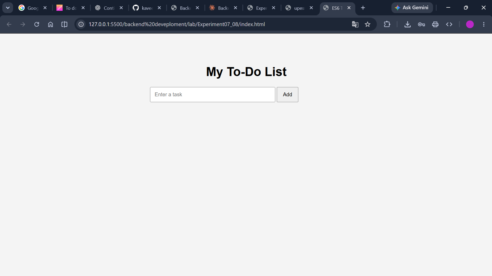
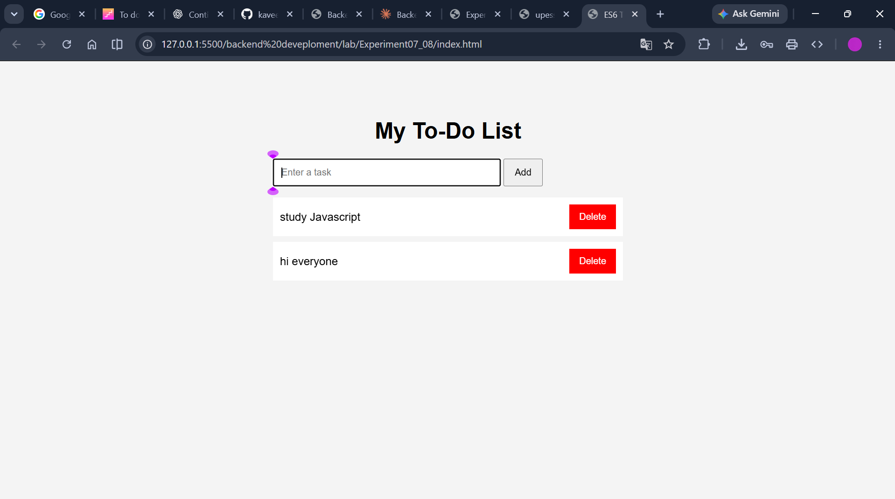
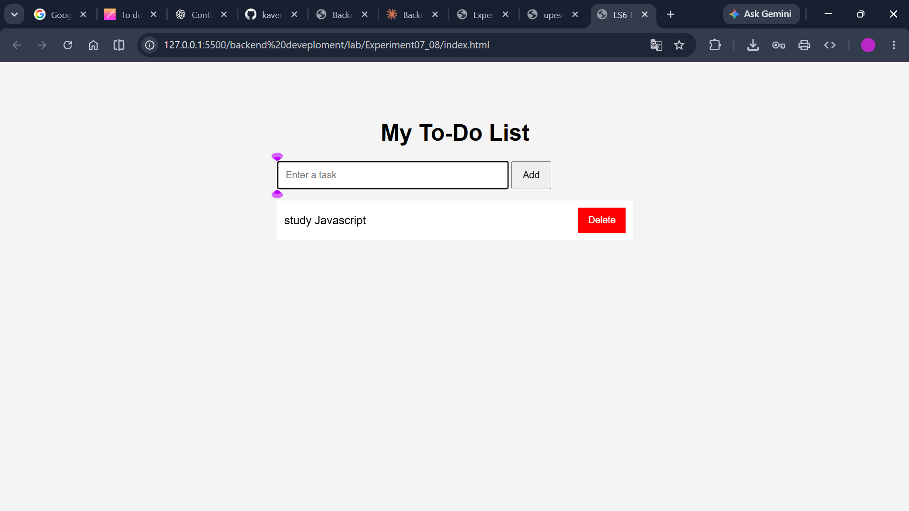

# Experiment08: To-Do List

**Course:** Backend Development

**Student:** Kabir Chaudhary

**Roll number:** 590015728

**Experiment:** Build an interactive to-do list using HTML, CSS, and JavaScript

## 1. Aim

To create a browser-based to-do list that lets a user add tasks, mark tasks complete, and delete tasks using JavaScript and DOM event handling.

## 2. Learning objectives

- Connect a JavaScript file to an HTML page.
- Select page elements with `document.getElementById()`.
- Define a class and create task objects.
- Validate and trim text entered by the user.
- Render a collection of data as HTML elements.
- Handle click and keyboard events.
- Use event delegation to manage clicks on a dynamically changing list.
- Update an array immutably with spread, `map()`, and `filter()`.
- Use `textContent`, `dataset`, and `classList` to interact with the DOM.

## 3. Project files and technologies

- `index.html` defines the page structure and embeds the CSS styles.
- `app.js` stores task data, renders the list, and implements task interactions.
- `screenshots/` contains the initial, add-task, and delete-task screenshots embedded in the matching sections below.
- **HTML** provides the input, buttons, heading, and list.
- **CSS** styles the page, tasks, completed-task appearance, and delete button.
- **JavaScript** maintains task state and updates the page in the browser.

Open `index.html` in a browser to use the app. No server, external library, package installation, or backend is needed.

## 4. Page structure and initial state

The HTML document declares the language as English, sets UTF-8 character encoding, and includes a viewport meta tag. Its browser tab title is **“ES6 To-Do App.”**

The page body contains:

- An `<h1>` heading, **“My To-Do List.”**
- A text input with `id="taskInput"` and a placeholder prompting the user to enter a task.
- An Add button with `id="addBtn"`.
- An initially empty unordered list with `id="taskList"`.
- A script element that loads `app.js`.

## 5. CSS and visual presentation

The CSS is embedded in the `<style>` element in `index.html`:

- The body uses Arial, a maximum width of 500 pixels, centered margins, padding, and a light gray background.
- The heading is centered.
- The input has padding, uses 65% of the available width, and uses `box-sizing: border-box`.
- Buttons have padding and a pointer cursor.
- The task list has no visible list markers or default padding.
- Each task row is a white, flexbox-aligned row with spacing.
- The `.done` class applies line-through text and gray coloring to completed task text.
- The `.delete-btn` class gives Delete buttons a red background and white text.

## 6. Task data and `Task` class

The JavaScript starts with an empty `tasks` array and selects the input, Add button, and list elements by their IDs.

The `Task` class creates task objects with:

- `id`: a value generated from `Date.now() + Math.random()`, used to identify the task in the rendered list.
- `title`: the text supplied by the user.
- `completed`: initially `false`.

The app state exists only in the current page's JavaScript memory. Refreshing or closing the page clears the tasks because the app does not use browser storage, a database, or a server.

## 7. Rendering tasks

The `renderTasks()` function redraws the task list from the `tasks` array:

1. Clears the list with `list.innerHTML = ""`.
2. Iterates through each task with `forEach()`.
3. Creates an `<li>` and a `` for the title.
4. Sets the title through `span.textContent`, so the title is treated as text rather than parsed as HTML.
5. Adds the `done` class when the task's `completed` value is true.
6. Creates a Delete button and adds its `delete-btn` class.
7. Appends the title and button to the list row.
8. Stores the task ID in `li.dataset.id` and appends the row to the list.

The screenshot below shows a task displayed in the list after it has been added. The code also supports toggling completion by clicking a task row, though the available screenshots do not show a completed task.

## 8. Adding a task

The `addTask()` function reads the input value and calls `trim()` to remove leading and trailing whitespace.

- If the trimmed title is empty, the app shows an alert asking the user to enter a task, focuses the input, and returns without adding anything.
- If the title is not empty, the app creates a `Task` instance and appends it to the `tasks` array using the spread operator.
- It clears the input, calls `renderTasks()`, and returns focus to the input.

The Add button calls `addTask()` when clicked. The input also listens for `keydown`; when the Enter key is pressed, it calls the same function. This gives users two ways to submit a task.

## 9. Completing and deleting tasks

One click handler is attached to the list rather than separate handlers to each task. This is **event delegation**: the list receives clicks that bubble up from the task rows and their children.

The handler:

1. Uses `event.target.closest("li")` to find the task row that contains the clicked element.
2. Returns if the click did not originate inside a list row.
3. Reads the task ID from `li.dataset.id` and converts it to a number.
4. If the click was on a button with the `delete-btn` class, removes that task from the array using `filter()`.
5. Otherwise, toggles that task's `completed` value using `map()` and an object spread.
6. Calls `renderTasks()` so the visible list matches the updated data.

Clicking the task itself toggles completion, which applies or removes the `.done` line-through style. Clicking its Delete button removes the task.

## 10. JavaScript and DOM concepts used

- **`document.getElementById()`** selects the input, buttons, and list.
- **`class Task`** defines the structure and initial state of task objects.
- **`addEventListener()`** registers click and keyboard handlers.
- **`trim()`** removes whitespace around the entered title.
- **`alert()` and `focus()`** report an empty input and return the user's attention to it.
- **Spread syntax (`...tasks`)** creates an updated task array when adding an item.
- **`forEach()`** iterates over tasks when rendering.
- **`createElement()` and `appendChild()`** create and assemble list rows and controls.
- **`textContent`** inserts task titles as text.
- **`dataset`** stores and retrieves each row's task ID.
- **`closest()`** finds a list row from a click on one of its descendants.
- **`map()`** creates a new array with one task's completion state toggled.
- **`filter()`** creates a new array without the deleted task.
- **`classList.add()`** applies the completed-task style.

## 11. Expected result

When the page first opens, the task list is empty. Entering a non-empty task and clicking Add—or pressing Enter—creates a row with a Delete button. Clicking the task text toggles its completed appearance. Clicking Delete removes the row. Attempting to add an empty or whitespace-only title displays an alert and does not create a task.

## 12. Scope and limitations

- Tasks are held only in memory and do not survive a page reload.
- There is no edit-task feature, due date, category, filter, or backend persistence.
- The task ID uses the current time plus a random fraction rather than a persistent identifier.
- The app uses an alert for empty input instead of an inline validation message.
- The available screenshots document the initial state, an added task, and deletion; they do not show the completion style or empty-input alert.

## 13. Conclusion

Experiment08 demonstrates a small interactive browser application built from HTML, CSS, and JavaScript. It uses an array of task objects as its state, renders that state into the DOM, and uses click and keyboard events to add, complete, and delete tasks. The example illustrates event delegation and common DOM and array APIs while keeping the implementation self-contained in the browser.
