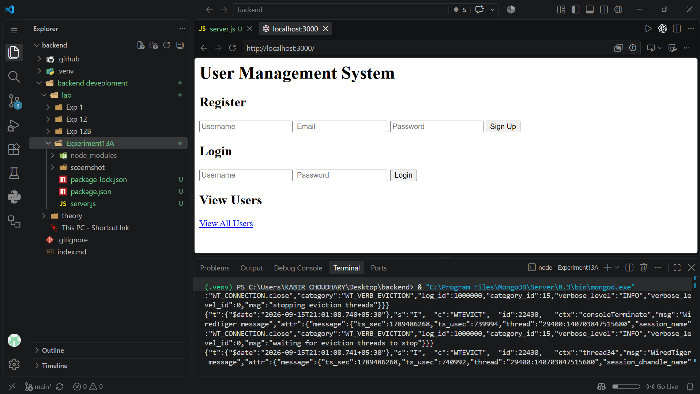
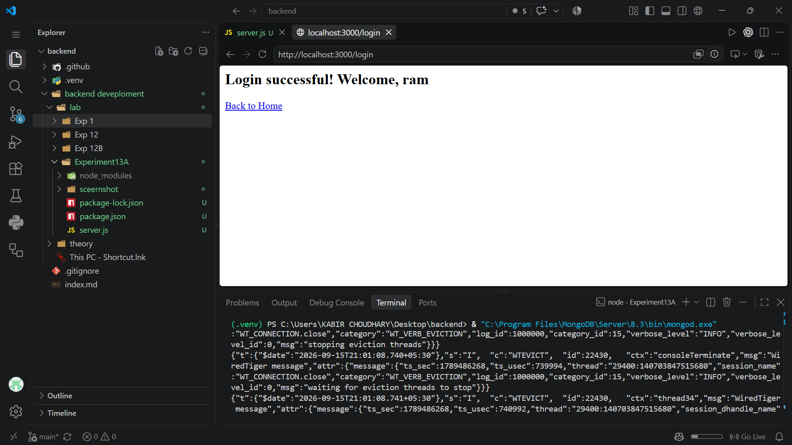
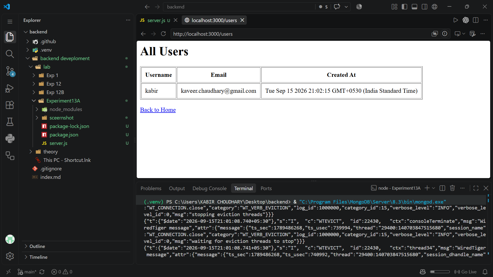

# Experiment 13A: User Management with Express and MongoDB

**Course:** Backend Development

**Student:** Kabir Chaudhary

**Roll number:** 590015728

**Experiment:** Create a user registration, login, and listing application using Node.js, Express, MongoDB, and Mongoose

## 1. Aim

To build a basic server-side user management application. The application accepts registration and login forms, stores user records in MongoDB through Mongoose, and displays saved users in an HTML table.

## 2. Learning objectives

- Create an Express web server and define GET and POST routes.
- Parse JSON and URL-encoded request bodies.
- Define a Mongoose schema and model for user records.
- Connect an Express application to a MongoDB database.
- Save and query documents with Mongoose.
- Handle duplicate-key, authentication, and database errors.
- Generate HTML responses dynamically from database results.
- Understand the difference between a basic demonstration and production-ready authentication.

## 3. Tools, dependencies, and files

- **Node.js:** Runs the server-side JavaScript.
- **Express 5:** Provides the HTTP server, middleware, routing, and response helpers.
- **MongoDB:** Stores the user documents in the local `userdb` database.
- **Mongoose:** Connects the application to MongoDB and defines the user schema and model.
- **npm:** Installs the dependencies declared by the project.
- `server.js` contains the database connection, schema/model, routes, and server startup.
- `package.json` declares Express and Mongoose as dependencies.
- `package-lock.json` records the resolved dependency tree.
- `sceernshot/` contains the homepage, successful registration, successful login, and user-list screenshots embedded in the corresponding sections below.

## 4. Database connection and request parsing

The server registers two Express body-parsing middleware functions before its routes:

- `express.json()` parses JSON request bodies.
- `express.urlencoded({ extended: true })` parses URL-encoded form submissions and makes their fields available through `req.body`.

Mongoose connects to:

```text
mongodb://localhost:27017/userdb
```

The database server must be running locally and accepting connections at the default MongoDB port before the application can store or retrieve users. A successful connection is logged to the terminal. A failed connection is reported with `console.error`; the connection attempt is not configured with environment-based settings in this source.

The Express application listens on port `3000` and prints `Server running on http://localhost:3000` when it starts.

## 5. User schema and model

The Mongoose `userSchema` defines four fields:

- `username`: a required string with a unique constraint.
- `email`: a required string with a unique constraint.
- `password`: a required string.
- `createdAt`: a date whose default value is the time the document is created (`Date.now`).

`mongoose.model("User", userSchema)` creates the `User` model used by the routes to save and query MongoDB documents. The unique constraints on username and email are enforced by MongoDB indexes; attempts to save duplicate values are handled by the registration route.

## 6. Home page and registration/login forms

`GET /` returns HTML containing three sections:

- A registration form that submits `username`, `email`, and `password` to `/signup` with the POST method.
- A login form that submits `username` and `password` to `/login` with the POST method.
- A link to `/users` to view all user records.

The forms use HTML `required` attributes, and the registration email field uses `type="email"`, which enables basic browser-side input checking. The page is constructed directly as an HTML string in the route rather than using a separate view template.



## 7. User registration: `POST /signup`

The registration handler:

1. Reads `username`, `email`, and `password` from `req.body`.
2. Creates a `User` document using those values.
3. Saves the document with `await newUser.save()`.
4. Returns a success page with a link back to the home page when the save succeeds.
5. Handles MongoDB duplicate-key error code `11000` with HTTP 400 and a message that the username or email already exists.
6. Returns HTTP 500 with a generic registration failure message for other save errors.

In the screenshot, the page confirms that registration succeeded. The route persists user records in the configured MongoDB database, so the record can subsequently be returned by the users route.


## 8. User login: `POST /login`

The login handler reads the submitted username and password, then searches MongoDB with `User.findOne({ username })`.

- If no matching username is found, the route returns HTTP 401 with **“User not found.”**
- If a user is found but the submitted password does not match the stored value, it returns HTTP 401 with **“Incorrect password.”**
- If both values match, the response welcomes the user by username and includes a link back to the home page.
- If a database or other error occurs during the lookup, the route returns HTTP 500 with **“Login failed.”**

The screenshot shows the successful-login response. This is a basic demonstration only: it does not create a session, issue a token, or otherwise keep the user authenticated for later requests.



## 9. Listing users: `GET /users`

The users route queries MongoDB with `User.find()` to retrieve all user documents. It constructs an HTML table with columns for:

- Username
- Email
- Created At

Each document is added as a table row, followed by a link back to the home page. If the database query or response generation fails, the route returns HTTP 500 with **“Failed to retrieve users.”**

The displayed list includes the stored registration details and creation timestamp. The route currently returns every user and does not require authentication or apply pagination.



## 10. Route summary

| Method | Route | Purpose |
|---|---|---|
| `GET` | `/` | Show the registration form, login form, and user-list link. |
| `POST` | `/signup` | Save a new user document and report success or failure. |
| `POST` | `/login` | Look up a username and compare the submitted password. |
| `GET` | `/users` | Read all user documents and display them in a table. |

## 11. Running the application

From the `Experiment13A` folder:

1. Ensure MongoDB is installed and running locally.
2. Install the declared Node.js dependencies with `npm install`.
3. Start the server with `node server.js`.
4. Open `http://localhost:3000` in a browser.
5. Register a user, log in with that account, or open **View All Users** to inspect stored records.

The current `package.json` does not define a `start` or `dev` script; use `node server.js` unless a script is added separately.

## 12. Scope and security limitations

This project demonstrates database-backed form handling and basic route behavior. It is not production-ready authentication:

- Passwords are stored and compared as plain text. A real application must hash passwords with a suitable password-hashing algorithm and never store raw passwords.
- Login success is returned as a page only. There is no session, cookie-based login state, token, logout route, or access control.
- `/users` exposes all stored usernames and email addresses without authentication.
- Values are interpolated into HTML response strings without HTML escaping. User-controlled values should be safely encoded before being rendered.
- Registration relies on browser-side `required` fields and MongoDB schema constraints; it does not perform explicit server-side validation or normalization of the submitted strings.
- The MongoDB URI is hard-coded for local development rather than read from configuration.
- The app does not configure HTTPS, CSRF protection, rate limiting, or production error logging.
- This app requires a running Node server and MongoDB instance. It cannot function as a standalone static GitHub Pages application; GitHub Pages can display this report and screenshots, not execute the Express server or connect to the local database.

## 13. Conclusion

Experiment 13A demonstrates a basic Express and Mongoose application that defines a user schema, stores registration data in MongoDB, checks login credentials, and renders a list of saved users. It introduces database-backed routes, asynchronous Mongoose operations, unique-field error handling, and HTML responses. The implementation is suitable for learning these concepts, but would need secure password hashing, input/output protections, authentication state, access control, and configurable database settings before real-world use.
