# Experiment 15: Django To-Do Application

**Course:** Backend Development

**Student:** Kabir Chaudhary

**Roll number:** 590015728

**Experiment:** Build a database-backed to-do list using Django

## 1. Aim

To develop a Django web application that lets a user create, view, complete, and delete to-do tasks. The application stores tasks in a database and uses Django views, URL routing, templates, static assets, and the Django administration site.

## 2. Learning objectives

- Create a Django project and application.
- Define a model and create its database table with migrations.
- Connect URL patterns to views and render templates.
- Process form submissions and persist records using the Django ORM.
- Protect state-changing forms with Django CSRF tokens.
- Reuse page components with template includes and template inheritance.
- Serve an application's CSS, JavaScript, and image assets.
- Register and manage application data through Django admin.

## 3. Tools and project structure

- **Python and Django:** Application runtime and web framework. The initial migration was generated with Django 6.1.2.
- **SQLite:** Default database, stored in `db.sqlite3` in the project directory.
- **HTML and Django templates:** Page structure and server-rendered task data.
- **CSS:** Application styling in `todo/static/todo/css/style.css`.
- **JavaScript:** A small page-load script in `todo/static/todo/js/app.js`.

Key files:

- `manage.py` provides Django's command-line entry point.
- `todo_project/settings.py` configures the project, installed app, database, templates, and static URL.
- `todo_project/urls.py` routes the admin path and includes the to-do app's routes.
- `todo/models.py`, `todo/views.py`, and `todo/urls.py` define the task data, request handling, and app routes.
- `todo/templates/todo/` contains the base, header, footer, task-list, and add-task templates.
- `todo/migrations/0001_initial.py` creates the initial `Task` table.
- `screenshots/` contains the experiment screenshots referenced below.

## 4. Setup and running the application

From the `Experiment15_Django_Todo_App` directory, activate the project's virtual environment and start Django's development server:

```powershell
.\venv\Scripts\Activate.ps1
python manage.py migrate
python manage.py runserver
```

Open `http://127.0.0.1:8000/` in a browser. The migration command applies the project and app database migrations; the initial task migration creates the table if it has not already been applied.

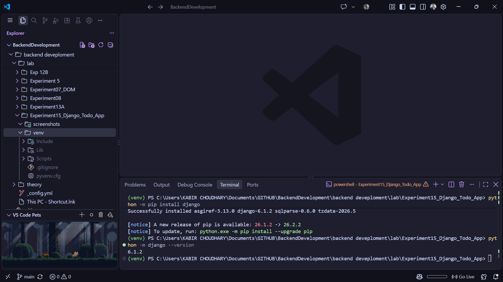

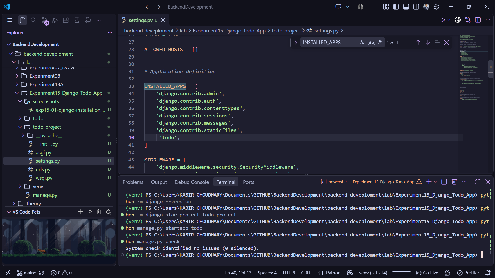

## 5. Task model and database migration

The `Task` model in `todo/models.py` defines:

| Field | Type | Purpose |
|---|---|---|
| `title` | `CharField(max_length=200)` | Stores the task description. |
| `completed` | `BooleanField(default=False)` | Records whether the task is complete. |
| `created_at` | `DateTimeField(auto_now_add=True)` | Records when the task was created. |

Django supplies the primary-key `id` field. The initial migration creates the corresponding database table. The SQLite database configuration is defined in `todo_project/settings.py`.

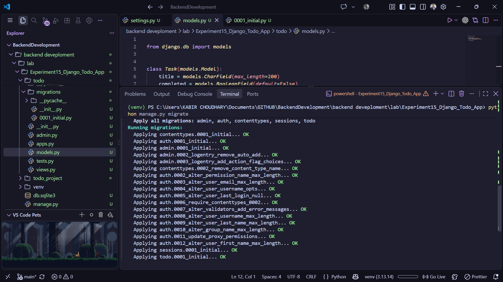

## 6. Views and URL routes

The project URL configuration includes the routes from `todo.urls` at the site root and exposes Django admin at `/admin/`.

| Method | Path | View | Behavior |
|---|---|---|---|
| `GET` | `/` | `task_list` | Lists tasks ordered by creation time, newest first. |
| `GET` | `/add/` | `add_task` | Displays the new-task form. |
| `POST` | `/add/` | `add_task` | Trims the submitted title, creates a task when it is non-empty, and redirects to the list. |
| `POST` | `/toggle/<task_id>/` | `toggle_task` | Finds the task, switches its completion state, and redirects to the list. |
| `POST` | `/delete/<task_id>/` | `delete_task` | Finds and deletes the task, then redirects to the list. |

The toggle and delete views accept only POST requests. Both actions use Django's `get_object_or_404`, so a request for a missing task returns a 404 response. The templates include CSRF tokens in their POST forms.

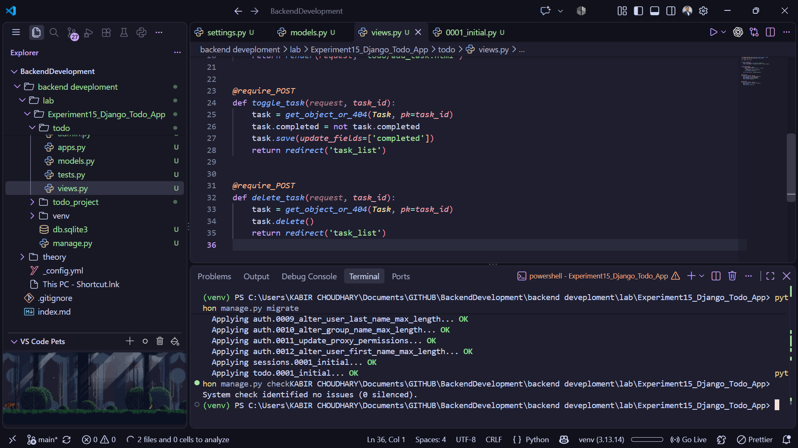

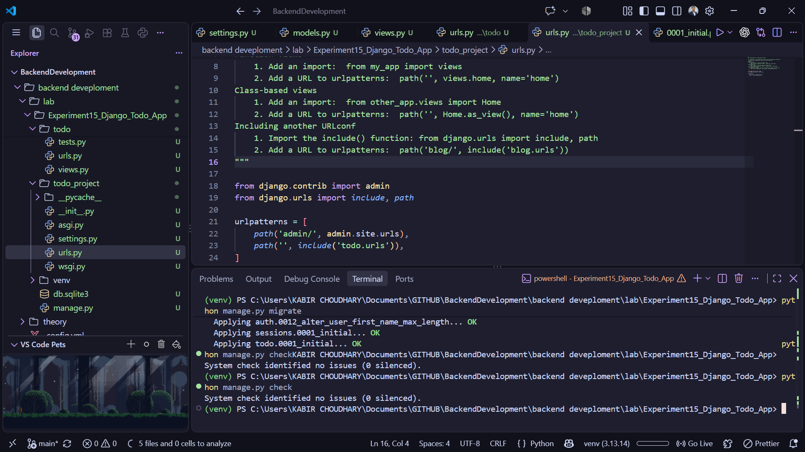

## 7. Templates and page layout

`base.html` defines the shared HTML document, loads the app stylesheet, includes the header and footer, and provides a content block. `task_list.html` and `add_task.html` extend this base template.

- `header.html` displays the app title, logo, and Home/Add Task navigation.
- `task_list.html` shows each task and provides separate forms to mark it complete/incomplete or delete it. Completed task titles appear with a strikethrough. An empty list displays a prompt to add the first task.
- `add_task.html` provides a required title input with a 200-character limit and a Save Task button.
- `footer.html` identifies the page as the Experiment 15 Django To-Do Application.

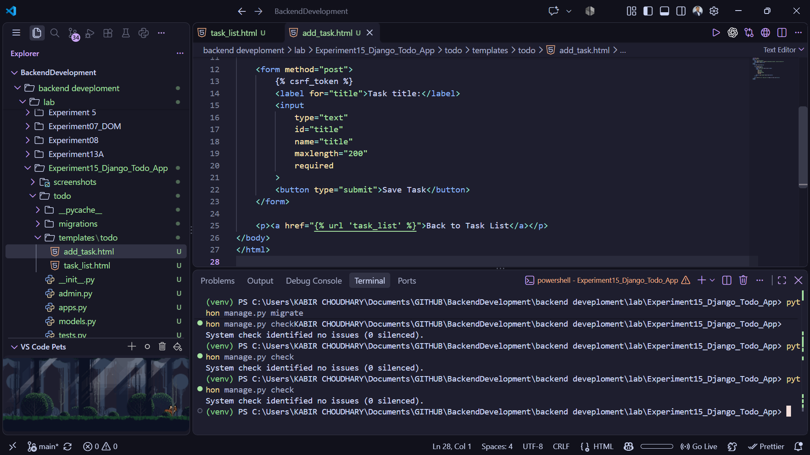

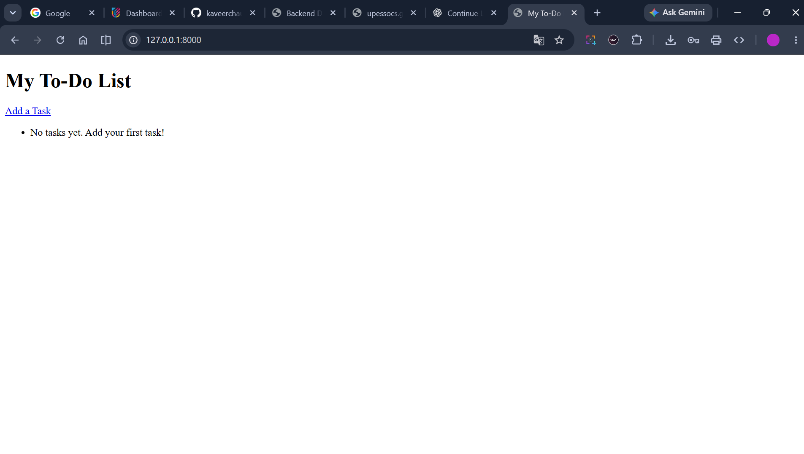

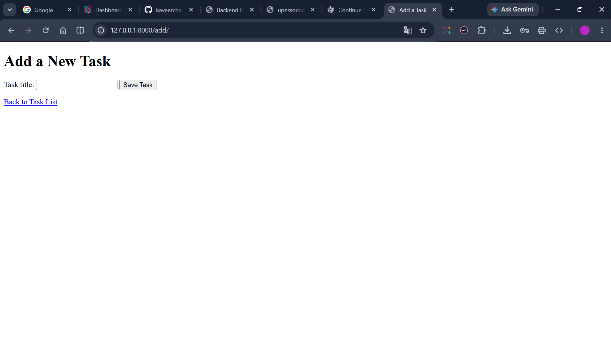

## 8. Adding, completing, and deleting tasks

To add a task, open **Add Task**, enter a title, and submit the form. The view trims whitespace and saves the task only if the resulting title is not empty. After submission, the browser returns to the task list.

Use **Mark Complete** or **Mark Incomplete** to toggle a task's status. Use **Delete** to remove a task. Both operations update the database and return to the list page.

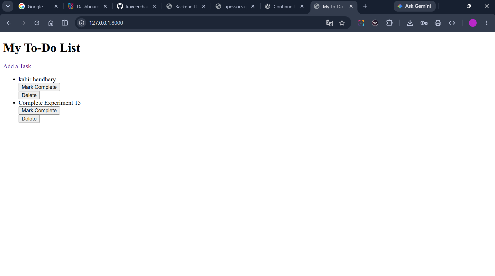

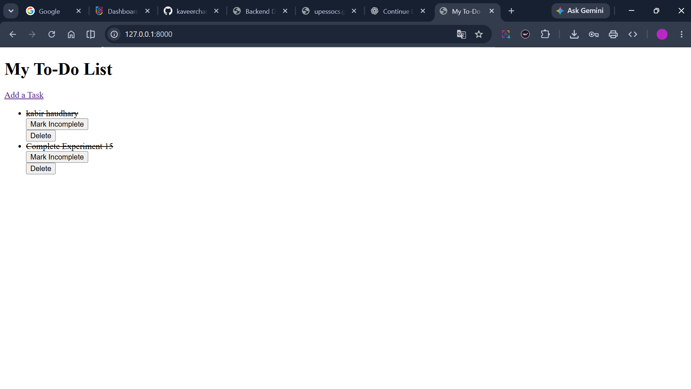

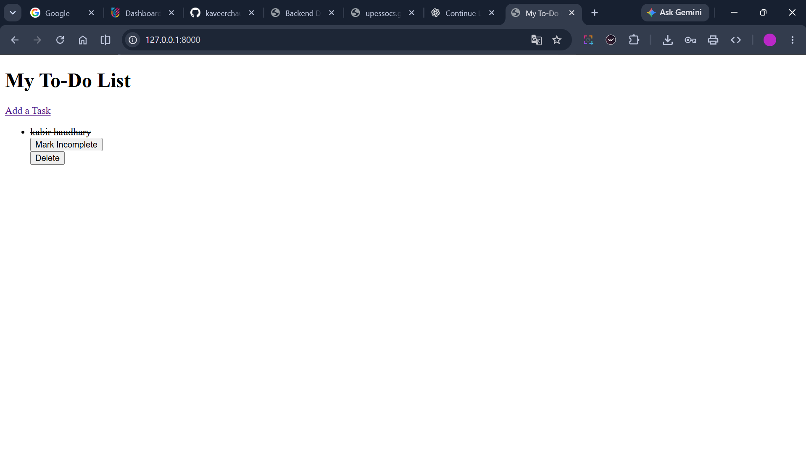

## 9. Django administration

`todo/admin.py` registers `Task` with the admin site. The task list in admin displays the title, completion status, and creation time; it also supports filtering by completion status, searching by title, and editing the completion field in the list.

The admin site is available at `/admin/`. An admin account can be created with:

```powershell
python manage.py createsuperuser
```

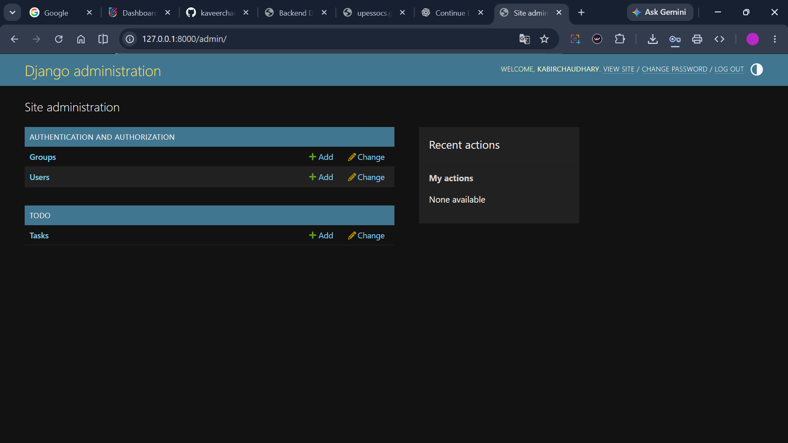

## 10. Reusable templates and static assets

The app uses Django template inheritance to keep the shared document structure in `base.html`; the header and footer are separate included templates. This avoids repeating the shared page layout on each screen.

The base template loads `todo/css/style.css` and `todo/js/app.js` using Django's `static` template tag. The stylesheet provides the page layout, colors, buttons, form controls, and a narrow-screen media query. The JavaScript focuses the title input when it is present and logs a load confirmation to the browser console. The header uses the static app logo.

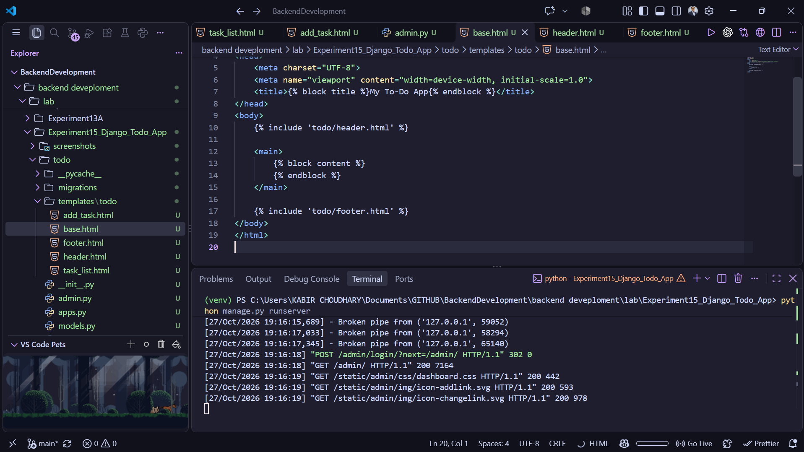

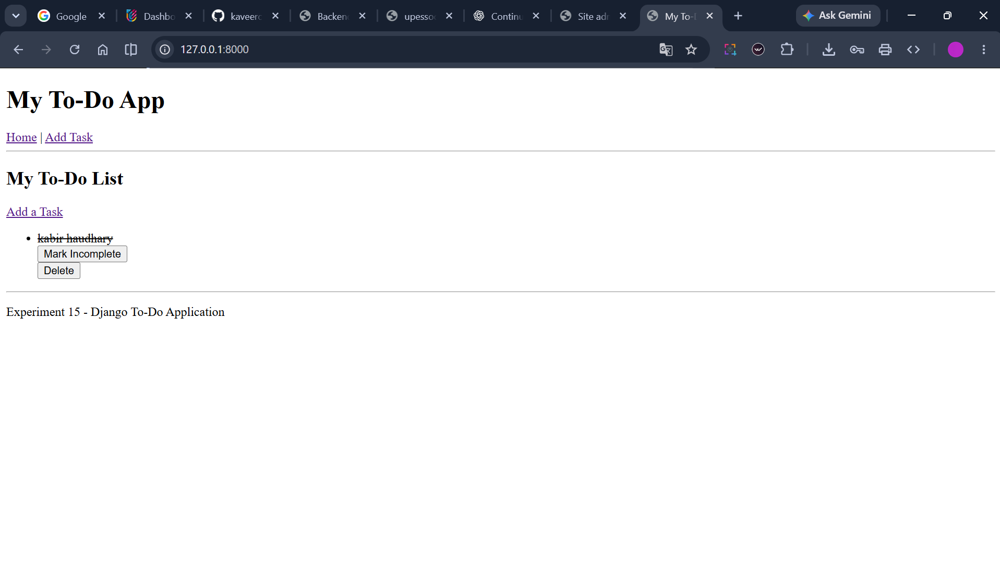

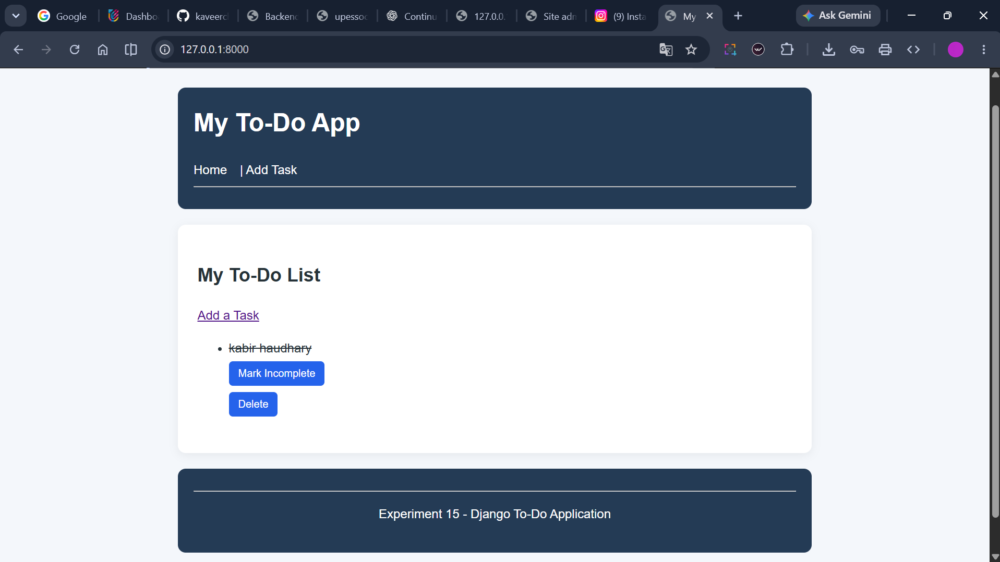

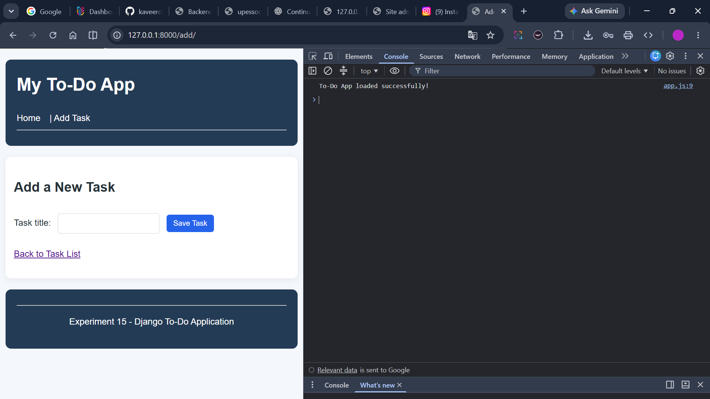

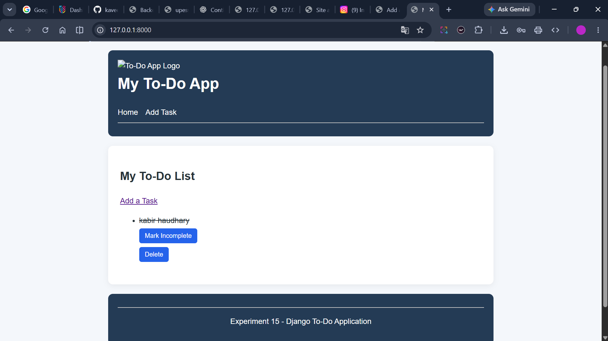

## 11. Result

The Django application provides a persistent to-do list backed by SQLite. Users can add tasks, view them in reverse chronological order, toggle completion, and delete them. The interface uses inherited and included templates, serves app static files, and exposes task records through Django admin.

## 12. Notes

This project is configured for local development. Before deploying it publicly, configure production settings such as `DEBUG`, allowed hosts, secret management, and static-file collection/serving, and use an appropriate production server.
