# Assignment 2: PostgreSQL JSONB and MongoDB

**Course:** Backend Development

**Topic:** Combining relational data with JSON documents and comparing PostgreSQL with MongoDB

## 1. Objectives

This assignment explores PostgreSQL as a relational database that can also store and query flexible JSON data. It demonstrates creating a product table with ordinary typed columns and a `JSONB` column, inserting product records, querying JSON fields, updating a JSON document, and creating an index. It then compares these operations with a MongoDB collection and queries through MongoDB Compass.

The practical uses a product catalogue containing books, laptops, and an accessory. The stable product attributes—name, category, and price—are stored in regular columns, while category-specific or optional attributes are stored as JSON.

## 2. PostgreSQL: relational columns and JSONB

PostgreSQL offers both `json` and `jsonb` data types:

- `json` stores the original JSON text and preserves its whitespace and key order. PostgreSQL validates the JSON input, but must parse it when processing JSON operations.
- `jsonb` stores a decomposed binary representation. It does not preserve insignificant whitespace or object-key order and does not retain duplicate object keys as separate values. Its representation is generally more efficient to query and can be indexed with PostgreSQL's JSONB-capable indexes.

The trade-off is that PostgreSQL must process the input into the binary representation when writing JSONB data. JSONB is a good choice for data that needs to be queried and indexed; plain `json` can be useful when preserving the original textual form is important.

The assignment's PostgreSQL table keeps core catalogue fields relational and stores variable product-specific fields in JSONB:

```sql
CREATE TABLE products (
    id INTEGER GENERATED ALWAYS AS IDENTITY PRIMARY KEY,
    name VARCHAR(100) NOT NULL,
    category VARCHAR(50) NOT NULL,
    price NUMERIC(10,2) NOT NULL,
    attributes JSONB
);
```

- `id` is an automatically generated primary key.
- `name` and `category` are required strings.
- `price` is a required decimal value with two fractional digits.
- `attributes` can hold different key/value fields for different types of product.

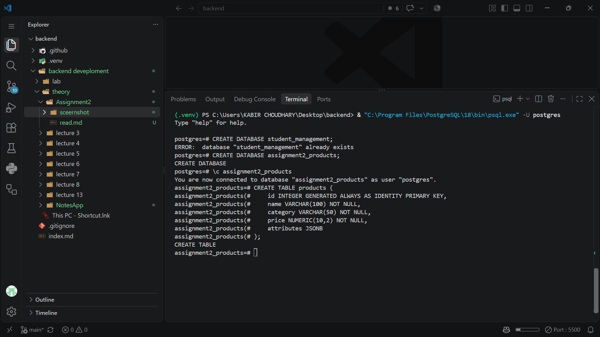

The preceding database-creation step is also captured here:

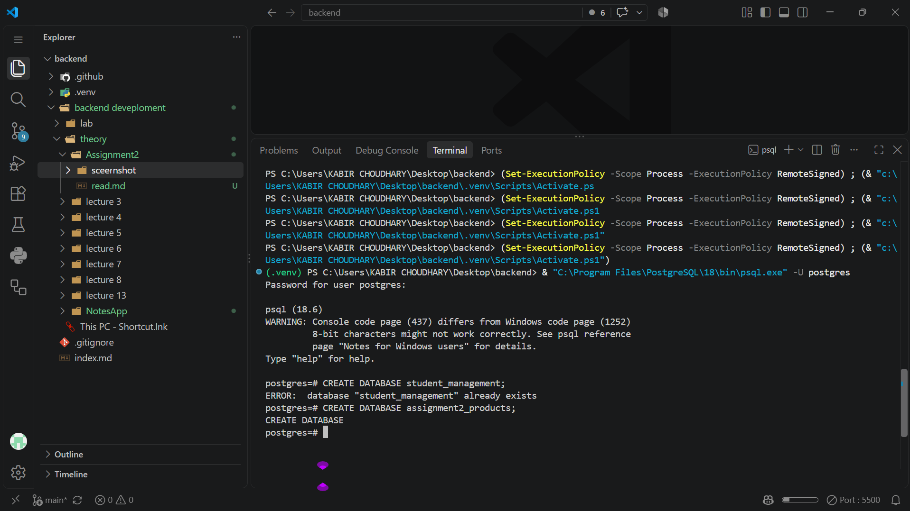

## 3. Inserting sample products

The practical inserts five records: two books, two laptops, and one accessory. Their `attributes` objects have different shapes because each product category has different details.

```sql
INSERT INTO products (name, category, price, attributes) VALUES
('Clean Code', 'book', 499.00,
 '{"author": "Robert C. Martin", "pages": 464}'),
('The Pragmatic Programmer', 'book', 599.00,
 '{"author": "Andrew Hunt", "pages": 352}'),
('Lenovo IdeaPad', 'laptop', 55000.00,
 '{"ram_gb": 16, "cpu": "Intel i5"}'),
('HP Pavilion', 'laptop', 65000.00,
 '{"ram_gb": 8, "cpu": "AMD Ryzen 5"}'),
('Wireless Mouse', 'accessory', 899.00,
 '{"color": "black", "wireless": true}');
```

The values stored in JSONB are still JSON: `pages` and `ram_gb` are numbers, and `wireless` is a boolean. Their types matter when expressions compare or cast them.

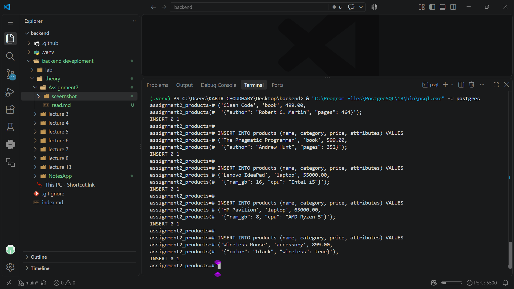

The completed table contains five products:

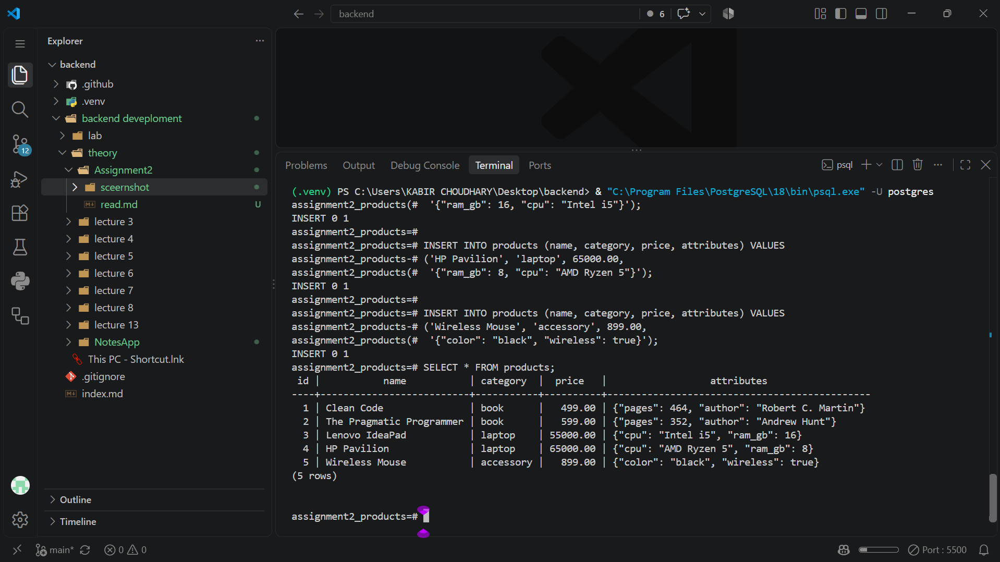

## 4. Querying JSONB values

PostgreSQL's JSONB operators allow a query to inspect an object, extract values, test keys, and match contained JSON structures.

| Operator | Result | Use |
|---|---|---|
| `->` | JSON/JSONB value | Extract a field while keeping its JSON type. |
| `->>` | Text | Extract a field as text, useful for display or conversion. |
| `@>` | Boolean | Check whether the left JSONB value contains the right JSONB value. |
| `?` | Boolean | Check whether a top-level object key (or array string element) exists. |

### Extract a value

For a book's author, `->>` returns text:

```sql
SELECT name, attributes ->> 'author' AS author
FROM products
WHERE category = 'book'
  AND attributes ? 'author';
```

The key-existence test keeps the query focused on book records that actually have an `author` attribute. In the supplied data, this returns `Clean Code` by Robert C. Martin and `The Pragmatic Programmer` by Andrew Hunt.

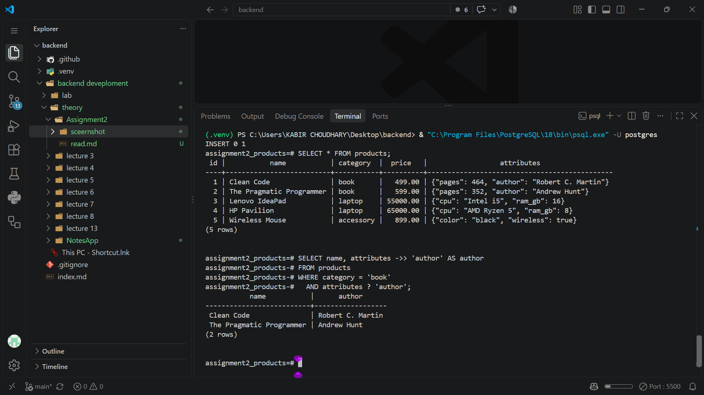

Use `->` when the JSON value itself is needed, for example:

```sql
SELECT name, attributes -> 'pages' AS pages_json
FROM products
WHERE name = 'Clean Code';
```

The result remains JSONB. To compare the numeric value, extract it as text and cast it:

```sql
SELECT name
FROM products
WHERE (attributes ->> 'pages')::integer >= 400;
```

### Filter using a JSON attribute

The following query finds laptops with at least 16 GB of RAM and returns their CPU field:

```sql
SELECT name, attributes ->> 'cpu' AS cpu
FROM products
WHERE category = 'laptop'
  AND (attributes ->> 'ram_gb')::integer >= 16;
```

For the supplied records, `Lenovo IdeaPad` is the only match. The cast is needed because `->>` returns text, while the comparison is numeric.

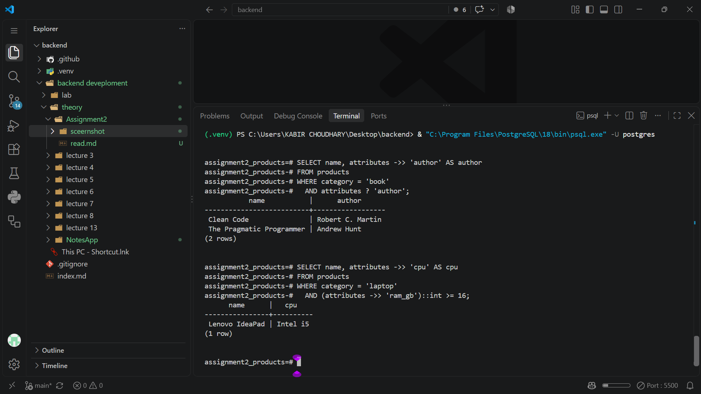

### Test key existence and containment

The `?` operator tests whether a top-level key exists:

```sql
SELECT name, attributes ->> 'color' AS color
FROM products
WHERE category = 'accessory'
  AND attributes ? 'color';
```

It returns the Wireless Mouse and its `black` color. The `@>` operator tests whether a JSONB value contains the specified JSON structure:

```sql
SELECT name
FROM products
WHERE attributes @> '{"wireless": true}';
```

This returns the Wireless Mouse because its attributes contain the key `wireless` with the boolean value `true`.

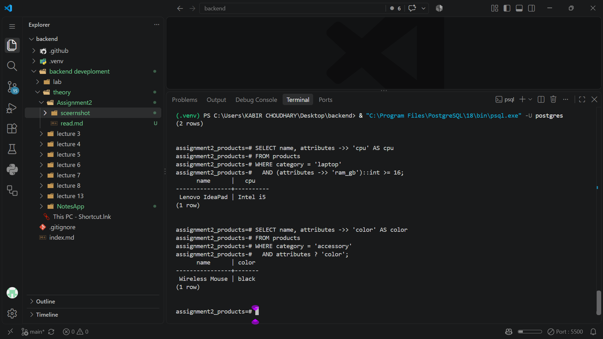

The containment query is shown separately here:

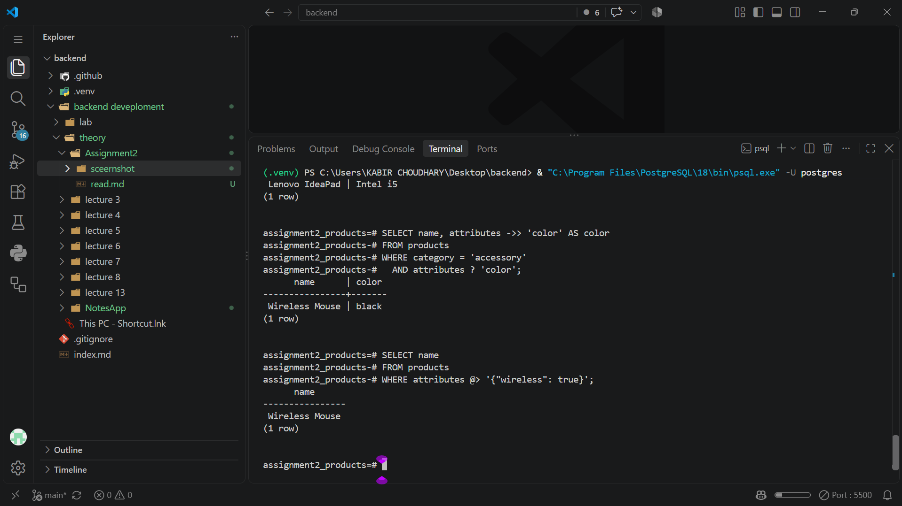

## 5. Updating JSONB data

The `||` operator concatenates JSONB objects. The assignment uses it to add a `discount_pct` field to the Wireless Mouse attributes:

```sql
UPDATE products
SET attributes = attributes || '{"discount_pct": 10}'
WHERE name = 'Wireless Mouse';
```

This updates one row and preserves the existing keys while adding the new field. If a concatenated object contains a key that is already present, the right-hand object's value takes precedence for that key.

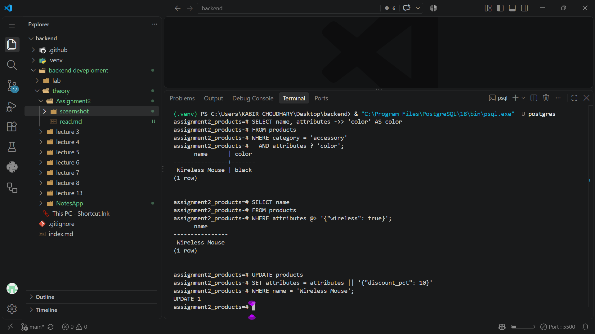

## 6. Indexing JSONB data and checking the plan

A GIN (Generalized Inverted Index) is useful when queries search within JSONB documents, including containment and key/value conditions. The assignment creates a GIN index on the full `attributes` column:

```sql
CREATE INDEX idx_products_attributes
ON products USING GIN (attributes);
```

Such an index can reduce the work required to find matching documents as a table grows. It adds storage and write-maintenance cost, however, and creating an index does not guarantee that the query planner will choose it for every query.

The provided `EXPLAIN ANALYZE` screenshot is a useful illustration of that distinction:

```sql
EXPLAIN ANALYZE
SELECT name
FROM products
WHERE attributes @> '{"wireless": true}';
```

The plan shown in the screenshot is a **sequential scan** on `products`, not an index scan. With only five rows, scanning the small table can be cheaper than consulting the index. `EXPLAIN ANALYZE` reports the plan and runtime for the data and statistics available at that time; it does not establish that the index will be faster for this tiny sample.

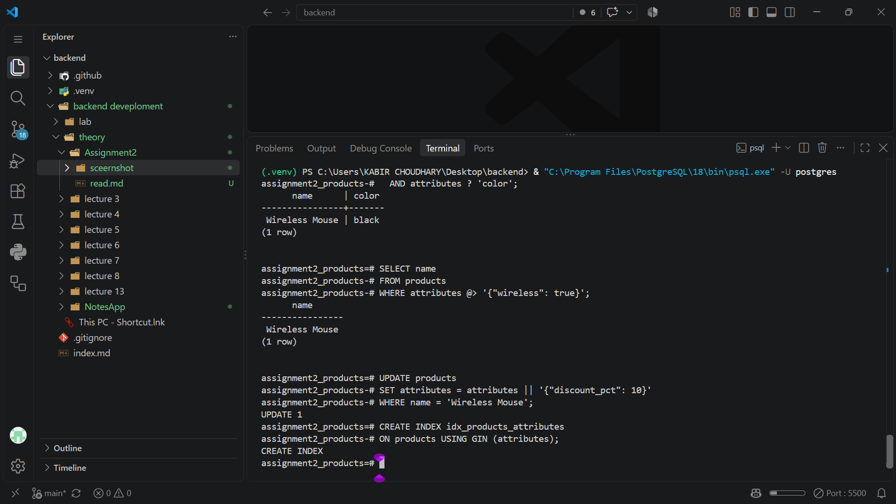

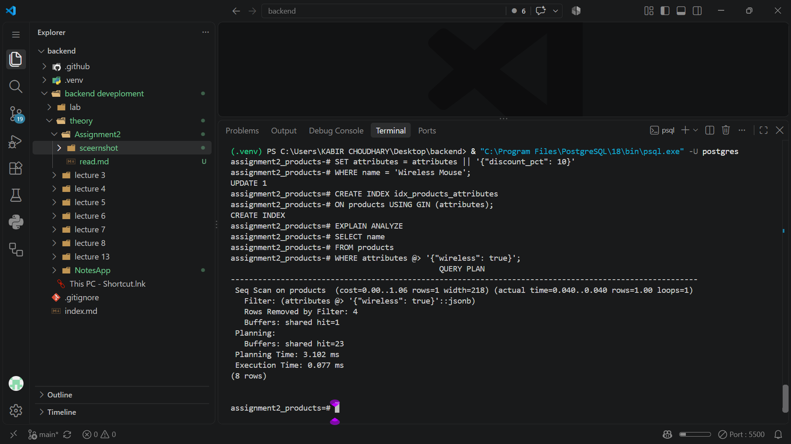

For a larger production dataset, compare plans on representative data and workload. Choose an index design based on the operators used by actual queries; a full-column GIN index and a targeted expression index have different trade-offs.

## 7. MongoDB comparison

The MongoDB Compass screenshots show a database named `assignment2_products` with a `products` collection. Product documents have the same general shape as the PostgreSQL rows: `_id`, `name`, `category`, `price`, and an embedded `attributes` document. MongoDB creates an `_id` field for documents that do not provide one.

The empty-collection screenshot is an initial/setup view. Later screenshots show five documents and demonstrate filtering nested attributes.

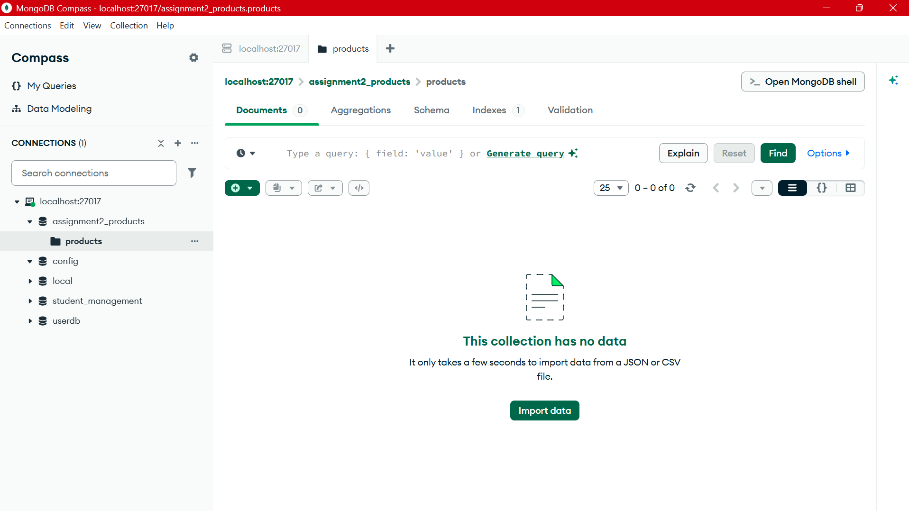

The MongoDB queries use dot notation to match embedded fields:

```javascript
// Books that have an author field
db.products.find({
  category: "book",
  "attributes.author": { $exists: true }
});

// Laptops with at least 16 GB RAM
db.products.find({
  category: "laptop",
  "attributes.ram_gb": { $gte: 16 }
});

// Accessories that are wireless
db.products.find({
  category: "accessory",
  "attributes.wireless": true
});
```

These correspond conceptually to the PostgreSQL filters: match the category and inspect one or more nested attributes. MongoDB's `$exists` checks whether a field is present; PostgreSQL's `?` operator checks for a key in a JSONB object. MongoDB's embedded-document matching is not identical in every detail to PostgreSQL's JSONB operators, so the database's type, matching, indexing, and query-plan rules still apply.

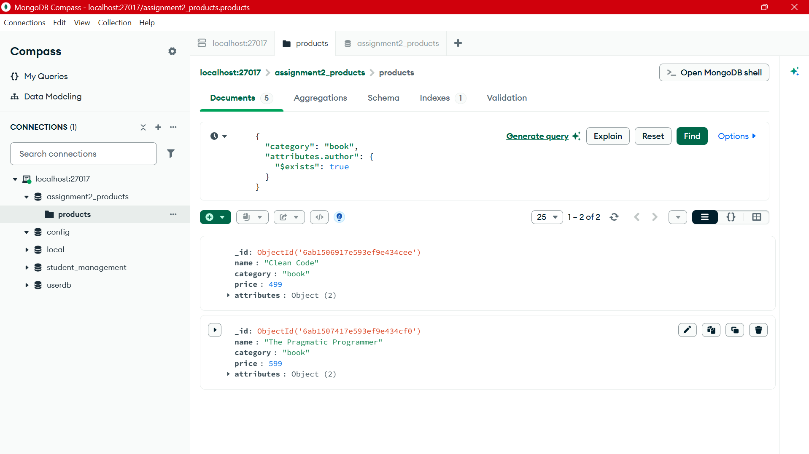

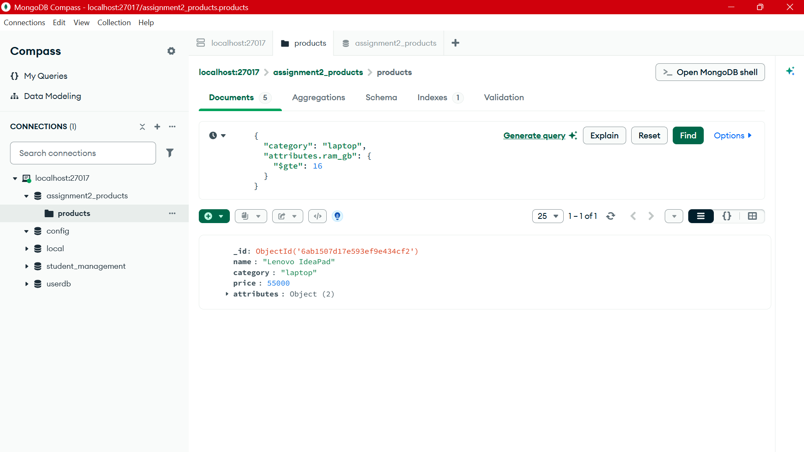

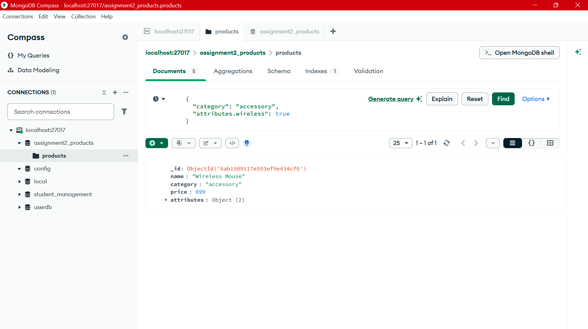

## 8. MongoDB indexes and PostgreSQL GIN indexes

The MongoDB screenshots show an index on the nested field `attributes.ram_gb` in the collection. This is a single-field index targeted at the laptop RAM query. MongoDB also maintains its standard unique `_id` index.

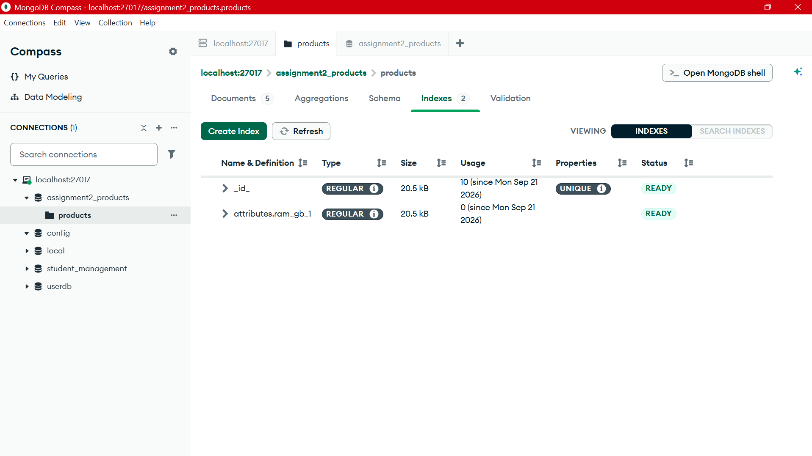

The PostgreSQL task instead creates a GIN index on the JSONB `attributes` column. Both can support searches within flexible product attributes, but their definitions and supported query patterns differ:

- A MongoDB index such as `attributes.ram_gb` targets one nested path.
- A PostgreSQL GIN index on `attributes` supports appropriate JSONB operators across the indexed document.
- Either database may choose not to use an available index when a collection/table is small or the estimated scan is cheaper.
- Indexes consume storage and add work to writes, so index fields and operator classes should be selected to match real queries.

## 9. PostgreSQL JSONB versus MongoDB

PostgreSQL with JSONB may be a good fit when an application needs relational constraints, joins, and transactions while also storing attributes whose shape varies by record. Stable and important values can remain in typed columns, with flexible details stored in JSONB. A single database can then handle both relational queries and supported JSON operations.

MongoDB can be a natural fit when the application is primarily document-oriented, records are commonly retrieved or updated as whole documents, and the document model aligns with application data. MongoDB provides document-oriented queries and indexes without placing the collection inside a relational schema.

The choice depends on access patterns, consistency requirements, data relationships, operational experience, and scale—not simply on whether either product can store JSON-like data. PostgreSQL JSONB is not a drop-in replacement for every MongoDB workload, and MongoDB does not automatically provide relational joins and constraints in the same way as PostgreSQL.

## 10. Summary

This assignment demonstrates how a PostgreSQL table can combine strongly typed relational columns with flexible JSONB attributes. It uses JSON extraction, key existence, containment, update operations, and a GIN index. MongoDB stores equivalent product information as documents and filters nested attributes with dot notation. The examples show that similar application queries can be expressed in both systems, while schemas, indexes, planner behavior, and data-integrity features remain database-specific.
