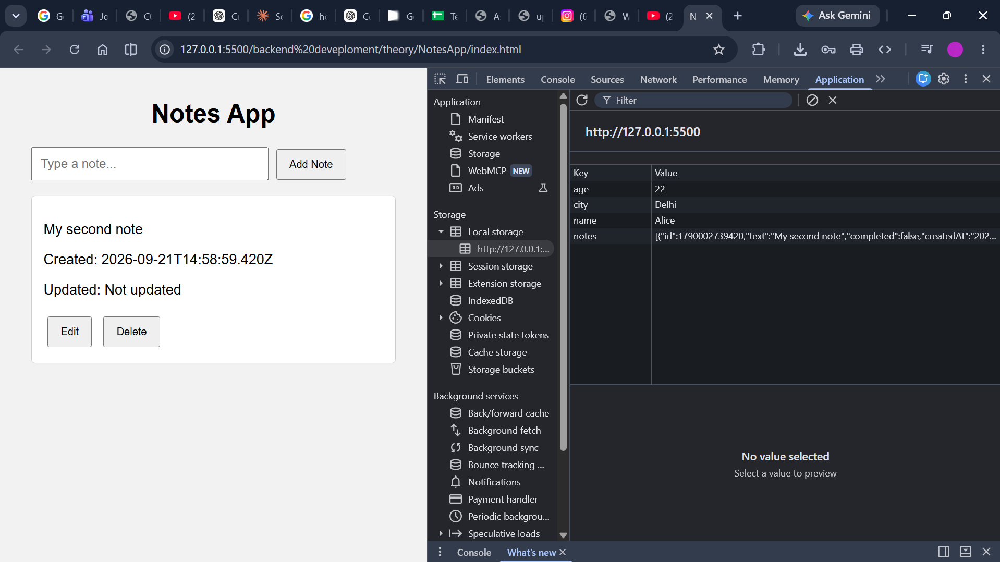
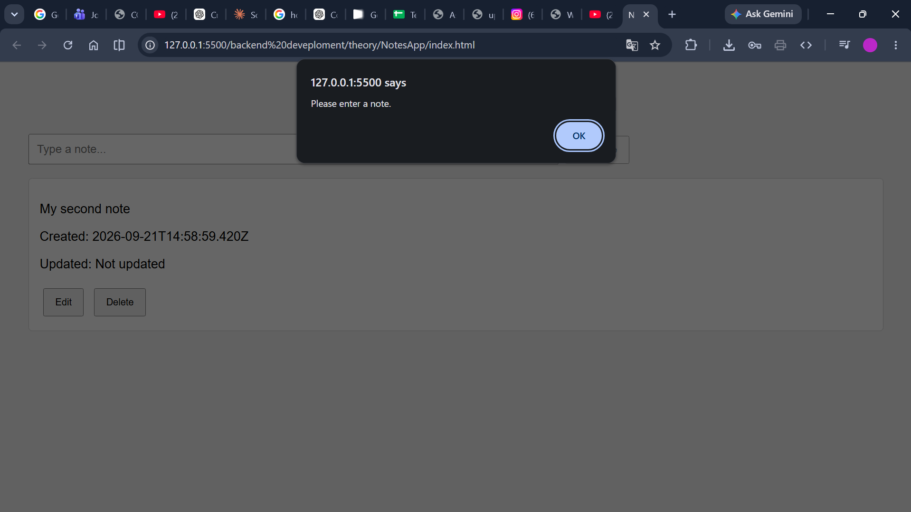
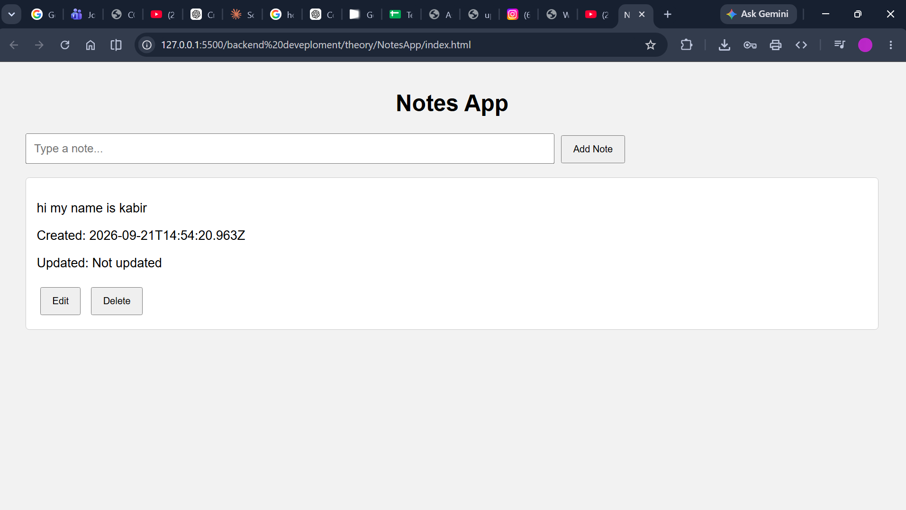
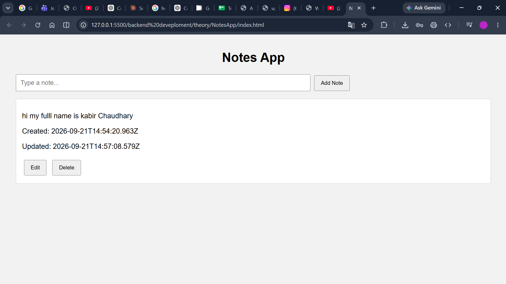
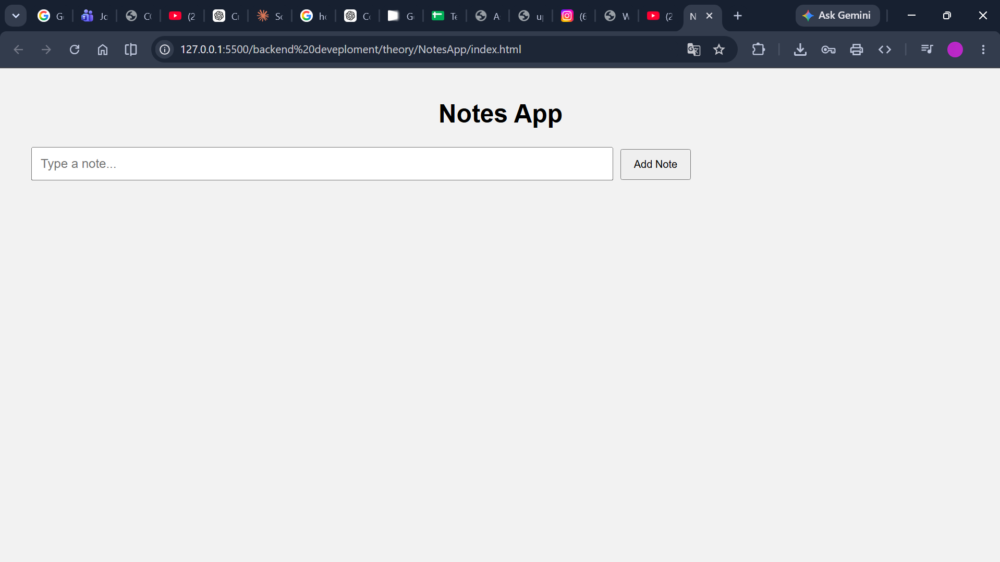

# Notes App: Browser-Based Notes with Local Storage

**Course:** Backend Development

**Project:** Notes App

## 1. Overview

The Notes App is a small client-side web application built with HTML, CSS, and JavaScript. It lets a user add, display, edit, and delete notes in the browser. Notes are saved in `localStorage`, so they remain available after a page refresh in the same browser and origin.

The application does not use a backend server or a remote database. The HTML defines the input and notes container, the stylesheet provides basic presentation, and the JavaScript implements the note operations and browser persistence.

## 2. Project files

- `index.html` defines the page title, note input, Add Note button, notes list container, and script reference.
- `style.css` styles the page, input, buttons, and note cards.
- `script.js` loads and saves notes, validates input, renders note cards, and handles edit and delete actions.

## 3. Note data and persistence

Each note is stored as an object with these fields:

| Field | Purpose |
|---|---|
| `id` | Numeric identifier generated from the current timestamp using `Date.now()`. |
| `text` | The note text entered by the user. |
| `completed` | Boolean initialized to `false`; the current interface does not provide a way to change it. |
| `createdAt` | Creation timestamp in ISO 8601 format, generated with `new Date().toISOString()`. |
| `updatedAt` | Initially `null`; set to an ISO timestamp when the note is edited. |

The notes are serialized as JSON in the browser's `localStorage` entry named `notes`:

```javascript
function getNotes() {
    const raw = localStorage.getItem("notes");
    return raw ? JSON.parse(raw) : [];
}

function saveNotes(notes) {
    localStorage.setItem("notes", JSON.stringify(notes));
}
```

`getNotes()` returns an empty array when there is no saved value. Otherwise, it parses the stored JSON. `saveNotes()` converts the array back to JSON text and writes it to local storage.



## 4. Adding a note

The page's Add Note button passes the input value to `addNote()`. The function rejects whitespace-only text, creates a new note with its initial metadata, saves the updated list, redraws the note cards, and clears the input:

```javascript
function addNote(text) {
    if (text.trim() === "") {
        alert("Please enter a note.");
        return;
    }

    const notes = getNotes();
    notes.push({
        id: Date.now(),
        text: text,
        completed: false,
        createdAt: new Date().toISOString(),
        updatedAt: null,
    });

    saveNotes(notes);
    renderNotes();
    document.getElementById("noteInput").value = "";
}
```

The empty-input screenshot shows the application displaying a validation alert while the existing note remains visible. It demonstrates rejection of an empty submission, not an empty-list screen.



The add-note screenshot shows a successfully created note with its creation time, an initial “Not updated” status, and Edit and Delete controls.



## 5. Rendering and updating the interface

`renderNotes()` reads the current saved note array and creates one card for each note. Cards display the text, creation timestamp, and either the update timestamp or “Not updated.” Each card has Edit and Delete buttons.

The page calls `renderNotes()` from `window.onload`, restoring the visible list from `localStorage` when the application is opened or refreshed.

## 6. Editing a note

When Edit is selected, `editNote(id)` finds the note with the matching identifier and opens a browser prompt pre-filled with the existing text. If the prompt is not cancelled and the new value is not whitespace-only, the function updates the text and `updatedAt`, saves the entire list, and renders it again.

Cancelling the prompt or submitting blank text leaves the existing note unchanged. The screenshot shows the edited content and the recorded update time.



## 7. Deleting a note

`deleteNote(id)` filters out the note with the selected ID, writes the remaining array to local storage, and redraws the list:

```javascript
function deleteNote(id) {
    const notes = getNotes().filter((note) => note.id !== id);
    saveNotes(notes);
    renderNotes();
}
```

The delete screenshot shows the interface after removing a note.



## 8. Application flow

1. The browser loads `index.html`, `style.css`, and `script.js`.
2. On page load, the app reads the `notes` value from `localStorage`.
3. The app renders one card per saved note.
4. Adding or editing validates the text, updates the note array, persists it, and rerenders the list.
5. Deleting removes a note from the array, persists the result, and rerenders the list.

This is a straightforward example of client-side state management: the JavaScript array is loaded from storage when needed, modified by user actions, and then written back.

## 9. Limitations and improvements

- **Browser-local data only:** `localStorage` is scoped to the browser profile and origin. Notes do not automatically sync to another browser or device and are not backed up on a server.
- **Storage and parsing errors:** `localStorage` access can fail in restricted browser contexts, and malformed stored JSON causes `JSON.parse()` to throw. The current code does not handle either case.
- **Timestamp IDs:** `Date.now()` is usually sufficient for this demonstration, but two notes created within the same millisecond could receive the same ID. A more robust identifier can be generated with `crypto.randomUUID()`.
- **Unused completion state:** `completed` is stored but not displayed or changed by any control. A completion toggle could make the field functional, or the field could be removed if completion is not required.
- **Longer note content:** The current input is a single-line text input. A `<textarea>` would be more suitable for multi-line notes.
- **Accessibility and interaction:** The controls use inline click handlers and native prompts. Adding semantic form handling, labels, and custom accessible dialogs would improve usability.
- **Safe text rendering:** `renderNotes()` inserts note text into `innerHTML` using a template string. Since note text is user-controlled, HTML in the note is interpreted as markup rather than displayed as plain text. A safer implementation would create DOM elements and assign note content with `textContent`.

## 10. Conclusion

The Notes App demonstrates basic create, read, update, and delete behavior in a browser without a backend. It stores structured note objects as JSON in `localStorage`, restores them on page load, and keeps the interface synchronized after each operation. It is a useful learning example of DOM interaction and browser storage; a production-ready version would also need safer rendering, error handling, stronger identifiers, accessibility improvements, and persistent server-side storage if cross-device access is required.
