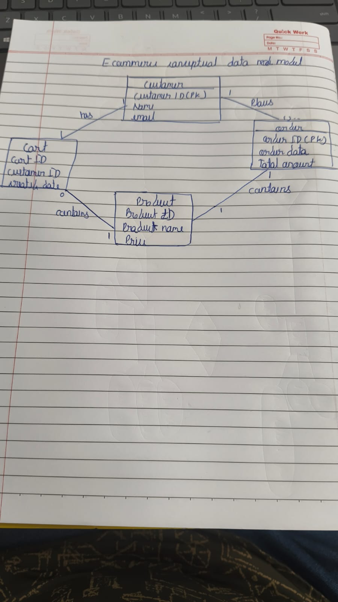
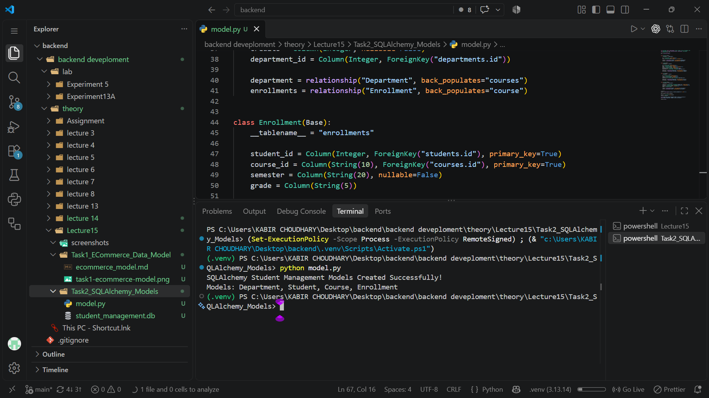
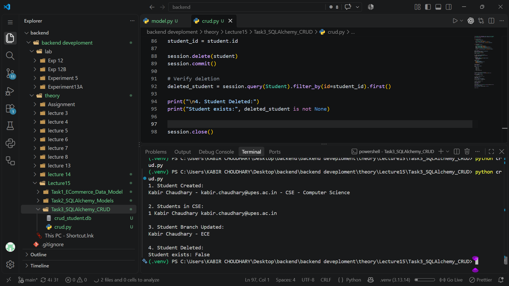
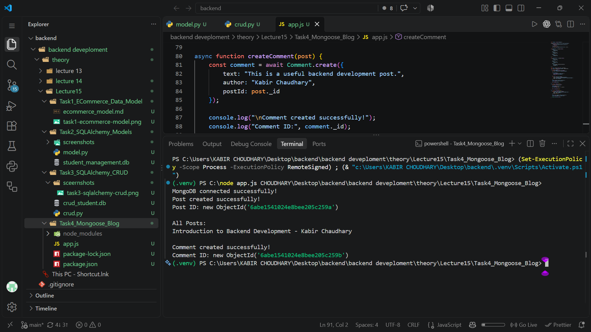

# Lecture 15: Data Modelling, ORM Operations, MongoDB, and API Validation

**Course:** Backend Development

**Topics:** Conceptual data modelling, SQLAlchemy, CRUD, Mongoose, FastAPI, and Pydantic

## 1. Learning objectives

Lecture 15 brings together several ways backend applications represent and work with data:

1. Describe an e-commerce system using entities and relationships.
2. Define relational tables and object relationships with SQLAlchemy.
3. Perform create, read, update, and delete operations through an ORM session.
4. Define MongoDB document schemas and reference related documents with Mongoose.
5. Validate HTTP request data and shape API responses with FastAPI and Pydantic.

The tasks use different persistence approaches. The SQLAlchemy examples use local SQLite databases, the Mongoose example connects to a local MongoDB server, and the FastAPI validation example keeps its records in an in-memory Python list. These are separate exercises and do not share one database.

## 2. Task 1 — E-commerce conceptual data model

The conceptual model identifies four entities and their sample attributes:

- **Customer:** customer ID, name, and email.
- **Cart:** cart ID, customer ID, and creation date.
- **Order:** order ID, order date, and total amount.
- **Product:** product ID, product name, and price.

The diagram expresses that a customer has a cart and places orders, while carts and orders contain products. It is a useful first step for naming the data and discussing business relationships before implementing tables.

The accompanying text version of the model is available in `Task1_ECommerce_Data_Model/ecommerce_model.md`.

### From concepts to a relational schema

The drawing is conceptual, not a complete physical database schema. In a relational implementation, relationships that can involve multiple products need explicit line-item tables:

- A cart may contain multiple products, and a product may appear in many carts. A `CartItem` table can connect them and record quantity.
- An order may contain multiple products, and a product may appear in many orders. An `OrderItem` table can connect them and record quantity and the price at purchase time.
- If a customer is allowed to retain historical or multiple carts, the customer-to-cart cardinality should be modelled explicitly. If only one active cart is allowed, that rule should be enforced in the schema or application.

These details help turn an ER-style sketch into tables with clear primary keys, foreign keys, and cardinalities.

## 3. Task 2 — SQLAlchemy student-management models

`Task2_SQLAlchemy_Models/model.py` uses SQLAlchemy's declarative ORM to define four SQLite-backed models.

| Model | Table | Main fields and relationships |
|---|---|---|
| `Department` | `departments` | Integer primary key, unique required name; relates to students and courses. |
| `Student` | `students` | Integer primary key; required name, unique required email, required branch, enrollment date defaulting to today, and department foreign key. |
| `Course` | `courses` | String course-code primary key, required title and credits, department foreign key. |
| `Enrollment` | `enrollments` | Student and course foreign keys combined as a composite primary key; required semester and optional grade. |

`Student` and `Course` each connect to `Department`, and `Enrollment` joins students to courses. The composite key on `Enrollment` prevents the same student-course pair from being inserted more than once; the model does not include a semester in that key, so it also does not represent separate enrollments for the same course in different terms.

The script creates a SQLite engine for `student_management.db`, calls `Base.metadata.create_all(engine)` to create missing tables, opens an ORM session, prints a success message, and closes the session. `create_all` creates tables that do not yet exist; it is not a migration system for changing an existing table definition.

## 4. Task 3 — SQLAlchemy CRUD operations

`Task3_SQLAlchemy_CRUD/crud.py` defines simpler `Department` and `Student` models and runs the four basic database operations against `crud_student.db`.

1. **Create:** find or create the `Computer Science` department, then create a student and commit the transaction.
2. **Read:** query students whose branch is `CSE`.
3. **Update:** change the new student's branch to `ECE` and commit the change.
4. **Delete:** delete that student, commit, and query by its saved ID to confirm that the row no longer exists.

The screenshot shows the execution output: the student is created in the Computer Science department, appears in the CSE query, is updated to ECE, and is then deleted; the verification prints `Student exists: False`.

The script uses a fixed student email and attempts to insert that student on every run. Since `email` is unique, running the script again against a database that still contains a student with that email can raise a uniqueness error. The department lookup is reused safely, but the student creation is not an upsert.

## 5. Task 4 — Mongoose blog posts and comments

`Task4_Mongoose_Blog/app.js` connects to the local MongoDB database `blog_database` and defines two Mongoose schemas:

- A **Post** has required `title`, `content`, and `author` string fields.
- A **Comment** has required `text` and `author` fields plus a required `postId` field referencing the `Post` model.

After connecting, the program searches for a post with the title `Introduction to Backend Development`. If it does not exist, it creates the post. It then reads and prints all posts, creates a comment referring to the post's `_id`, prints the comment ID, and closes the MongoDB connection.

This demonstrates a document-oriented data model and a reference between collections: comments store the post's identifier rather than embedding the full post document. MongoDB supplies an `_id` value for each created document.

The existing-post check prevents duplicate posts with that exact title, but the current flow creates a new comment each time the script runs. The `mongoose` dependency is declared in `Task4_Mongoose_Blog/package.json`; MongoDB must also be running locally for the connection URI in the script to work.

## 6. Task 5 — FastAPI and Pydantic data validation

`Task5_Data_Validation/app.py` creates a FastAPI application with a `POST /students` endpoint.

### Request model

`StudentCreate` validates incoming fields before the endpoint runs:

- `name` is required and must contain between 1 and 100 characters.
- `email` is required and must be a valid email address (`EmailStr`).
- `branch` is required and must exactly match one of `CSE`, `ECE`, `IT`, `ME`, or `CE`.
- `enrollment_date` is an optional date.

### Endpoint and response

For a valid request, `create_student` assigns an ID based on the current in-memory list length, uses today's date if no enrollment date was supplied, appends the record to `students`, and returns it. FastAPI serializes and validates the result against `StudentResponse`; the endpoint declares HTTP status **201 Created**.

The two screenshots show different parts of the API validation workflow:

- The request example omits the required `branch` field, and FastAPI returns **422 Unprocessable Content** with a `Field required` validation detail. This is an expected rejection of an invalid request, not a successful student creation.
- The API documentation shows the declared 201 response shape and the 422 validation-error shape.

The `students` list is process-local memory, not durable storage. Records disappear when the server restarts, and `len(students) + 1` is suitable only for this small demonstration because deletions, concurrent requests, or multiple workers can make generated IDs unreliable. A production API would normally persist records in a database and use database-generated identifiers.

## 7. Comparing the approaches

| Exercise | Data representation | Persistence shown | Main lesson |
|---|---|---|---|
| E-commerce model | Conceptual entities and relationships | None in this task | Identify entities and relationships before defining implementation details. |
| SQLAlchemy models | Python classes mapped to relational tables | SQLite | Declare columns, keys, foreign keys, and ORM relationships. |
| SQLAlchemy CRUD | ORM objects and queries | SQLite | Create, retrieve, update, and delete records with transactions. |
| Mongoose blog | MongoDB documents and collection schemas | Local MongoDB | Validate document fields and link documents through an ObjectId reference. |
| FastAPI validation | Pydantic request and response models | In-memory Python list | Reject invalid requests and document consistent API response shapes. |

## 8. Key takeaways

- A conceptual diagram communicates business concepts; it still needs implementation decisions about cardinality, junction tables, keys, and constraints.
- An ORM maps application objects to database records, while foreign keys and constraints preserve relational integrity.
- Database changes made in an ORM session are persisted when committed; sessions should be closed after use.
- MongoDB documents can be related by storing another document's identifier, as the comment schema does with `postId`.
- Request validation happens before endpoint logic, so invalid input can be rejected with a structured 422 response.
- A response model describes and validates output, while an HTTP status such as 201 communicates the result of the operation.
- Demonstration storage choices matter: SQLite and MongoDB persist data in the examples, but the FastAPI list does not.

## 9. Conclusion

Lecture 15 surveys a progression from designing data concepts to implementing persistence and HTTP validation. The e-commerce sketch is a starting point for relational design; SQLAlchemy demonstrates both table modelling and CRUD; Mongoose shows document schemas and references; and FastAPI/Pydantic demonstrates how to validate client input and return a defined response. Each task illustrates a different part of backend data handling, with different assumptions about storage and data integrity.
