# Lecture 19: RESTful APIs with FastAPI

**Course:** Backend Development

**Topic:** REST API design, request validation, SQLAlchemy, and SQLite

## 1. Overview

This exercise builds a student-management REST API with FastAPI. It stores students, courses, and student-course enrollments in a SQLite database through SQLAlchemy. Pydantic schemas validate request data and define the response shapes returned by the endpoints.

The application is defined in `main.py`. The database connection and session dependency are in `database.py`, SQLAlchemy table models are in `models.py`, and API schemas are in `schemas.py`. On startup, `Base.metadata.create_all()` creates any missing tables in `students.db`.

## 2. Data model and validation

The SQLAlchemy models define four tables:

| Model | Purpose |
|---|---|
| `Department` | Stores uniquely named departments and relates them to students. |
| `Student` | Stores a student's name, age, unique email, branch, and optional department ID. |
| `Course` | Stores a course title and optional description. |
| `Enrollment` | Connects a student to a course using their foreign-key IDs. |

`StudentCreate` validates new-student data, including the email format and branch enum (`CSE`, `ECE`, `ME`, or `CIVIL`). `StudentUpdate` makes the student fields optional so that a request can update only selected values. Response schemas use ORM attribute data to serialize database records.

## 3. API endpoints

| Method | Endpoint | Purpose |
|---|---|---|
| `GET` | `/` | Check that the API is running. |
| `POST` | `/students` | Create a student. |
| `GET` | `/students` | List all students. |
| `GET` | `/students/filter` | Filter, search, and paginate students. |
| `GET` | `/students/{student_id}` | Retrieve one student by ID. |
| `PUT` | `/students/{student_id}` | Update a student's supplied fields. |
| `DELETE` | `/students/{student_id}` | Delete a student. |
| `POST` | `/courses` | Create a course. |
| `GET` | `/courses` | List courses. |
| `POST` | `/students/{student_id}/enrollments` | Enroll an existing student in an existing course. |
| `GET` | `/students/{student_id}/enrollments` | List a student's enrollments. |

The filter endpoint accepts `page` and `limit` pagination parameters, an optional `branch`, an optional `department_id`, and an optional `search` term. Search checks student names and emails. Page and limit values below 1 are rejected with HTTP 422. Student, course, and enrollment lookups that refer to missing records return HTTP 404.

The `/students/filter` route is registered before `/students/{student_id}` so the literal `filter` path is not treated as a student ID.

## 4. Running the API

From the `Lecture19_RESTful_APIs` directory, install the dependencies and start the development server:

```bash
pip install -r requirements.txt
uvicorn main:app --reload
```

The interactive Swagger UI is available at `http://127.0.0.1:8000/docs`. The SQLite database defaults to `students.db` in the working directory; `DATABASE_URL` can be set to use a different database URL.

## 5. Screenshot evidence

The following screenshots document the API documentation, running service, student and course operations, filtering, enrollment, and database state. All 19 screenshots from the `sceernshots` directory are included.

### API startup and documentation

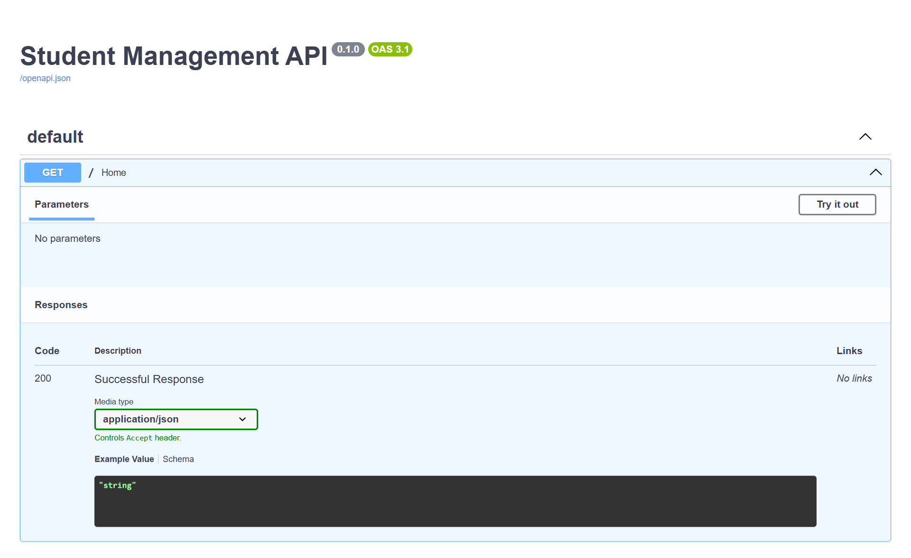

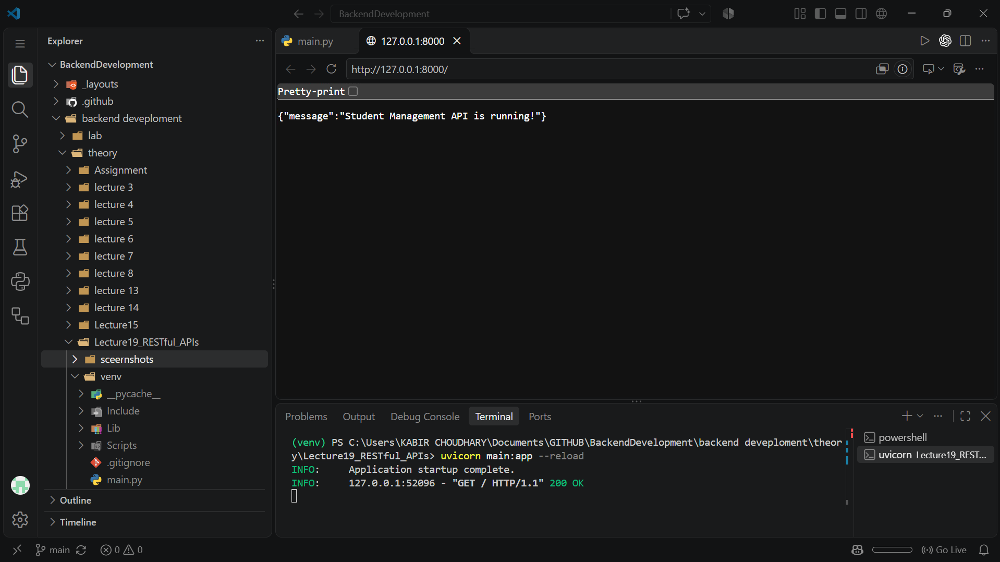

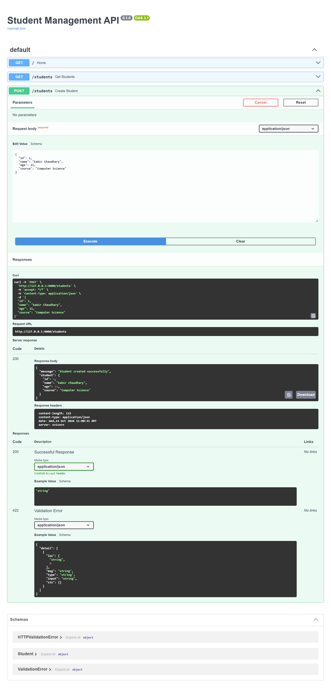

### Student creation and listing

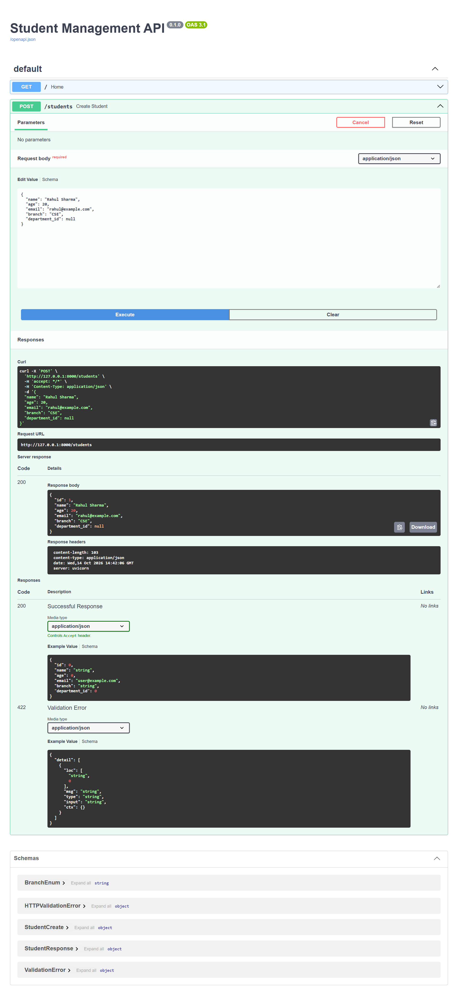

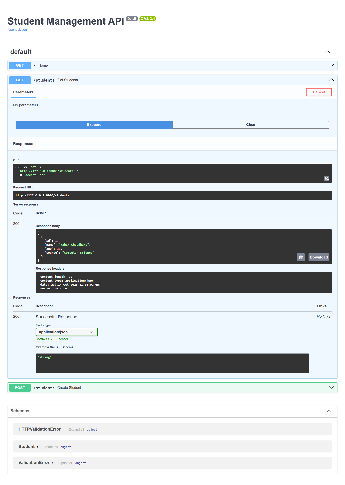

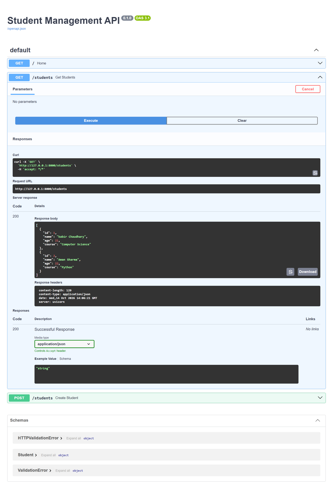

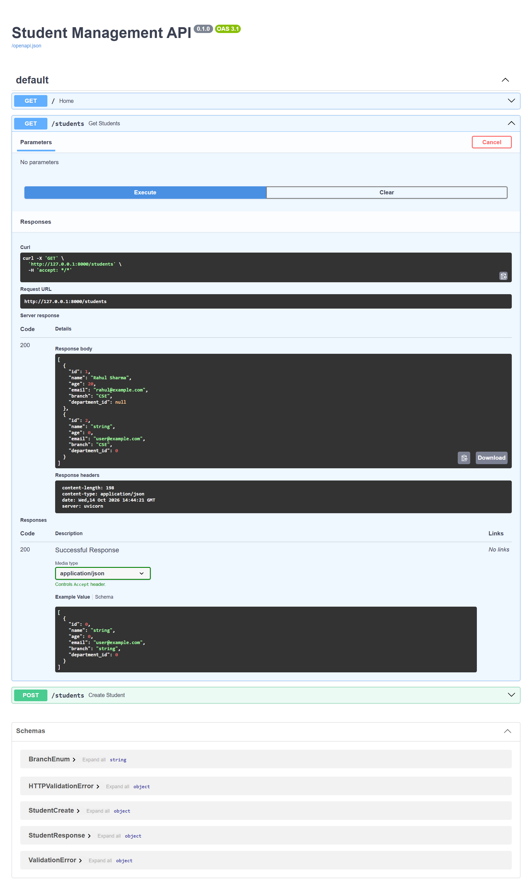

### Retrieve, filter, and search students

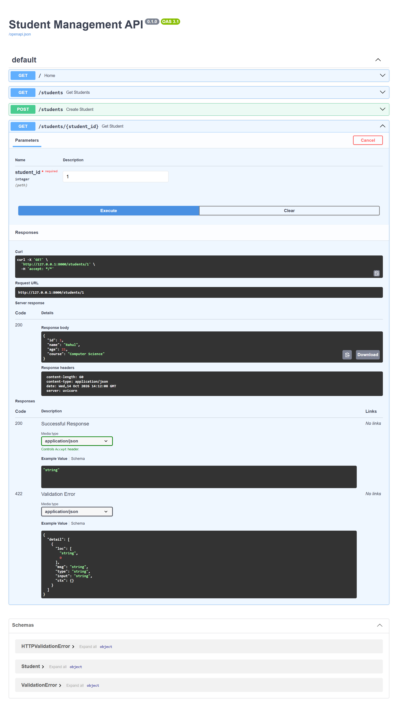

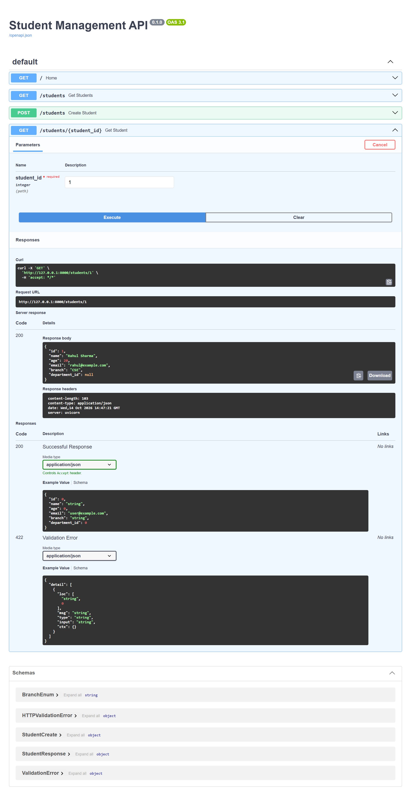

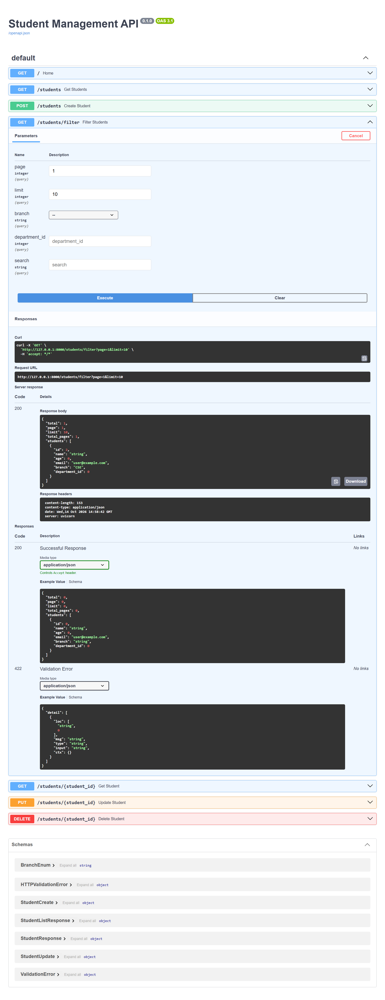

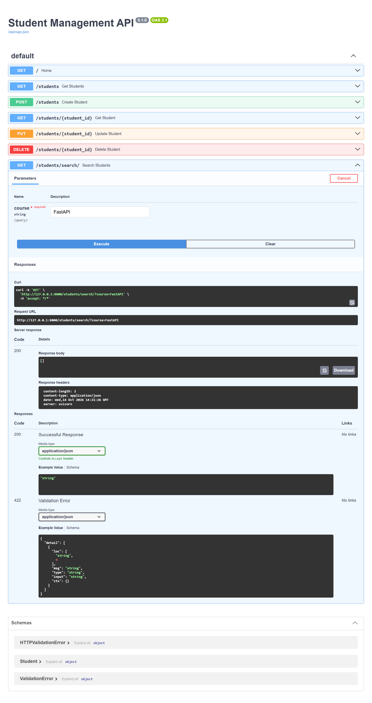

### Update and delete students

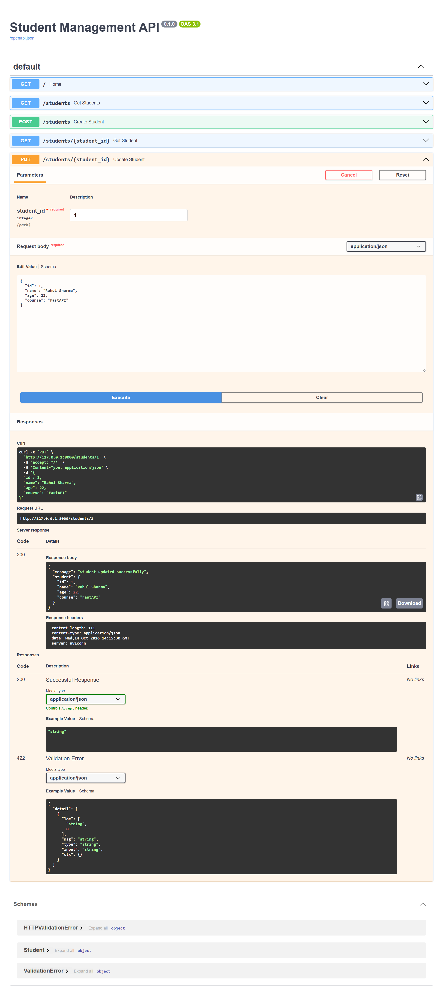

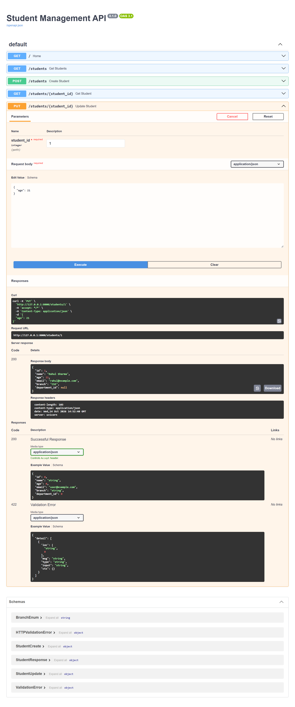

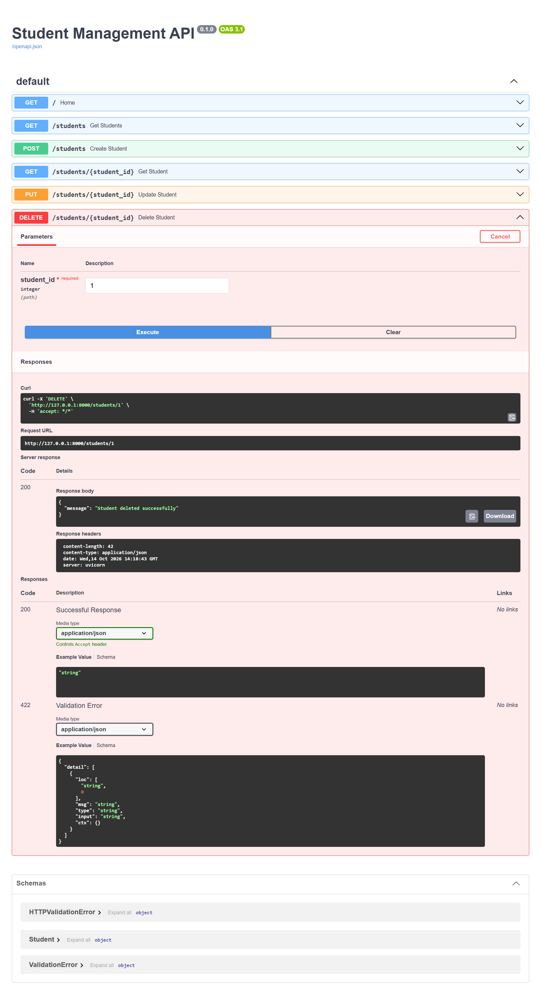

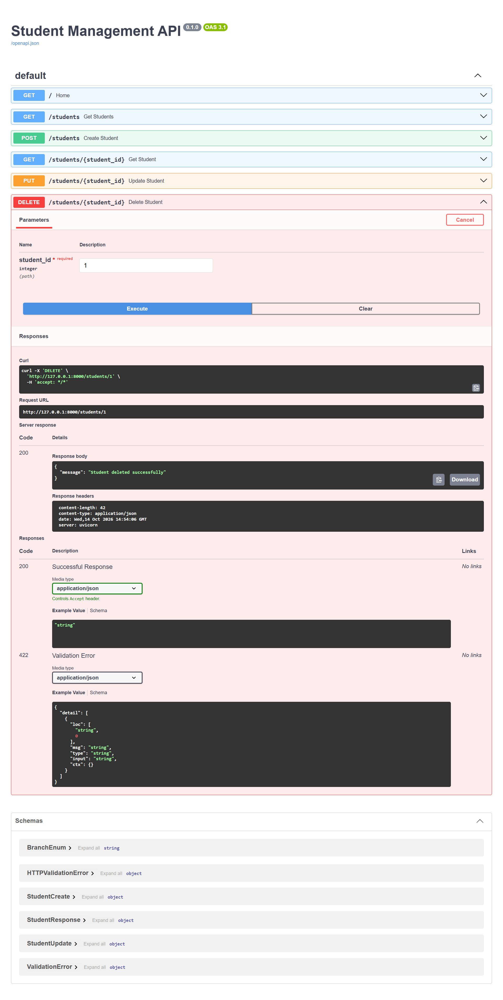

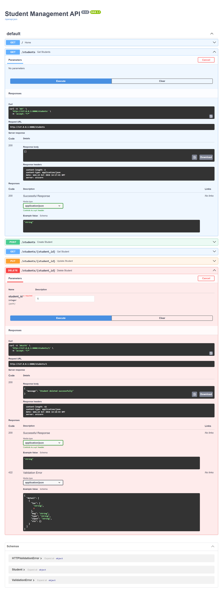

### Courses and enrollments

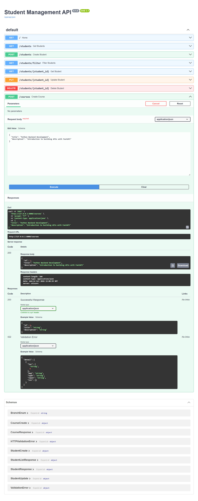

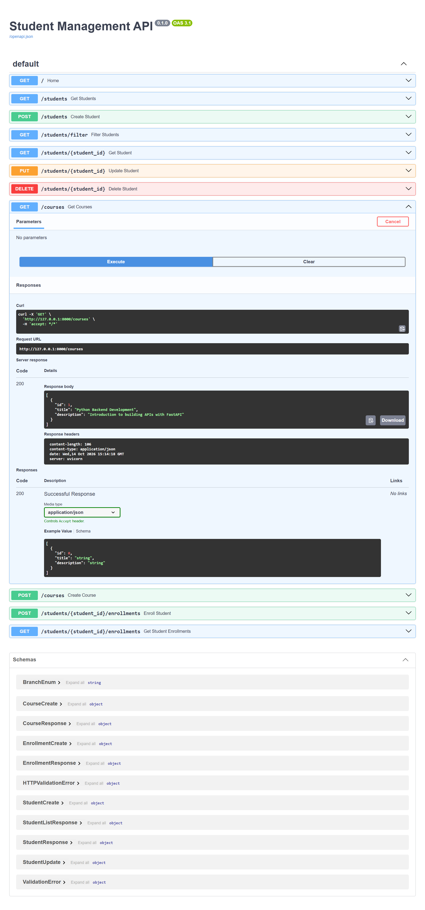

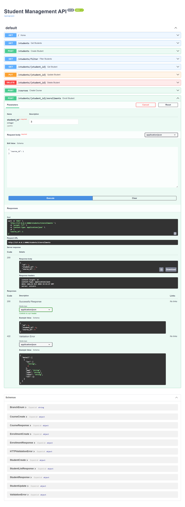
