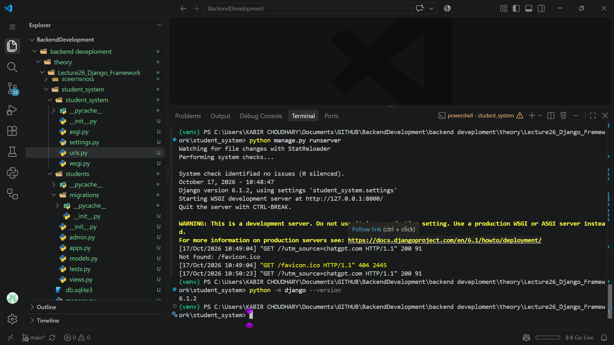
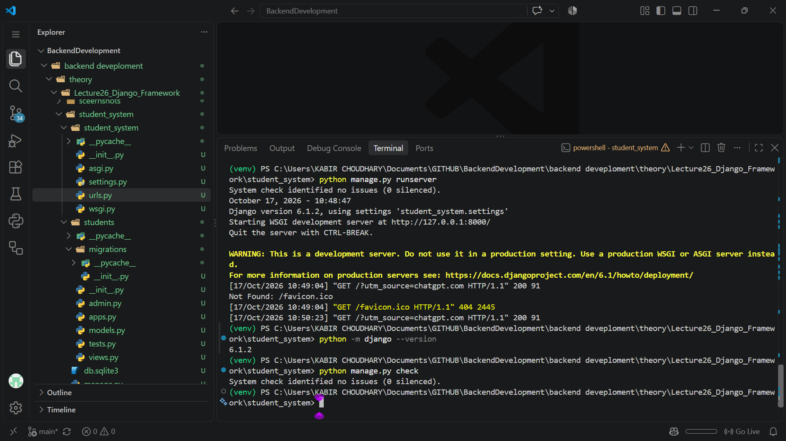
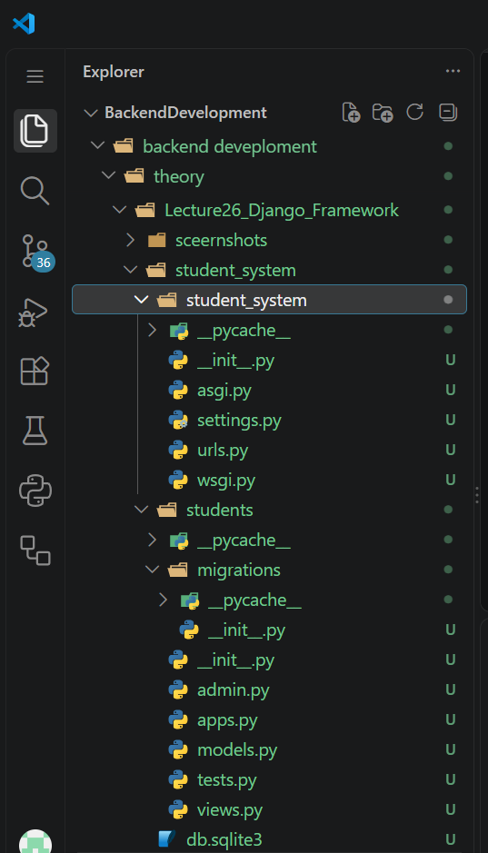
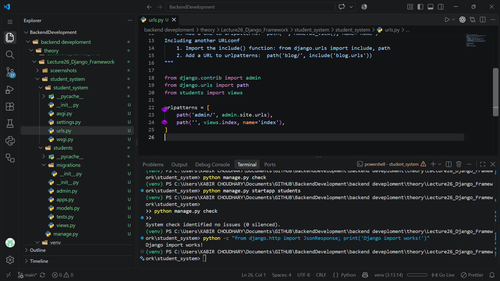
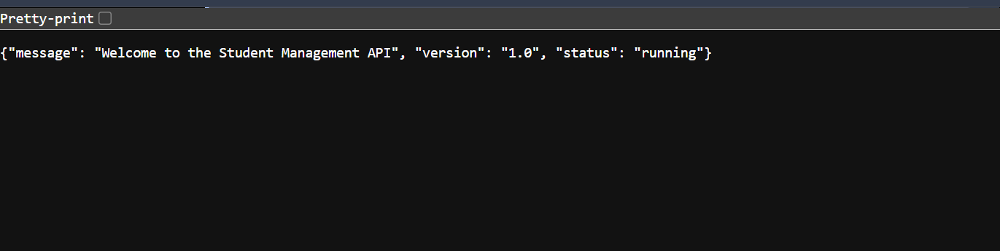
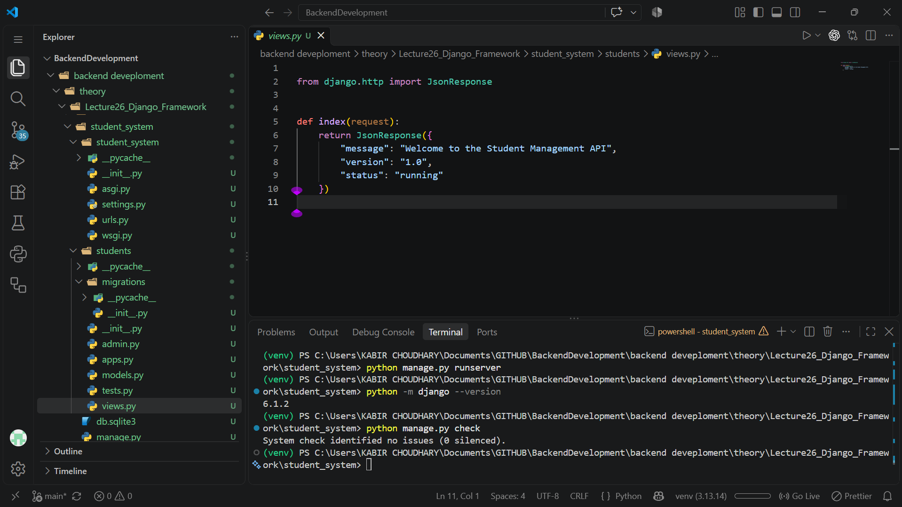
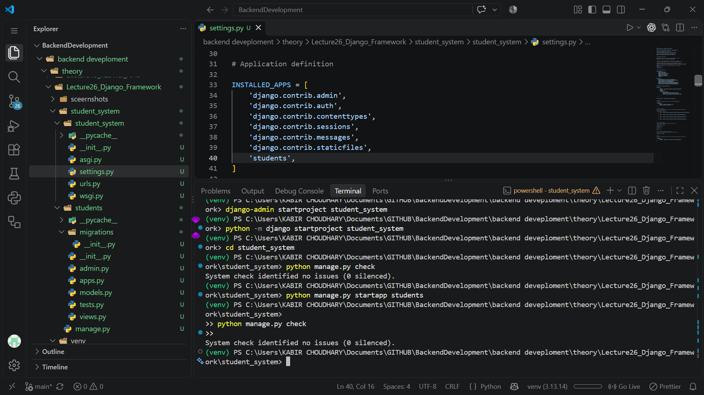

# Lecture 26: Django Framework

**Course:** Backend Development  
**Topic:** Django setup, project structure, URL routing, and creating a basic student management API

## 1. Overview

Django is a high-level Python web framework that follows the Model-View-Template (MVT) architecture. It helps developers build scalable web applications quickly with built-in features such as URL routing, database handling, admin interface, and reusable app architecture.

In this lecture, we created a Django project named `student_system` and a Django app named `students`. The project was configured to run a simple API endpoint returning a JSON welcome response. This introduced the core workflow of Django: project setup, configuration, app creation, URL mapping, and server execution.

## 2. Objectives

- Understand what Django is and why it is used.
- Learn the difference between a Django project and a Django app.
- Set up a Django project and configure the app.
- Understand URL routing in Django.
- Create a basic view that returns a response.
- Explore how Django supports structured backend development.

## 3. Django architecture

Django follows the MVT pattern:

- Model: Represents the database structure and data logic.
- View: Handles the request and returns the response.
- Template: Renders HTML pages for the client.

This pattern separates business logic, presentation, and data management, making the framework cleaner and more maintainable than writing raw server logic from scratch.

## 4. Project structure

The lecture project was created as:

```text
student_system/
├── manage.py
├── db.sqlite3
├── student_system/
│   ├── __init__.py
│   ├── settings.py
│   ├── urls.py
│   ├── wsgi.py
│   └── asgi.py
└── students/
    ├── __init__.py
    ├── admin.py
    ├── apps.py
    ├── models.py
    ├── tests.py
    └── views.py
```

### Key files used

- `manage.py`: Runs Django commands like `runserver`, `migrate`, and `createsuperuser`.
- `student_system/settings.py`: Contains project configuration such as installed apps, database settings, and middleware.
- `student_system/urls.py`: Defines which URL paths map to which views.
- `students/views.py`: Contains request handling logic.

## 5. Implementation performed

### Step 1: Create project and app

The project was initialized with Django's default project template:

```bash
python -m venv venv
venv\Scripts\activate
pip install django
python manage.py startproject student_system
python manage.py startapp students
```

This created the working Django environment and basic structure for the backend project.

### Step 2: Configure the app

The app was included in the project settings:

```python
INSTALLED_APPS = [
    'django.contrib.admin',
    'django.contrib.auth',
    'django.contrib.contenttypes',
    'django.contrib.sessions',
    'django.contrib.messages',
    'django.contrib.staticfiles',
    'students',
]
```

The database was configured to use SQLite by default:

```python
DATABASES = {
    'default': {
        'ENGINE': 'django.db.backends.sqlite3',
        'NAME': BASE_DIR / 'db.sqlite3',
    }
}
```

### Step 3: Define the home route

The project URL file was configured so that the root URL points to the student app view.

```python
from django.contrib import admin
from django.urls import path
from students import views

urlpatterns = [
    path('admin/', admin.site.urls),
    path('', views.index, name='index'),
]
```

### Step 4: Create the response view

The view function returned a JSON response:

```python
from django.http import JsonResponse


def index(request):
    return JsonResponse({
        "message": "Welcome to the Student Management API",
        "version": "1.0",
        "status": "running"
    })
```

This demonstrated how Django can return structured API-style responses without using Flask or FastAPI.

## 6. Running the project

The project was started using:

```bash
python manage.py runserver
```

The server responded on the local development URL, where the root route displayed JSON data to the browser or API client.

## 7. Learning outcomes

From this lecture, we learned that:

- Django provides a complete framework for backend development.
- A project is the overall application container, while an app is a modular feature component.
- Django uses a URL dispatcher to route requests to the appropriate logic.
- Views can return HTML, JSON, redirects, or templates.
- The framework comes with database support and admin features built in.
- Django is especially useful for building structured applications with multiple modules.

## 8. Screenshot evidence

The screenshots captured during the lecture show the installation, project creation, project structure, URL routing, and the running API output.

### Django setup and environment







### Routing and running application









## 9. Conclusion

Lecture 26 introduced Django as a powerful Python web framework for building backend systems in a clean and organized way. The session covered the fundamentals of project creation, app structure, URL configuration, and view handling. The student_system project served as a practical demonstration of how Django can create a simple web API with minimal code while keeping the application modular and maintainable.

This lecture gave us a strong foundation for future backend work involving forms, models, templates, and database-driven application development using Django.
