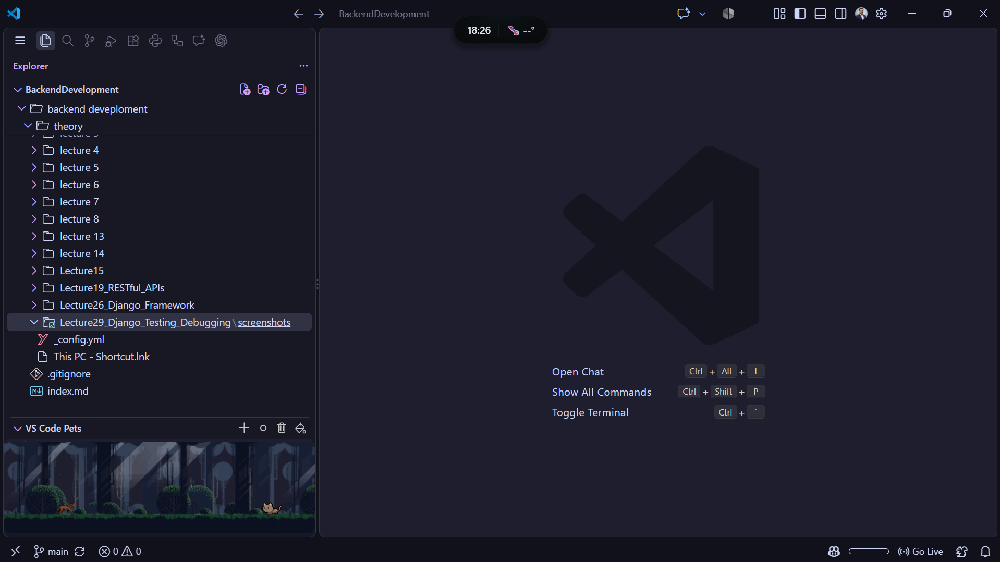
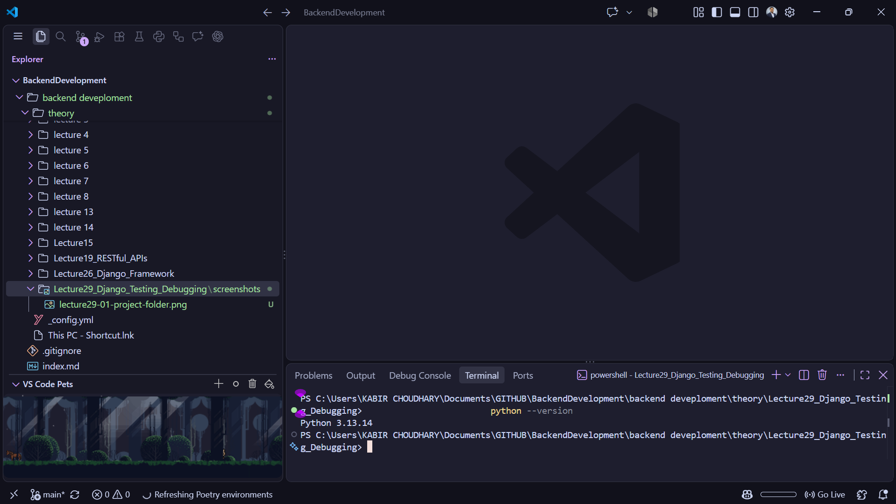
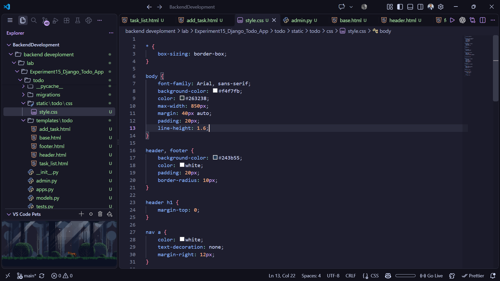
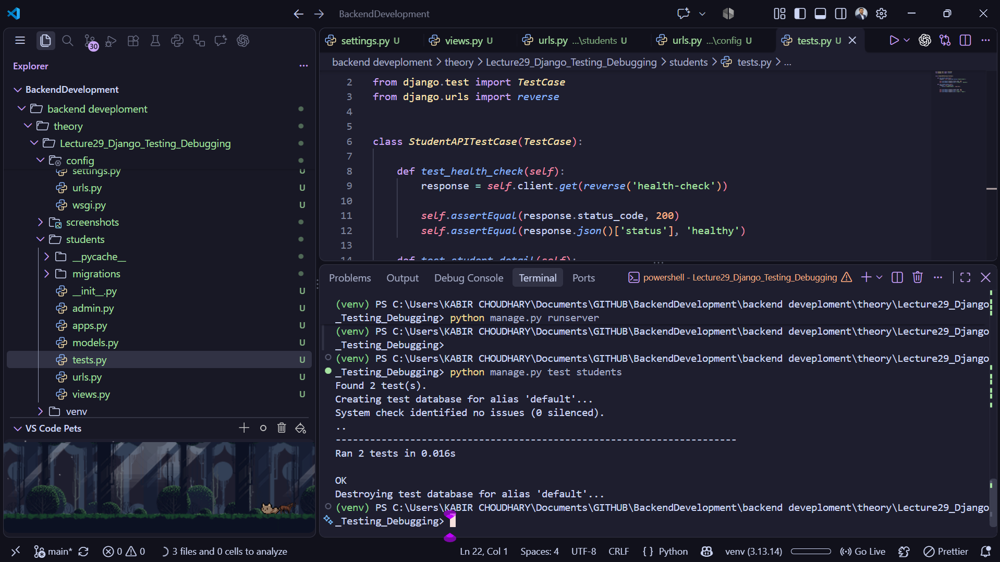
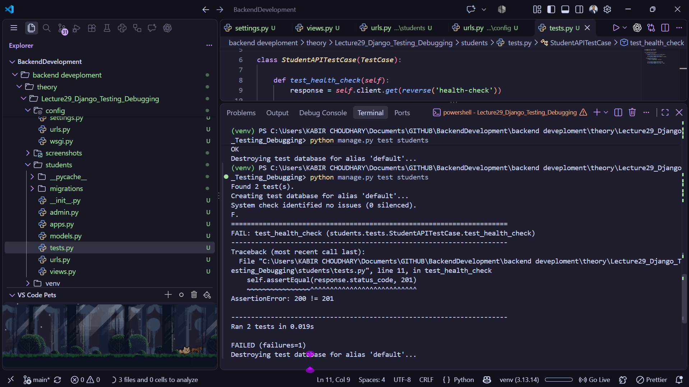

# Lecture 29: Django Testing and Debugging

**Course:** Backend Development  
**Topic:** Django testing, debugging, API validation, and external service error handling

## 1. Overview

Django testing and debugging are essential parts of backend development because they help ensure that the application behaves correctly, responds properly to requests, and handles failures gracefully. In this lecture, we explored how to write tests for Django views and models and how to debug issues using mock data, request simulation, and logging.

The project focused on a simple student management application where we tested endpoint responses, model behavior, and external data handling. This helped us understand how to validate the application before deployment and how to handle unexpected errors in a professional way.

## 2. Objectives

- Understand the importance of testing in Django applications.
- Learn how to use Django's built-in `TestCase` for API and model testing.
- Validate URL responses using the Django test client.
- Mock external service calls to simulate success and failure scenarios.
- Apply debugging practices such as logging and graceful error handling.

## 3. Project Structure

The lecture project was created as a Django project named `config` with an app named `students`.

```text
Lecture29_Django_Testing_Debugging/
├── manage.py
├── db.sqlite3
├── config/
│   ├── __init__.py
│   ├── settings.py
│   ├── urls.py
│   ├── wsgi.py
│   └── asgi.py
├── students/
│   ├── __init__.py
│   ├── admin.py
│   ├── apps.py
│   ├── models.py
│   ├── tests.py
│   ├── urls.py
│   ├── utils.py
│   └── views.py
└── screenshots/
```

### Key files

- `manage.py`: Used to run migrations, start the server, and execute tests.
- `config/settings.py`: Project configuration, installed apps, and database setup.
- `students/models.py`: Contains the `Student` model.
- `students/views.py`: Contains endpoint logic.
- `students/urls.py`: Maps URLs to corresponding views.
- `students/tests.py`: Includes all Django tests.
- `students/utils.py`: Contains logic for calling external services safely.

## 4. Model Design

The `Student` model was defined with two fields: `name` and `course`.

```python
from django.db import models


class Student(models.Model):
    name = models.CharField(max_length=100)
    course = models.CharField(max_length=100)

    def __str__(self):
        return self.name
```

This model demonstrates how Django uses Python classes to map directly to database tables. We can create, fetch, and test records with simple ORM queries.

## 5. URL Routing and Views

The application included views for:

- health check endpoint
- listing students
- returning details of a single student

URL configuration looked like this:

```python
from django.urls import path
from . import views

urlpatterns = [
    path("health/", views.health_check, name="health-check"),
    path("students/", views.student_list, name="student-list"),
    path("students/<int:student_id>/", views.student_detail, name="student-detail"),
]
```

The views returned JSON responses using Django's `JsonResponse`:

```python
from django.http import JsonResponse


def health_check(request):
    return JsonResponse({"status": "ok"})


def student_detail(request, student_id):
    return JsonResponse({
        "student_id": student_id,
        "name": "Kabir Chaudhary",
        "course": "Django"
    })
```

This showed how to build lightweight backend APIs in Django using simple view functions and JSON output.

## 6. Django Testing

Django's testing system is built on Python's `unittest` framework. The lecture used `TestCase`, which provides a database-enabled testing environment and allows checking application behavior safely.

A sample test from the lecture:

```python
from django.test import TestCase
from django.urls import reverse


class StudentAPITestCase(TestCase):

    def test_health_check(self):
        response = self.client.get(reverse('health-check'))

        self.assertEqual(response.status_code, 200)
        self.assertEqual(response.json()['status'], 'ok')
```

This demonstrates how the Django test client calls the endpoint without starting a browser and allows us to validate the response status and body.

### Types of tests covered

- API endpoint testing
- Invalid route testing (`404` response)
- Model creation testing
- String representation testing
- External service behavior using mocked network calls

## 7. Testing the Student API

In the lecture, multiple tests were written for different scenarios:

1. `test_health_check`  
   Confirms the server returns a `200` status and a valid JSON response.

2. `test_student_detail`  
   Checks that the student detail endpoint returns the correct `student_id`, `name`, and `course`.

3. `test_student_detail_invalid_id`  
   Ensures invalid data such as a string path returns a `404` code.

4. `test_student_list`  
   Verifies that the student list contains the expected number of students and correct values.

5. `test_create_student`  
   Ensures database insertion through the `Student` model works correctly.

6. `test_student_string_representation`  
   Validates the `__str__` method returns the student name.

These tests ensure the application logic behaves as expected and helps track bugs early.

## 8. Debugging with Mocking and Logging

A major part of the lecture focused on debugging network-related failures. The `students/utils.py` file defined a function named `get_external_data()` that fetches remote data from an external URL:

```python
import json
import logging
import urllib.error
import urllib.request

logger = logging.getLogger(__name__)


def get_external_data(student_id):
    try:
        url = f"https://example.com/students/{student_id}"

        with urllib.request.urlopen(url, timeout=5) as response:
            data = json.loads(response.read().decode("utf-8"))

        return {
            "data": data,
            "error": None,
        }

    except (TimeoutError, urllib.error.URLError) as exc:
        if isinstance(exc, TimeoutError) or isinstance(getattr(exc, "reason", None), TimeoutError):
            return {
                "data": None,
                "error": "External service timed out",
            }

        return {
            "data": None,
            "error": "External service error",
        }
```

This code is a good example of defensive backend programming:

- It catches timeout problems.
- It handles URL/request errors.
- It returns a clean error payload instead of crashing the application.
- It logs exceptions for debugging.

### Mocked network testing

The lecture used Python's `unittest.mock.patch` to simulate external service responses:

```python
from unittest.mock import patch
import socket


@patch("students.utils.urllib.request.urlopen")
def test_external_service_timeout(self, mock_urlopen):
    mock_urlopen.side_effect = socket.timeout

    result = get_external_data(1)

    self.assertIsNone(result["data"])
    self.assertEqual(result["error"], "External service timed out")
```

This is useful because it allows developers to test edge cases such as timeouts or unavailable APIs without making real network requests.

## 9. Running the Tests

The lecture concluded with running Django tests using the following command:

```bash
python manage.py test students
```

This command runs all tests in the `students` application and checks whether the application passes validation. If any test fails, it provides a clear traceback and location to debug.

The project was also run using:

```bash
python manage.py runserver
```

This starts the local Django development server and allows the API endpoints to be tested in a browser or with HTTP clients.

## 10. Learning Outcomes

From this lecture, we learned that:

- Django testing helps validate both functionality and reliability.
- The `TestCase` class is a powerful tool for API and database testing.
- The Django test client can simulate HTTP requests for endpoint testing.
- Mocking is a practical way to test network failures without depending on live services.
- Logging and graceful exception handling are important in real-world debugging.
- Strong backend applications are built not only by writing features but also by testing and debugging them carefully.

## 11. Screenshot Evidence

The following screenshots document the project setup, Python environment, and testing workflow:











## 12. Conclusion

Lecture 29 introduced the importance of testing and debugging in Django-based backend development. We explored how to validate endpoints, model behavior, and external service interactions in a structured and professional way. By writing tests and using debugging techniques such as logging and mocking, we learned how to build more reliable and maintainable applications.

This lecture was a strong continuation of the Django learning journey and gave us the confidence to build backend systems that are not only functional but also dependable under real-world conditions.
