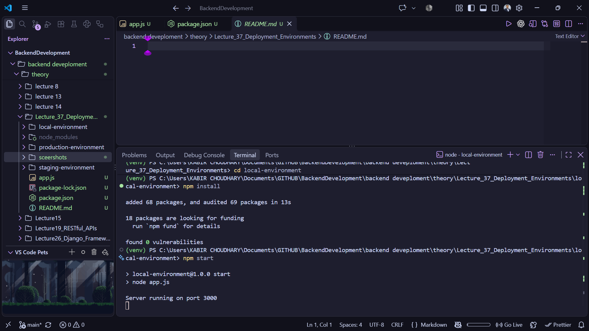
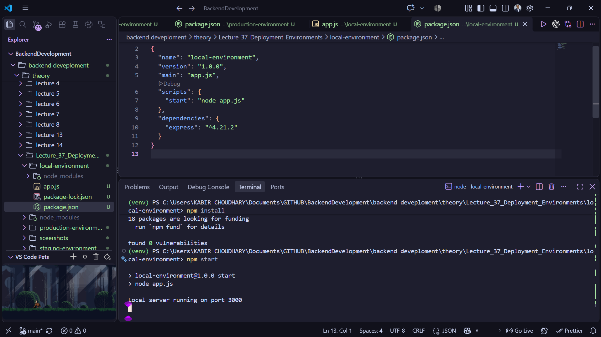
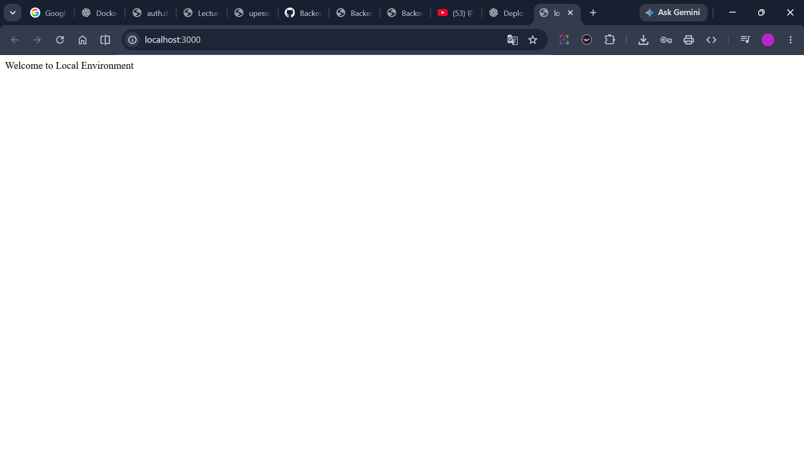
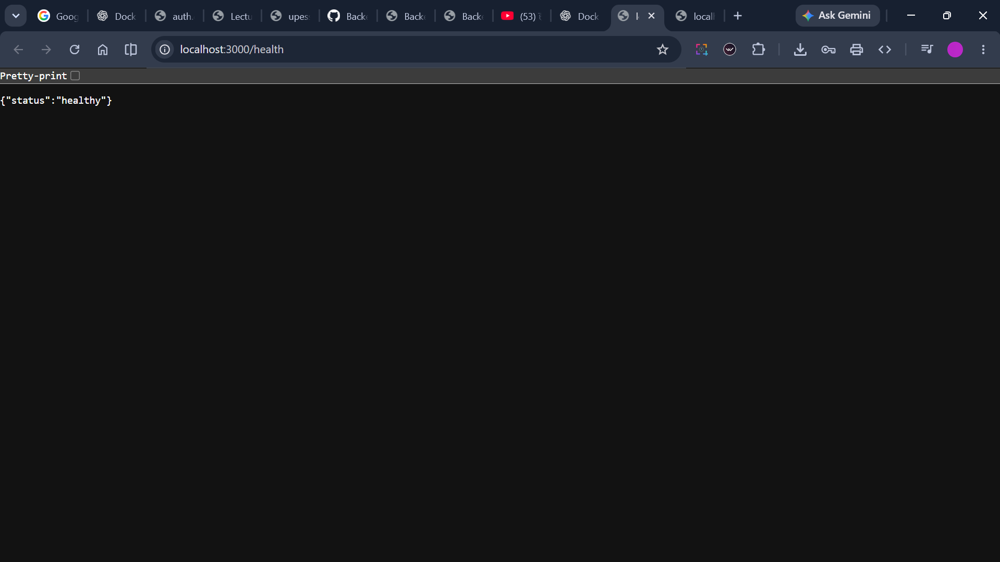
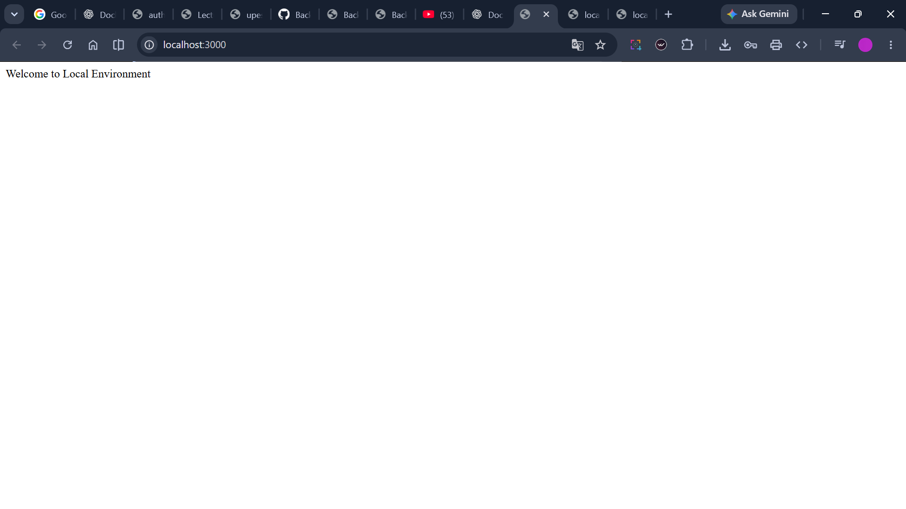
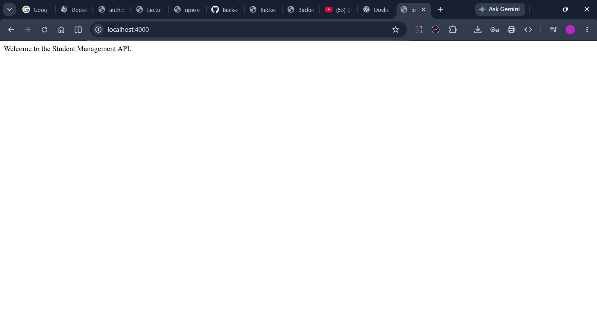
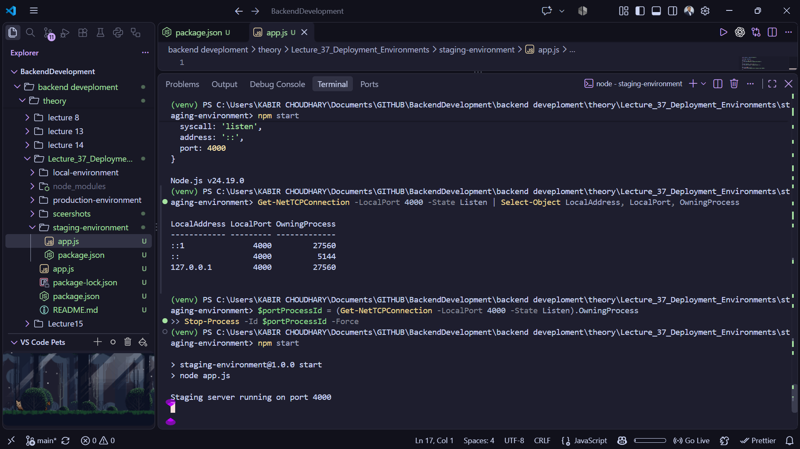
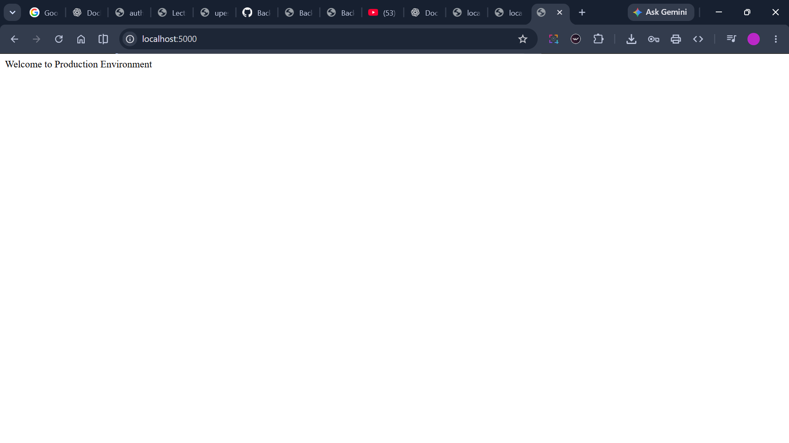
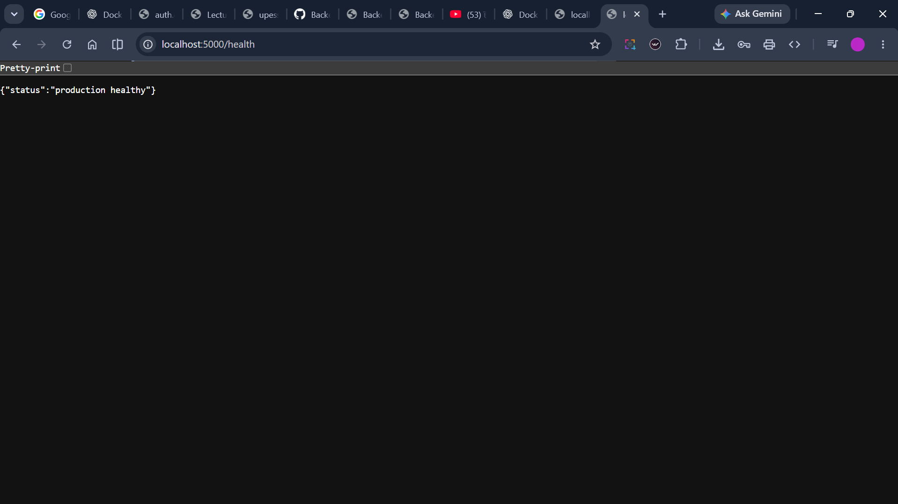
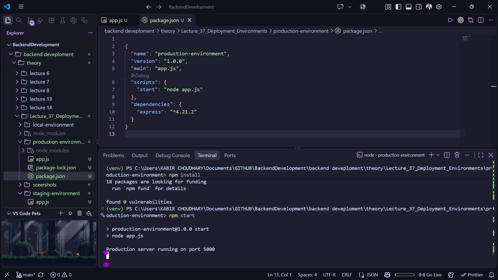

# Lecture 37: Deployment Environments

**Course:** Backend Development  
**Topic:** Local, staging, and production environments with Express

## 1. Overview

This practical demonstrates how the same Express application can be configured
for local development, staging, and production. Each environment responds with
its own welcome message and health status. The local and staging applications
use fixed ports, while production can take its port from the `PORT` environment
variable.

## 2. Objectives

- Organize an Express project into separate local, staging, and production
  environments.
- Create a homepage route and a JSON health-check route for each environment.
- Run and verify each environment on its configured port.
- Use an environment variable to configure the production server port.

## 3. Application routes and configuration

Each application exposes two routes:

| Route | Local | Staging | Production |
| --- | --- | --- | --- |
| `GET /` | `Welcome to Local Environment` | `Welcome to Staging Environment` | `Welcome to Production Environment` |
| `GET /health` | `{"status":"healthy"}` | `{"status":"staging healthy"}` | `{"status":"production healthy"}` |

The local server listens on port `3000`, staging on port `4000`, and production
uses `process.env.PORT` or falls back to port `5000`. Each environment has its
own `app.js` and `package.json`; Express is the application dependency.

## 4. Running the environments

Install dependencies in each environment directory and start its app with the
provided npm script:

```powershell
cd local-environment
npm install
npm start
```

Repeat from `staging-environment` and `production-environment`. The production
port can be overridden before starting the server:

```powershell
$env:PORT = 5000
npm start
```

Visit the corresponding server at `http://localhost:3000`,
`http://localhost:4000`, or `http://localhost:5000`, and append `/health` to
check the environment's health response.

## 5. Screenshot evidence

All 12 screenshots in the `sceershots` folder are included below.

### Project and local environment









.png>)



### Staging environment






### Production environment







## 6. Conclusion

Separating local, staging, and production configurations makes it possible to
verify an Express application in distinct environments while retaining the
same basic route behavior. The health endpoint provides a simple check that
each server is responding, and the production `PORT` setting allows its
listening port to be configured through the environment.
