# Lecture 39: Docker Practical

**Course:** Backend Development
**Topic:** Containerizing FastAPI and Express applications with Docker

## 1. Overview

This practical focuses on using Docker to containerize two backend applications: a FastAPI-based student API and an Express-based student API. The objective is to demonstrate how to create Dockerfiles, build container images, run containers, and verify that services work correctly on exposed ports.

Docker makes deployments consistent by packaging the application, runtime, and dependencies into a portable image that can run anywhere.

## 2. Objectives

- Install and verify Docker on the system.
- Create a FastAPI application and prepare it for containerization.
- Build and run a Docker image for the FastAPI app.
- Test API responses for `/`, `/health`, and `/students`.
- Create an Express application and prepare it for containerization.
- Build and run a Docker image for the Express app.
- Confirm the application is accessible on localhost.

## 3. Tools and Technologies Used

- Docker
- Python 3.12 slim base image
- Node.js 22 Alpine base image
- FastAPI
- Express.js
- Uvicorn
- JSON API testing via browser requests

## 4. FastAPI Docker Application

The FastAPI project contains a simple student API with three routes:

- `GET /` returns the application name and status
- `GET /health` returns a health check response
- `GET /students` returns a list of sample student records

The application code is stored in `main.py` and the Docker configuration is defined in `Dockerfile`.

### Project files

The FastAPI project includes the Python application, requirements, and Dockerfile needed to run in a container.

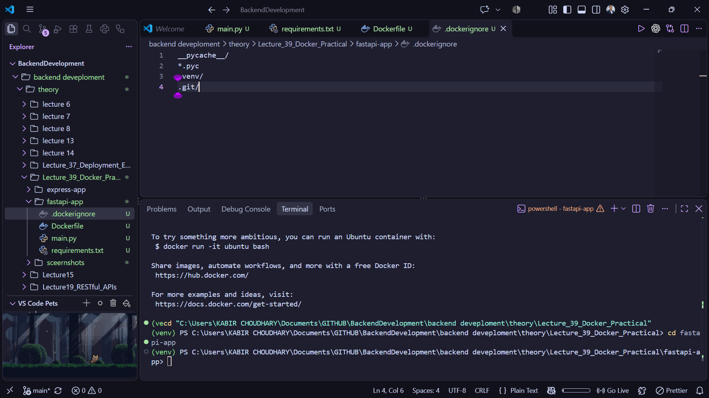

### Docker configuration

The Dockerfile uses the official `python:3.12-slim` image, installs dependencies from `requirements.txt`, copies the app code, exposes port `8000`, and starts Uvicorn on `0.0.0.0:8000`.

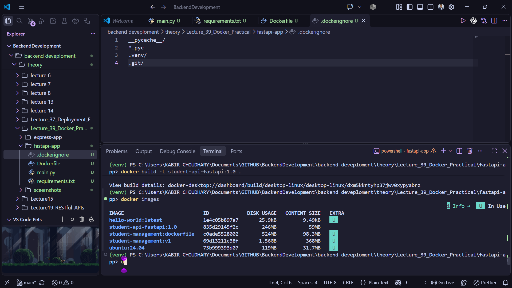

### Building the image

The Docker image was built using the following process:

```bash
docker build -t fastapi-student-api .
```

This creates a container image that includes the FastAPI application and all required Python packages.


### Running the container

After building the image, the container was launched and verified as running.

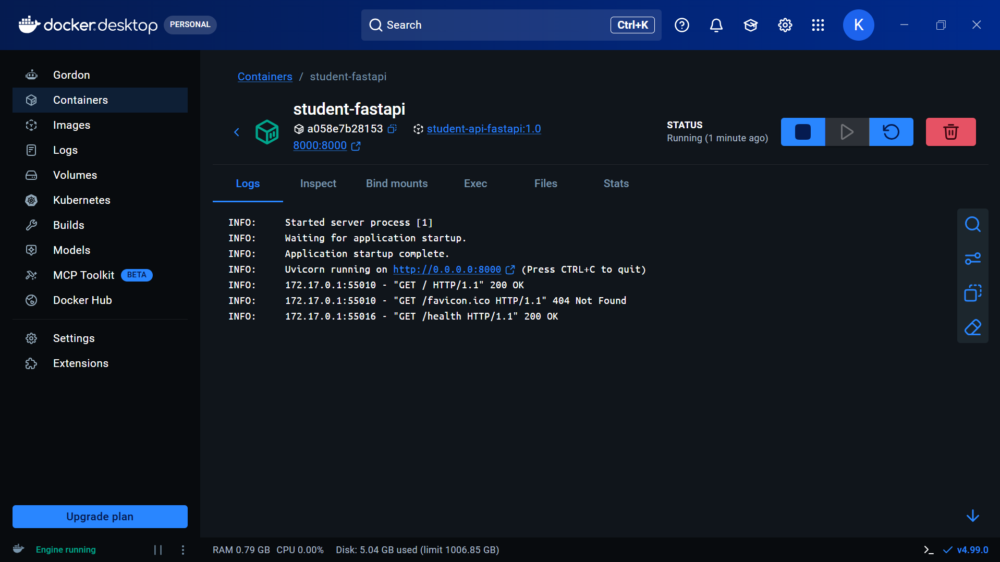

### API verification

The application was tested using browser or HTTP requests:

#### Root endpoint

`GET /` returned the application metadata and status.

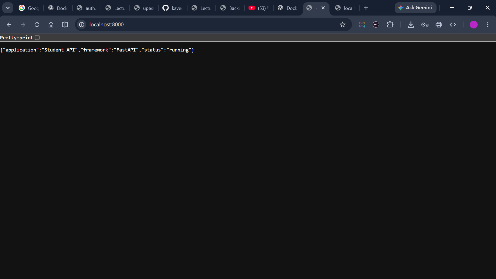

#### Health endpoint

`GET /health` returned a healthy response.

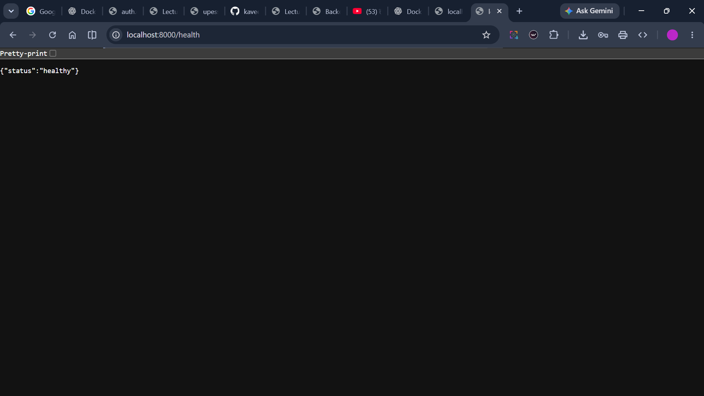

#### Students endpoint

`GET /students` returned the list of sample students.

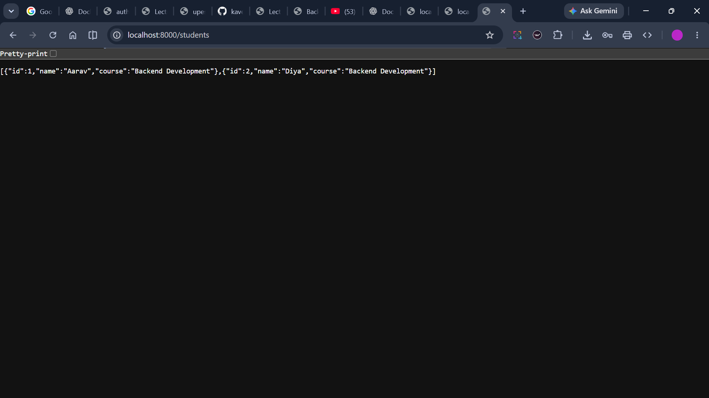

## 5. Express Docker Application

The Express project also exposes a student API with the same functional endpoints:

- `GET /` returns the app name and framework
- `GET /health` checks health status
- `GET /students` returns sample student records

The app is built with `Express.js` and runs on port `3000` by default.

### Project files

The Express project includes the server file, dependency manifest, and Dockerfile.

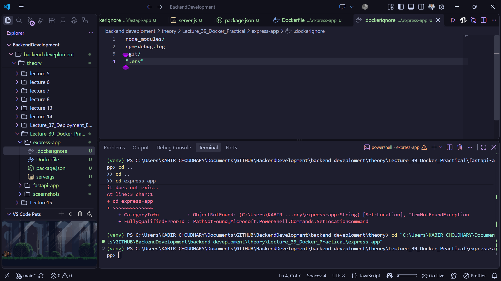

### Docker configuration

The Dockerfile uses the official `node:22-alpine` image, installs dependencies, copies the server code, exposes port `3000`, and runs the app with the `npm start` script.

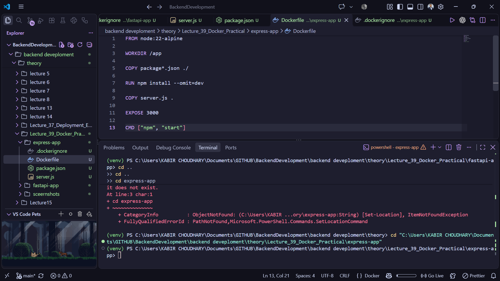

### Building the image

The Express image was built using Docker and then run locally.

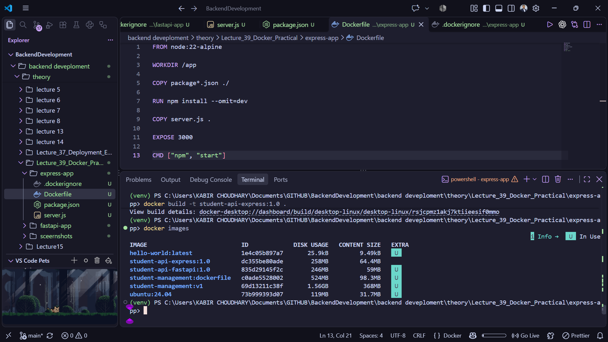

### Running on localhost

The containerized Express application was started successfully and served requests on localhost.

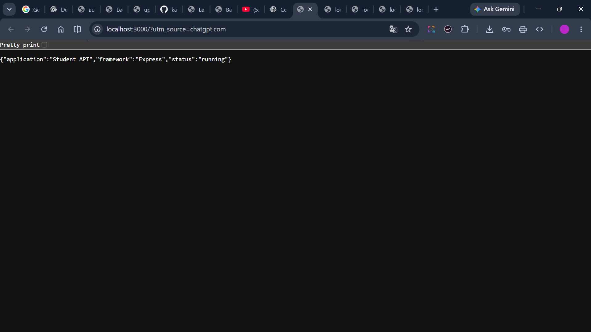

## 6. Docker Installation Verification

Before building the applications, Docker itself was checked and verified to be available in the environment.

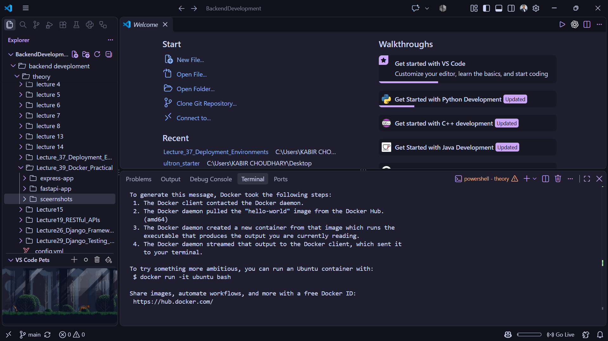

## 7. Screenshot Evidence

The following screenshots were collected for the practical:

1. 
2. 
3. 
4. 
5. 
6. 
7. 
8. 
9. 
10. 
11. 

## 8. Conclusion

This lecture demonstrated the core workflow of Dockerizing backend applications. We successfully verified Docker installation, created a FastAPI app and an Express app, built Docker images for both, ran the containers, and tested their endpoints. Docker ensures that the application and its dependencies remain portable, reproducible, and easy to deploy across environments.

The practical also highlights the difference between Python and Node runtime images while keeping the same deployment pattern: install dependencies, copy source files, expose the port, and start the server.
