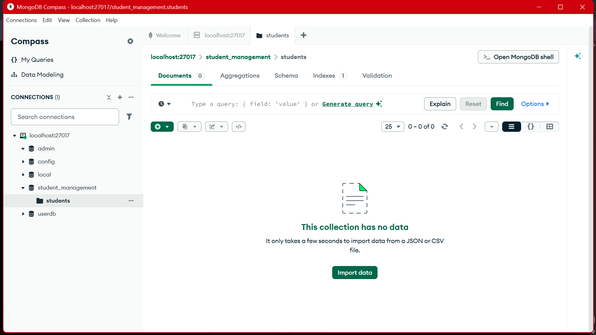
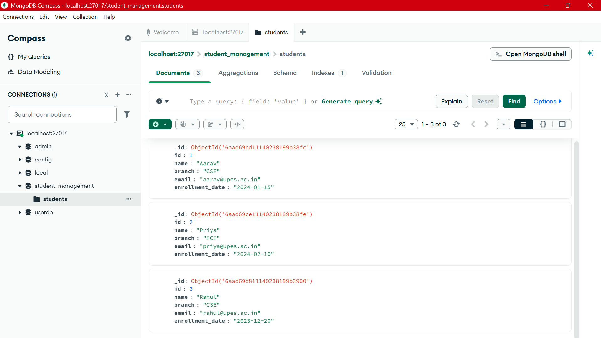

# Lecture 13: MongoDB Database and Collection Operations

**Course:** Backend Development

**Topic:** Creating a MongoDB database and collection and working with student documents

## 1. Objective

This practical introduces MongoDB's document-oriented data model. It demonstrates creating or selecting a database, creating a collection, inserting student documents, and using CRUD operations to find, update, and delete data.

The screenshots that actually show MongoDB Compass connect to `localhost:27017` and display the `student_management.students` namespace.

## 2. MongoDB concepts

- A **database** groups collections and their related data. This exercise uses `student_management`.
- A **collection** groups documents in a database. This exercise uses `students`.
- A **document** is a BSON record made up of fields and values. Student fields shown here include `id`, `name`, `branch`, `email`, and `enrollment_date`.
- Each inserted MongoDB document receives an `_id` field if one was not supplied. The Compass screenshot displays these generated values as `ObjectId(...)`.
- MongoDB stores documents without requiring a relational table definition before insertion. A collection can contain documents with different fields, although an application commonly validates and standardizes its document shape.

## 3. Database and collection

MongoDB Compass shows the `student_management` database and its `students` collection on the local MongoDB connection. The initial-state screenshot shows the collection selected before it has any documents.



In the MongoDB shell, the database can be selected (and created when data is first written), and the collection can be explicitly created:

```javascript
use student_management
db.createCollection("students")
```

Creating a collection explicitly is optional in many workflows because MongoDB can create it automatically when the first document is inserted. Do not run `createCollection` again if the collection already exists.

## 4. Student document structure

The populated Compass screenshot displays three student documents in `students`. Their visible application fields are:

| ID | Name | Branch | Email | Enrollment date |
|---:|---|---|---|---|
| 1 | Aarav | CSE | aarav@upes.ac.in | 2024-01-15 |
| 2 | Priya | ECE | priya@upes.ac.in | 2024-02-10 |
| 3 | Rahul | CSE | rahul@upes.ac.in | 2023-12-20 |

The visible enrollment-date values are quoted strings in Compass, not MongoDB date values. MongoDB has also generated an `_id` for each document.



## 5. Insert documents

The following is an illustrative MongoDB shell example matching the three documents visible in the Compass screenshot:

```javascript
db.students.insertMany([
  {
    id: 1,
    name: "Aarav",
    branch: "CSE",
    email: "aarav@upes.ac.in",
    enrollment_date: "2024-01-15"
  },
  {
    id: 2,
    name: "Priya",
    branch: "ECE",
    email: "priya@upes.ac.in",
    enrollment_date: "2024-02-10"
  },
  {
    id: 3,
    name: "Rahul",
    branch: "CSE",
    email: "rahul@upes.ac.in",
    enrollment_date: "2023-12-20"
  }
])
```

`insertMany()` inserts multiple documents in one operation. MongoDB assigns `_id` values automatically because the example does not provide them. The `id` field shown in the documents is a separate application-level field and is not the same as MongoDB's `_id`.

## 6. Read and filter documents

To display every student document:

```javascript
db.students.find()
```

To find students in the CSE branch:

```javascript
db.students.find({ branch: "CSE" })
```

The filter is a document: the `branch` field must equal `"CSE"`. For the three records shown above, this returns Aarav and Rahul.

Because the screenshot stores `enrollment_date` as an ISO-formatted string, a string comparison can find dates later than January 31, 2024:

```javascript
db.students.find({ enrollment_date: { $gt: "2024-01-31" } })
```

This comparison relies on the consistent `YYYY-MM-DD` string format. For applications that perform date arithmetic or use mixed formats, store dates as BSON Date values and query with a date value instead.

## 7. Update a document

`updateOne()` selects a document with a filter and applies changes through an update operator such as `$set`. For example, to change the branch on the student whose application ID is `2`:

```javascript
db.students.updateOne(
  { id: 2 },
  { $set: { branch: "IT" } }
)
```

The filter selects the target document; `$set` changes only the named field, leaving the student's other fields intact. The result reports how many documents matched and how many were modified. This command is an illustrative MongoDB equivalent, not evidence that the PostgreSQL update screenshot in this folder was executed against MongoDB.

## 8. Delete a document

`deleteOne()` removes one document matching a filter. For example:

```javascript
db.students.deleteOne({ id: 3 })
```

The filter should uniquely identify the intended record when only one student is meant to be removed. Check the matched/deleted count and query the collection again to confirm the result.

## 9. CRUD summary

| Operation | MongoDB method | Example |
|---|---|---|
| Create | `insertOne()` / `insertMany()` | Insert one or more student documents. |
| Read | `find()` / `findOne()` | List or filter student documents. |
| Update | `updateOne()` / `updateMany()` | Apply operators such as `$set` to matching documents. |
| Delete | `deleteOne()` / `deleteMany()` | Remove matching documents. |

## 10. Screenshot and evidence note

The first two images above show MongoDB Compass: the local MongoDB database/collection and a populated collection of three student documents. The other files currently stored in this folder do **not** show MongoDB operations. They show PostgreSQL's `psql` terminal and SQL statements such as `CREATE TABLE`, `SELECT`, `UPDATE`, and `DELETE`:

- `Experiment13-Students-Inserted.png.png`
- `Experiment13-Students-Table-Created.png.png`
- `Experiment13-Query-CSE-Students.png.png`
- `Experiment13-Query-After-January-2024.png.png`
- `Experiment13-Query-Update-Branch.png.png`
- `Experiment13-Query-Updated-Student.png.png`
- `Experiment13-Query-Delete-Student.png.png`
- `Experiment13-Query-Remaining-Students.png.png`

Those PostgreSQL screenshots are not embedded as MongoDB evidence because doing so would misrepresent which database produced them. The MongoDB shell examples in this report explain the corresponding document-database operations; they are illustrative examples and are not claimed to be captured in those PostgreSQL screenshots.

## 11. MongoDB and relational database comparison

The folder's mixed screenshots provide a useful distinction between the models, but the operations should not be confused:

- MongoDB stores student data as BSON documents in the `students` collection and automatically provides `_id`.
- PostgreSQL stores rows in a table with declared column types and constraints such as `PRIMARY KEY`, `NOT NULL`, and `UNIQUE`.
- MongoDB filters use query documents and update operators; the terminal captures use SQL clauses such as `WHERE`, `SET`, and `DELETE FROM`.
- The MongoDB Compass screenshot displays three student documents; the PostgreSQL terminal screenshots show a separate five-row student table and later SQL operations.

## 12. Conclusion

This practical introduces MongoDB's database, collection, and document concepts and the core create, read, update, and delete operations. The Compass evidence confirms the local `student_management.students` collection and shows three student documents, each with a generated MongoDB `_id`. The accompanying report examples demonstrate how MongoDB shell commands express the same operations. The folder also contains PostgreSQL screenshots; keeping those separate from MongoDB evidence makes the database technologies and their different query models clear.
