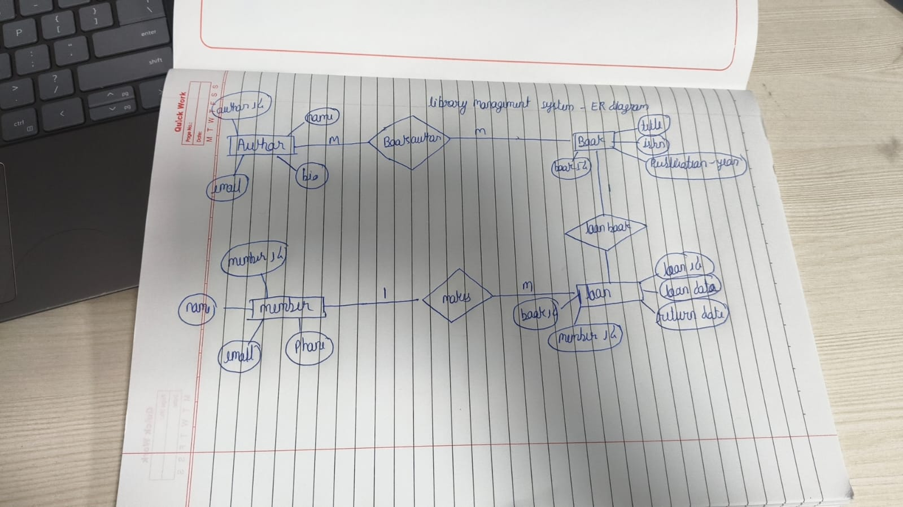
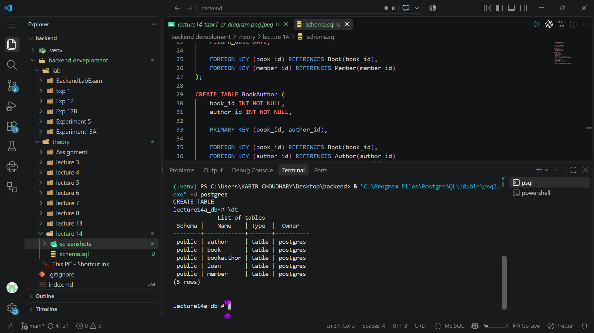
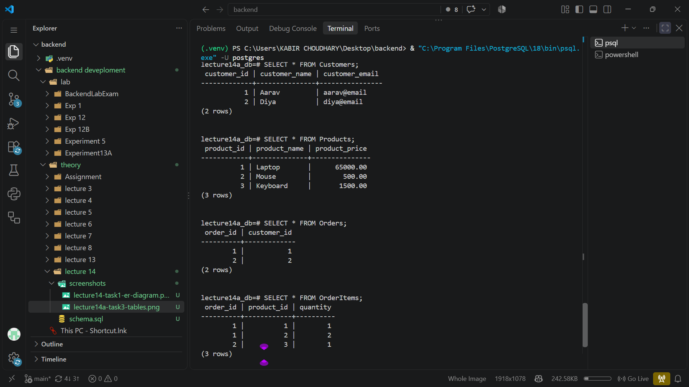

# Lecture 14: Relational Database Design and SQL

**Course:** Backend Development

**Topic:** ER modelling, relational tables, keys, and data queries

## 1. Lecture overview

The Lecture 14 folder contains a handwritten library-management ER diagram, a PostgreSQL `schema.sql` file for the library entities, and terminal screenshots showing table creation and query results. Together, these materials demonstrate how to represent entities and relationships in a relational database, define tables and constraints, and inspect data with SQL.

The SQL schema defines five library tables: `Author`, `Book`, `Member`, `Loan`, and `BookAuthor`. Two of the supplied terminal screenshots, however, show a different example database with `Customers`, `Products`, `Orders`, and `OrderItems`. This report describes the library schema and identifies the screenshot/schema mismatch rather than treating the screenshots as evidence of library-table data.

## 2. Entity-relationship model

The handwritten diagram models a library with four main entities:

- **Author** — the person who writes a book.
- **Book** — a title that can be borrowed.
- **Member** — a library user who borrows books.
- **Loan** — a borrowing event linking one member and one book, with loan and return dates.

The diagram shows that an author can be associated with multiple books and a book can be associated with multiple authors. This many-to-many relationship is represented in the relational schema by the separate `BookAuthor` junction table.

It also shows members making loans and books being loaned. Each loan records the member and book involved. The ER diagram includes some attributes that are not present in `schema.sql`, such as author biography, member phone, and book publication year. The SQL file should be treated as the authoritative definition of the columns actually created.



## 3. Relational schema in `schema.sql`

The file defines the following tables and columns.

### `Author`

```sql
CREATE TABLE Author (
    author_id SERIAL PRIMARY KEY,
    name VARCHAR(100) NOT NULL
);
```

- `author_id` is an automatically generated integer primary key.
- `name` is required and is limited to 100 characters.

### `Book`

```sql
CREATE TABLE Book (
    book_id SERIAL PRIMARY KEY,
    title VARCHAR(200) NOT NULL,
    isbn VARCHAR(20) UNIQUE
);
```

- `book_id` identifies each book.
- `title` is required and can contain up to 200 characters.
- `isbn` is optional, but if present it must be unique.

### `Member`

```sql
CREATE TABLE Member (
    member_id SERIAL PRIMARY KEY,
    name VARCHAR(100) NOT NULL,
    email VARCHAR(100) UNIQUE
);
```

- `member_id` identifies each library member.
- `name` is required.
- `email` is optional, but duplicate non-null email values are disallowed by the unique constraint.

### `Loan`

```sql
CREATE TABLE Loan (
    loan_id SERIAL PRIMARY KEY,
    book_id INT NOT NULL,
    member_id INT NOT NULL,
    loan_date DATE NOT NULL,
    return_date DATE,
    FOREIGN KEY (book_id) REFERENCES Book(book_id),
    FOREIGN KEY (member_id) REFERENCES Member(member_id)
);
```

- `loan_id` identifies an individual loan.
- `book_id` and `member_id` are required foreign keys to `Book` and `Member`.
- `loan_date` is required.
- `return_date` is nullable, which allows a loan to represent a book that has not yet been returned.

### `BookAuthor`

```sql
CREATE TABLE BookAuthor (
    book_id INT NOT NULL,
    author_id INT NOT NULL,
    PRIMARY KEY (book_id, author_id),
    FOREIGN KEY (book_id) REFERENCES Book(book_id),
    FOREIGN KEY (author_id) REFERENCES Author(author_id)
);
```

This junction table implements the many-to-many relationship between books and authors. Its composite primary key prevents the same author-book association from being inserted more than once. Both foreign keys ensure that each association refers to existing records.

## 4. Keys, constraints, and relationships

- A **primary key** uniquely identifies a row. The schema uses generated IDs for authors, books, members, and loans.
- A **composite primary key** combines `book_id` and `author_id` in `BookAuthor`.
- A **foreign key** enforces a relationship to a row in another table. Loans cannot refer to nonexistent books or members, and book-author links cannot refer to nonexistent books or authors.
- **`NOT NULL`** requires a value to be supplied for important fields such as names, loan dates, and relationship IDs.
- **`UNIQUE`** prevents duplicate ISBNs and duplicate non-null member email addresses.
- **`SERIAL`** is PostgreSQL's auto-incrementing integer shorthand for generated identifiers.

These constraints let PostgreSQL reject invalid or inconsistent data rather than relying only on application code to preserve every rule.

## 5. Creating the schema in PostgreSQL

Create or connect to a PostgreSQL database, then run the schema file from `psql`:

```sql
\c library_db
\i schema.sql
\dt
```

The database must exist before `\c library_db` can connect to it. The `\i` command is a `psql` meta-command that executes the SQL file; it is not ordinary SQL and may need a full or correctly relative file path depending on the current working directory.

The table definitions contain dependencies: `Loan` references `Book` and `Member`, while `BookAuthor` references `Book` and `Author`. The provided file creates the referenced tables before the dependent tables, so it can be executed in order in a new, empty schema.

## 6. Example library queries

The schema can be used for queries such as:

### List all books

```sql
SELECT book_id, title, isbn
FROM Book;
```

### List books with their authors

```sql
SELECT Book.title, Author.name AS author_name
FROM Book
JOIN BookAuthor ON Book.book_id = BookAuthor.book_id
JOIN Author ON BookAuthor.author_id = Author.author_id
ORDER BY Book.title, Author.name;
```

The two joins follow the many-to-many relationship through `BookAuthor`.

### List a member's loans

```sql
SELECT Member.name, Book.title, Loan.loan_date, Loan.return_date
FROM Loan
JOIN Member ON Loan.member_id = Member.member_id
JOIN Book ON Loan.book_id = Book.book_id
ORDER BY Loan.loan_date;
```

### Find books not yet returned

```sql
SELECT Member.name, Book.title, Loan.loan_date
FROM Loan
JOIN Member ON Loan.member_id = Member.member_id
JOIN Book ON Loan.book_id = Book.book_id
WHERE Loan.return_date IS NULL;
```

The last query uses the nullable return date to identify outstanding loans.

## 7. Screenshots of table and query tasks

The screenshot labelled Task 3 shows PostgreSQL listing five tables named `author`, `book`, `bookauthor`, `loan`, and `member`. PostgreSQL displays unquoted identifiers in lowercase; these names correspond to the five library tables defined in `schema.sql`.



The screenshot labelled Task 5 displays final query data for a different schema: `Customers`, `Products`, `Orders`, and `OrderItems`. It shows two customers, three products, two orders, and three order-item rows. Those tables and their data are not defined in the supplied library `schema.sql`, so this screenshot documents a separate order-management exercise rather than the library schema.



## 8. Differences between the ER diagram and SQL file

The ER diagram and the supplied DDL are related, but they are not identical:

- The diagram includes attributes such as author biography, member phone, and book publication year that are not defined in the SQL tables.
- The SQL file introduces `BookAuthor` as an explicit junction table for the many-to-many author-book relationship.
- The SQL file includes `Loan` with `loan_date` and nullable `return_date` fields.

When implementing a schema from a diagram, the model and DDL should be reconciled so that required attributes and relationship rules are not lost. For this report, table and column descriptions follow `schema.sql`, while the ER diagram is described as the design illustration it provides.

## 9. Limitations and possible improvements

- The SQL file defines structure only; it contains no library seed records or sample inserts.
- It does not specify `ON DELETE` or `ON UPDATE` behavior for foreign keys, so PostgreSQL's default referential-action behavior applies.
- The schema does not enforce rules such as `return_date >= loan_date`, valid ISBN formatting, or a unique active loan per physical copy.
- `Book` represents a title, not individual physical copies. A real library may need a `BookCopy`/inventory table so different copies of a title can be loaned independently.
- The ER diagram's additional attributes should be added to the DDL if they are requirements.
- The order-management screenshot should be clearly separated from the library database evidence in any future materials.

## 10. Conclusion

Lecture 14 connects ER modelling to relational SQL. The library diagram identifies authors, books, members, and loans; `schema.sql` turns these concepts into five PostgreSQL tables using primary keys, foreign keys, uniqueness, and required-field constraints. The `BookAuthor` junction table is the central example of mapping a many-to-many relationship into relations. The screenshots also include a separate order-management data exercise, which is documented separately to avoid conflating it with the library schema.
