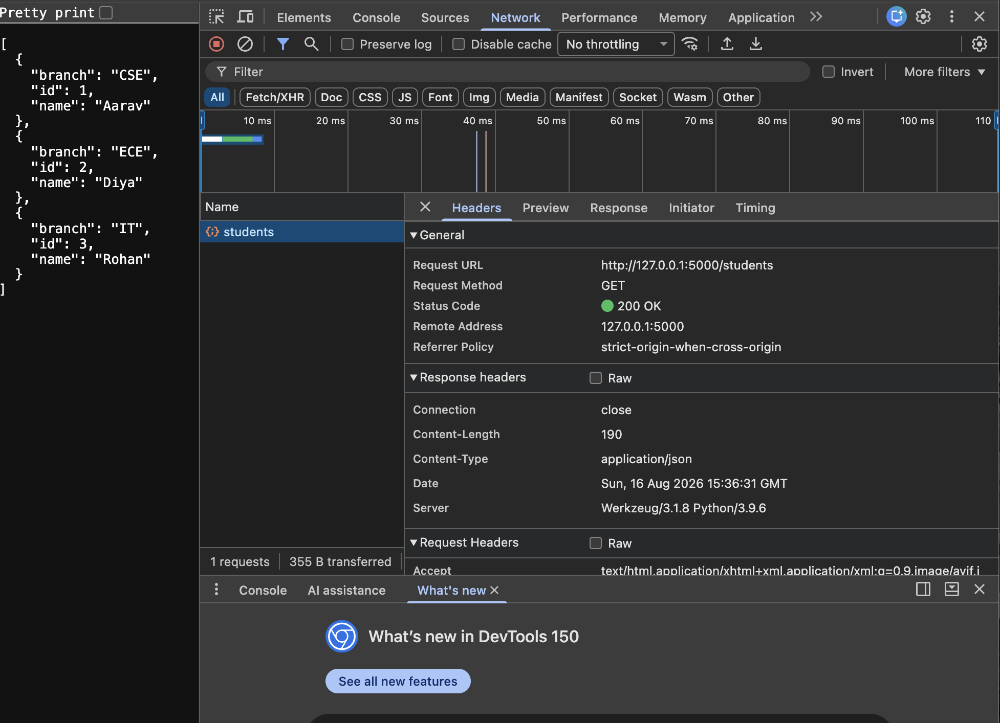

# Lecture 3: Backend Routes, Responses, and Development Tools

**Course:** Backend Development

**Student:** Kabir Chaudhary

**Roll number:** 590015728

**Topics:** Node.js and Express routing, JSON, HTML responses, EJS templates, Flask routes, and browser DevTools

## 1. Lecture overview

Lecture 3 contains eight small exercises that introduce backend request handling in JavaScript and Python. The exercises progress from a basic server to multiple routes, in-memory student data, HTML and EJS responses, Flask endpoints, and inspecting an HTTP response in browser developer tools.

Each task is a separate example with its own server file. They are not combined into one application. The Node.js tasks use Express, while the Flask tasks use Python. Only the EJS task includes an explicit view-template directory.

## 2. Learning objectives

- Start a basic web server and listen on a local port.
- Define routes for different URL paths and HTTP methods.
- Return plain text, JSON, and generated HTML responses.
- Read URL path parameters and use them to select a record.
- Filter in-memory data and handle a missing record with HTTP 404.
- Pass data from an Express route to an EJS template.
- Accept a JSON request body in a Flask POST route.
- Inspect request and response details using browser DevTools.

## 3. Technologies and project layout

- **Node.js:** Runtime for the Express examples.
- **Express:** Routing and response framework used in Tasks 1–5.
- **EJS:** Template engine used in Task 5 to render HTML from server-side data.
- **Python and Flask:** Runtime and framework used in Tasks 6–7.
- **HTTP:** Request methods, paths, response bodies, and status codes used throughout the exercises.
- **JSON:** Structured data format returned by the student API and accepted by its POST route.
- **Browser DevTools:** Network inspection tool shown in Task 8.

The code is organized in folders named `Task-1-Hello-World` through `Task-8-DevTools`. The Node examples each have a `server.js`; the Flask examples each have an `app.py`. Task 5 also has `views/home.ejs` and `views/students.ejs`. Task 8 contains the DevTools screenshot.

No `package.json`, `requirements.txt`, or other dependency manifest is present in these task folders. The Express and EJS examples require the corresponding Node packages to be available; the Flask examples require Flask in the selected Python environment.

## 4. Task 1: Hello World with Express

`Task-1-Hello-World/server.js` imports Express, creates an app, and defines `GET /`. The route sends the plain-text response **“Backend Server Running.”** The application listens on port `3000` and prints its local URL to the terminal.

This is the simplest server example: one route receives a GET request and returns a text response.

## 5. Task 2: Multiple Express routes

`Task-2-Multiple-Routes/server.js` adds separate routes to the same Express application:

- `GET /` returns **“Welcome to the Student Management API.”**
- `GET /students` returns **“List of all students.”**
- `GET /students/1` returns a sample student string for Aarav, roll number 1.

This task shows that a server can map different URL paths to different handlers. The app listens on port `3000`.

## 6. Task 3: JSON student data and route parameters

`Task-3-JSON-Data/server.js` defines an in-memory array of three student objects. Each record includes an `id`, `name`, and `branch`.

Its routes demonstrate JSON output and data lookup:

- `GET /` sends a short API greeting.
- `GET /students` returns the full student array with `res.json()`.
- `GET /students/branch/:branch` reads the `branch` path parameter, compares it case-insensitively, filters the array, and returns matching records as JSON.
- `GET /students/:id` converts the `id` path parameter to a number and searches for a matching student. It returns the student as JSON when found, or HTTP 404 with `{ "error": "Student not found" }` otherwise.

The records are held in memory, so this example has no database or persistent storage.

## 7. Task 4: HTML responses

`Task-4-HTML-Responses/server.js` uses `res.send()` to return HTML:

- `GET /` responds with a heading and welcome paragraph.
- `GET /students` creates an HTML unordered list from three sample student records. Each list item displays a student's name and branch.
- `GET /students/:id` searches for the requested student and returns an HTML heading and branch paragraph. If the ID does not match, the route responds with HTTP 404 and a **“Student not found”** heading.

This demonstrates generating markup in route handlers rather than returning plain text or JSON. The data is hard-coded in memory. The student values are interpolated into HTML strings without escaping; this is acceptable only as a simple trusted-data exercise, not as a safe pattern for user-controlled content.

## 8. Task 5: EJS templating

`Task-5-EJS-Templating/server.js` configures EJS with `app.set("view engine", "ejs")` and defines the same three sample students used in the earlier examples.

- `GET /` calls `res.render("home")` to render `views/home.ejs`.
- `GET /students` calls `res.render("students", { students: students })` to pass the student array to `views/students.ejs`.

The home template presents a student-management heading, a welcome paragraph, and a link to `/students`. The students template loops through the supplied array with EJS tags and displays each student's name and branch in a list. `<%= ... %>` outputs values using EJS's escaped-output syntax.

By convention, Express looks for the `views` directory relative to the Node process's working directory unless a different views path is configured. Run this task from its own folder so the default view lookup matches the included `views/` directory. The server listens on port `3000`.

## 9. Task 6: Flask Hello World

`Task-6-Flask-Hello-World/app.py` creates a Flask application and defines a route for `/`. Visiting the route returns the plain-text response **“Backend Server Running.”**

The `if __name__ == "__main__":` block starts Flask's development server when the file is run directly. The call uses `debug=True`, which is intended for local development only and should not be enabled on a production-facing server.

## 10. Task 7: Flask routes, JSON, and POST

`Task-7-Flask-Routes-JSON-POST/app.py` defines an in-memory list of three student dictionaries and four routes:

- `GET /` returns **“Student Management API.”**
- `GET /students` uses `jsonify()` to return all student records as JSON.
- `POST /students` reads a JSON body with `request.get_json()`, appends the received value to the in-memory list, and returns it as JSON with HTTP 201.
- `GET /students/<int:student_id>` uses Flask's integer path converter, searches the list, returns the matching student as JSON, or returns a JSON error with HTTP 404.

The POST route illustrates accepting JSON and creating a resource response. It does not validate the request body or verify that it is a correctly shaped student record before appending it. The data is stored only in process memory and is lost when the server restarts.

The task starts Flask's development server with `debug=True`. Flask uses port `5000` by default unless configured otherwise. Because the Node examples use port `3000` and the Flask examples use port `5000`, run the desired exercise's server separately.

## 11. Task 8: Inspecting an API response with DevTools

The included screenshot shows a browser request to `http://127.0.0.1:5000/students` selected in the Network panel. It displays a successful **GET** request with status **200 OK**, a JSON response containing Aarav, Diya, and Rohan, and the response content type `application/json`.

This demonstrates how the browser's Network panel can be used to inspect:

- The request URL and HTTP method.
- The response status code.
- Response headers, including content type.
- The response body returned by the API.
- Request timing and transferred data.



## 12. Route and response summary

| Exercise | Method and path | Response or behavior |
|---|---|---|
| Task 1 | `GET /` | Plain-text server status. |
| Task 2 | `GET /`, `/students`, `/students/1` | Different plain-text route responses. |
| Task 3 | `GET /`, `/students`, `/students/branch/:branch`, `/students/:id` | Greeting, JSON data, branch filtering, and student lookup with a JSON 404. |
| Task 4 | `GET /`, `/students`, `/students/:id` | HTML pages/lists and an HTML 404 for a missing student. |
| Task 5 | `GET /`, `/students` | EJS-rendered home and student list pages. |
| Task 6 | `GET /` | Plain-text Flask response. |
| Task 7 | `GET /`, `GET /students`, `POST /students`, `GET /students/<int:student_id>` | Text, JSON collection, JSON creation response, and JSON lookup/404. |
| Task 8 | Browser inspection of `GET /students` | DevTools inspection of a JSON response and HTTP metadata. |

## 13. Running the examples

Run only one server example at a time if it uses the same port as another task.

### Express tasks

From the selected task folder, ensure Express is installed and run:

```text
node server.js
```

The Express examples listen on `http://localhost:3000`. Task 5 also requires EJS to be installed and should be started from its task folder so that Express finds the local `views/` directory.

### Flask tasks

With Flask installed in the active Python environment, run the selected `app.py` from its task folder. The Flask examples use the built-in development server on `http://127.0.0.1:5000` by default.

Task 7's POST route must be called with a JSON request body containing the student data. For example, an HTTP client can send a JSON object with `id`, `name`, and `branch` to `POST /students`.

## 14. Key concepts

- **Route:** A mapping between an HTTP method/path and a handler.
- **Request method:** GET is used to retrieve data/pages; POST is used in Task 7 to submit a new student.
- **Path parameter:** A value embedded in a URL, such as `:id`, read from Express's `req.params` or Flask's route argument.
- **JSON response:** Structured response data returned with `res.json()` or Flask's `jsonify()`.
- **Status code:** An HTTP result indicator, such as 200 for success, 201 for a created resource, and 404 for a missing record.
- **In-memory data:** Arrays and lists used for demonstration but not persisted across server restarts.
- **Server-side rendering:** EJS combines a template with server-provided values to generate HTML.
- **Development tools:** Browser DevTools shows the HTTP request and response independently of the server source code.

## 15. Limitations and development notes

- The examples are separate tasks and may use the same local port; stop one server before starting another on that port.
- Student records are hard-coded or kept in memory. No task connects to a database.
- Task 7 accepts a JSON body without validation; real APIs should check the body shape and required fields.
- Flask's `debug=True` is for local development and should not be exposed in production.
- The task folders do not include dependency manifests, so the required framework packages must already be installed in the environment used to run each example.
- The screenshot is a DevTools capture of the Flask `/students` endpoint returning JSON; it is not a screenshot of every exercise.

## 16. Conclusion

Lecture 3 moves from a minimal server to practical backend patterns: multiple routes, path parameters, JSON and HTML responses, basic lookup and filtering, and template-based rendering. It also compares Express with Flask and uses browser DevTools to inspect a real API response. The examples provide a foundation for later work with validated request bodies, persistent databases, and production-ready deployment.
