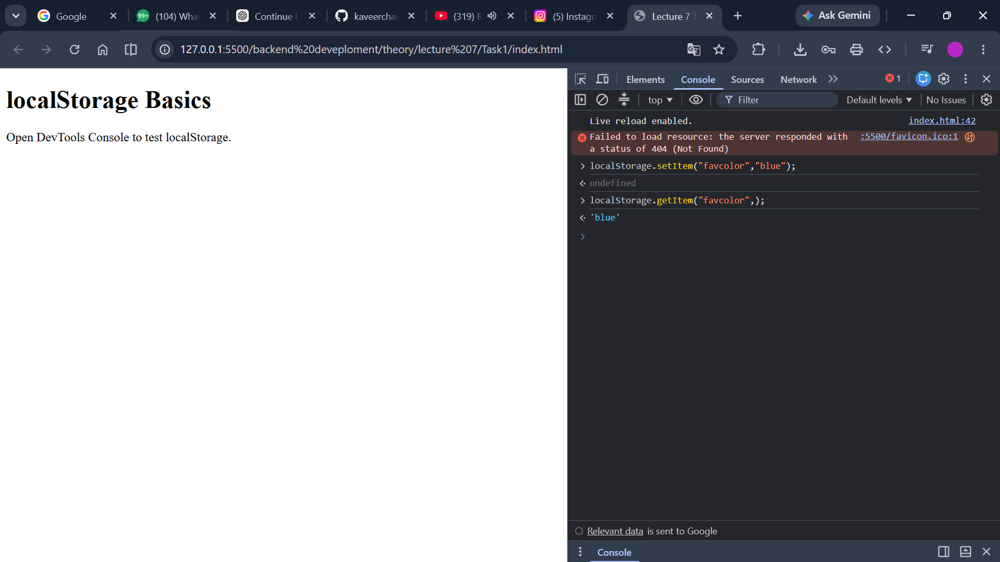

# Lecture 7: Browser Storage and JSON

**Course:** Backend Development

**Project:** Web Storage exercises and a persistent Notes App

## 1. Lecture overview

Lecture 7 introduces browser-side storage and the JSON conversion needed to save structured JavaScript data. The first eight tasks use small HTML pages as DevTools practice areas for `localStorage`, `sessionStorage`, `JSON.stringify()`, and `JSON.parse()`. Task 9 applies those ideas in a small Notes App that stores, displays, edits, and deletes notes using `localStorage`.

The folder also contains a minimal Express server. It responds with a greeting at `/`; it is separate from the browser storage exercises and does not itself serve the task HTML files.

## 2. Project structure and setup

- `Task1/` and `Task 2/` contain practice pages for `localStorage` and `sessionStorage`.
- `Task 3/` through `Task 6/` contain pages for JSON serialization, parsing, and structured values.
- `Task 7/` and `Task 8/` contain pages for DevTools storage inspection and combined storage practice.
- `Task 9/` contains the Notes App HTML, CSS, JavaScript, and its screenshots.
- `server.js` defines the minimal Express greeting endpoint.
- `package.json` defines the `npm start` command and the Express dependency.
- `package-lock.json` records the resolved npm dependency tree.

To run the Express example, open a terminal in the Lecture 7 folder and run:

```powershell
npm install
npm start
```

The server listens at `http://localhost:3000`. The individual task pages are standalone HTML files. The Express app only defines `GET /` and does not use `express.static()` to host those pages; open the task HTML files directly or serve them with a local static-file server when doing the browser exercises.

## 3. Task 1 — `localStorage` basics

`Task1/index.html` introduces persistent browser key-value storage. The page asks the learner to open the Developer Tools Console and test `localStorage`.

Typical operations include:

```javascript
localStorage.setItem("username", "Alice");
localStorage.getItem("username");
localStorage.removeItem("username");
localStorage.clear();
```

`setItem()` stores a value under a key, `getItem()` retrieves it, `removeItem()` deletes a single key, and `clear()` removes all keys for the current origin. Values are stored as strings. `localStorage` normally remains available after closing and reopening a tab or browser, subject to browser settings and origin rules.



An additional timestamped screenshot is included with this task:


## 4. Task 2 — `sessionStorage` basics

`Task 2/index.html` provides a DevTools practice page for `sessionStorage`. Its API resembles `localStorage`, but its data is scoped to the page's browsing session (and tab) and is normally cleared when that tab or window's session ends.

```javascript
sessionStorage.setItem("theme", "dark");
sessionStorage.getItem("theme");
sessionStorage.removeItem("theme");
```

The task screenshots document the session-storage exercises:


## 5. Task 3 — the JSON storage problem

`Task 3/index.html` introduces an important limitation of Web Storage: its values are strings. Passing an ordinary JavaScript object to `localStorage.setItem()` does not preserve the object's fields. JavaScript converts the object to a string such as `[object Object]`, which cannot be parsed back into the original object.

```javascript
const student = { name: "Aarav", branch: "CSE" };
localStorage.setItem("student", student); // Does not serialize the object as JSON.
```

The solution is to serialize the object as JSON before saving it, then parse the JSON text when reading it. Tasks 4 and 5 practice those two directions separately.


## 6. Task 4 — `JSON.stringify()`

`Task 4/index.html` is a console practice page for `JSON.stringify()`. This method converts supported JavaScript values into JSON text, which can be stored in Web Storage or sent in an HTTP request.

```javascript
const student = { name: "Aarav", branch: "CSE" };
const jsonText = JSON.stringify(student);

localStorage.setItem("student", jsonText);
```

The stringified value can be inspected as text in DevTools. Serialization also works for arrays and nested objects, provided their contents are representable in JSON.


## 7. Task 5 — `JSON.parse()`

`Task 5/index.html` focuses on the reverse operation: `JSON.parse()` converts valid JSON text into a JavaScript value.

```javascript
const savedText = localStorage.getItem("student");
const student = savedText ? JSON.parse(savedText) : null;
```

The task screenshots demonstrate parsing a stored object, completing a JSON round trip, and the error produced by invalid JSON. `JSON.parse()` throws a `SyntaxError` when the string is malformed, so production code should validate or handle untrusted and potentially corrupted stored data.


## 8. Task 6 — JSON objects, arrays, and helpers

`Task 6/index.html` combines the previous concepts in a JSON playground. The screenshots cover simple objects, nested objects, arrays of objects, and helper functions for saving and loading JSON from Web Storage.

A reusable pair of helpers can keep serialization logic in one place:

```javascript
function saveData(key, value) {
  localStorage.setItem(key, JSON.stringify(value));
}

function loadData(key) {
  const raw = localStorage.getItem(key);
  return raw ? JSON.parse(raw) : null;
}
```

Arrays and nested structures can be stored in the same way as simple objects because `JSON.stringify()` serializes the supported structure recursively.


## 9. Task 7 — verify storage in Developer Tools

`Task 7/index.html` prompts the learner to inspect Local Storage in the browser's Developer Tools. The Application (or Storage) panel shows keys and string values saved for the current origin. This gives a second way to verify the effects of `setItem()`, updates, and deletion alongside reading values from the Console.

The screenshots document example stored items and their inspection, editing, and removal:


## 10. Task 8 — combined Web Storage practice

`Task 8/index.html` is a combined console practice page for `localStorage`, `sessionStorage`, and JSON. The screenshots show basic local storage, converting JSON text back to a JavaScript value, using the console to inspect data, and removing a stored item.

The task reinforces that the two storage APIs have similar string-based methods but different lifetimes, and that structured values must be serialized before saving and parsed after retrieval.


## 11. Task 9 — Notes App

Task 9 combines HTML, CSS, JavaScript, JSON, and `localStorage` in a small Notes App. The page contains a text input, an **Add Note** button, and a container for rendered notes. `style.css` applies the layout and card styling; `script.js` manages note data and user actions.

### Loading and saving notes

`getNotes()` reads the `"notes"` key from `localStorage`. It parses and returns the saved JSON array, or returns an empty array when no notes have been stored. `saveNotes(notes)` serializes the array with `JSON.stringify()` before writing it back.

On the browser's `load` event, `renderNotes()` reads the saved array and builds the note cards. This restores the notes after a page reload in the same browser origin.

### Adding a note

Clicking **Add Note** or pressing Enter in the input calls `addNote()`. It trims whitespace, rejects an empty value with an alert, and appends a note containing:

- `id`: the value returned by `Date.now()`
- `text`: the note text
- `createdAt`: the creation time in ISO format
- `updatedAt`: initially `null`

The updated array is saved, the interface is re-rendered, and the input is cleared.


### Editing a note

The Edit button calls `editNote(id)`. The app locates the note and asks for replacement text using `prompt()`. Cancelling leaves it unchanged; whitespace-only text is rejected. A valid edit updates `text` and sets `updatedAt` to the current ISO timestamp before saving and rendering again.


### Deleting a note

The Delete button calls `deleteNote(id)`. It filters the selected note out of the array, saves the remaining notes, and redraws the list.


### Persistence and stored representation

Notes are stored in Local Storage under the `"notes"` key as a JSON string. The screenshots show the storage entry, the updated value after changes, and notes remaining available after a page reload.


## 12. Minimal Express server

The root `server.js` file creates an Express application, listens on port `3000`, and defines one route:

```javascript
app.get("/", (req, res) => {
  res.send("Hello from Lecture 7! Node.js + Express is running.");
});
```

Opening `http://localhost:3000/` returns that plain-text greeting. This server does not define API routes for the notes, connect to a database, or serve the task folders. The Notes App is a client-side demonstration whose data is stored in the browser, not on the Express server.

## 13. Key concepts

- **Origin-scoped storage:** Browser storage is associated with the page's origin; different schemes, hosts, and ports have separate storage.
- **`localStorage`:** Persists key-value strings across page reloads and browser restarts until removed, subject to browser policy.
- **`sessionStorage`:** Stores key-value strings for a browsing session, usually isolated to a tab.
- **JSON serialization:** `JSON.stringify()` converts supported objects and arrays into JSON text.
- **JSON parsing:** `JSON.parse()` reconstructs JavaScript data from valid JSON text.
- **CRUD in the browser:** The Notes App creates, reads, updates, and deletes notes in client-side storage.
- **Rendering and events:** DOM events connect input and button actions to data functions, and rendering refreshes the visible list.

## 14. Limitations and improvements

- Browser storage is not a database or a secure place for secrets. Users and scripts running in the same origin can inspect or modify its contents.
- `getNotes()` parses stored JSON without a `try/catch` or schema validation. Malformed or unexpected data can prevent rendering.
- `renderNotes()` interpolates note text into `innerHTML`. Since note content is user-controlled and persisted, this can allow HTML injection and cross-site scripting. A safer implementation should construct elements and set note content with `textContent`.
- Notes exist only in the current browser's storage and are not synchronized to the Express server or other devices.
- `Date.now()` is used as the note identifier; a more robust application would use a collision-resistant identifier and validate stored records.
- The Express server is independent of the notes and only provides a greeting route.

## 15. Conclusion

Lecture 7 progresses from browser storage primitives to JSON serialization and parsing, DevTools verification, and a small persistent Notes App. The exercises show that Web Storage stores strings, that JSON provides a way to represent structured values, and that application code must transform data both when saving and when loading it. Task 9 applies those operations to note creation, editing, deletion, display, and persistence while illustrating that client-side storage remains local to the browser.
