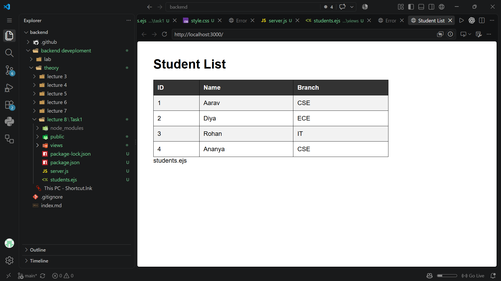
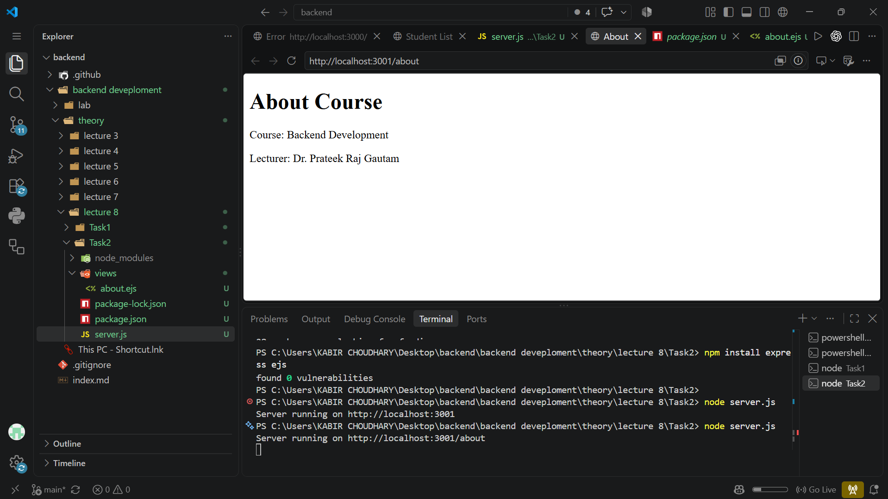
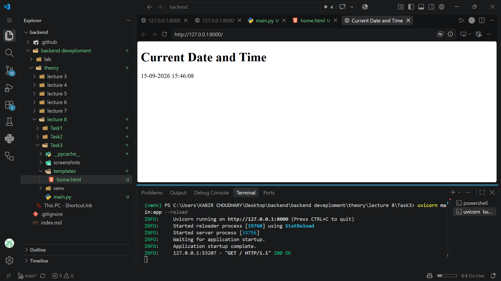

# Lecture 8: Server-Rendered Templates and Static Files

**Course:** Backend Development

**Project:** Express with EJS and FastAPI with Jinja2

## 1. Lecture overview

Lecture 8 demonstrates how backend frameworks can render HTML templates and serve static files such as CSS and images. Tasks 1, 2, and 4 use Node.js with Express and EJS. Tasks 3 and 5 use FastAPI with Jinja2 templates. The examples progress from rendering dynamic student and course data, to formatting a page with CSS, to adding a static asset route.

## 2. Project structure

- `Task1/` — Express/EJS student table with alternating row classes.
- `Task2/` — Express/EJS course information page.
- `Task3/` — FastAPI/Jinja2 page displaying the current date and time.
- `Task 4/` — Express/EJS student table with a custom stylesheet.
- `Task 5/` — FastAPI/Jinja2 page that mounts a static directory and references an image.

Each task is a separate example with its own server or application. The Node projects have their own `package.json` and `package-lock.json`; the FastAPI tasks do not include a requirements file.

## 3. Task 1 — Student table with Express and EJS

Task 1 creates an Express server on port `3000`. The server selects EJS as its view engine, serves files from the `public` directory, and defines four student records in a JavaScript array. A GET request to `/` renders the `students` view and passes the array to the template:

```javascript
app.get("/", (req, res) => {
  res.render("students", { students });
});
```

The EJS template loops through `students` to build a table of IDs, names, and branches. It also assigns alternating `even` and `odd` classes based on each record's index. `public/css/style.css` defines the table borders, spacing, header colors, and alternating row backgrounds.

The rendered view belongs in `views/students.ejs`, which is the path EJS resolves by default. There is also a separate top-level `students.ejs` file in the folder; the server does not configure that as its views directory.

Run the project from `Task1`:

```powershell
npm install
npm start
```

Then open `http://localhost:3000/`.



## 4. Task 2 — Dynamic course information

Task 2 runs a separate Express application on port `3001`. Its `/about` route renders `views/about.ejs`, passing two values in the render context:

- `course`: `Backend Development`
- `lecturer`: `Dr. Prateek Raj Gautam`

The EJS template inserts these values into the course information page. This demonstrates separating data in a route handler from the HTML presentation in a template.

Run the project from `Task2`:

```powershell
npm install
npm start
```

Open `http://localhost:3001/about`.



## 5. Task 3 — Current date and time with FastAPI and Jinja2

Task 3 defines a FastAPI application with a GET route at `/`. The handler obtains the current local date and time with Python's `datetime.now()`, formats it as day-month-year and 24-hour time (`%d-%m-%Y %H:%M:%S`), and supplies the result to `templates/home.html` as the `now` template variable.

The route declares `HTMLResponse` and returns `TemplateResponse` with the request, template filename, and rendering context. In `home.html`, Jinja2 evaluates `&#123;&#123; now &#125;&#125;` and inserts the formatted value into the page.

Run from the `Task3` folder after installing FastAPI, Uvicorn, and Jinja2 in the selected Python environment:

```powershell
python -m pip install fastapi uvicorn jinja2
uvicorn main:app --reload
```

The default Uvicorn address is `http://127.0.0.1:8000/`.



## 6. Task 4 — Styled student table

Task 4 extends the Express/EJS student-list example with a custom stylesheet. Its Express server listens on port `3002`, configures EJS, serves the `public` directory, and passes four in-memory student records to the `students` view at `/`.

The template creates a row for each student and the stylesheet applies a light-blue page background, Arial font, centered table borders, cell padding, and a dark header row. The screenshot shows the resulting layout and styling.

Run the project from the `Task 4` folder:

```powershell
npm install
npm start
```

Then open `http://localhost:3002/`.


## 7. Task 5 — FastAPI static-file mounting

Task 5 introduces FastAPI's `StaticFiles`. The application mounts the folder named `static` at the URL prefix `/static`:

```python
app.mount("/static", StaticFiles(directory="static"), name="static")
```

This makes files in `static` available through URLs beneath `/static`. The root route renders `templates/home.html` as an HTML response, and the template references an image at `/static/images/logo.png`.

There is an asset-path mismatch in the supplied project: the file present in `static/images` is named `images.jpg`, while the HTML requests `logo.png`. As written, that image URL will not match the supplied file and is expected to return a not-found response until the filename or template path is made consistent. The available `task5-static-image.png.png` screenshot also appears to show the date/time page rather than confirm the static image loading, so it should not be treated as proof that the image route works.

The Task 5 application starts Uvicorn on `127.0.0.1:8000` with reload enabled when `main.py` is run directly:

```powershell
python -m pip install fastapi uvicorn jinja2
python main.py
```

The browser page is at `http://127.0.0.1:8000/`. In its current configuration, the image path mismatch can be tested directly at `http://127.0.0.1:8000/static/images/logo.png`.


## 8. EJS and Jinja2 template syntax

Both template engines combine server-side data with HTML, but their syntax differs:

| Purpose | EJS | Jinja2 |
|---|---|---|
| Insert an escaped value | `<%= value %>` | `&#123;&#123; value &#125;&#125;` |
| Run template statements | `<% ... %>` | `&#123;% ... %&#125;` |
| Example in this lecture | Loop over students in `students.ejs`. | Insert the `now` value into `home.html`. |

In the EJS student views, `<%= ... %>` prints values into table cells, while `<% ... %>` runs the JavaScript loop without directly printing its code. In the Jinja2 page, `&#123;&#123; now &#125;&#125;` inserts the value passed in the Python context.

## 9. Route and port summary

| Task | Framework | Method and route | Port | Result |
|---|---|---|---:|---|
| 1 | Express + EJS | GET `/` | 3000 | Student table with alternating row classes. |
| 2 | Express + EJS | GET `/about` | 3001 | Course and lecturer details. |
| 3 | FastAPI + Jinja2 | GET `/` | 8000 | Current local date and time. |
| 4 | Express + EJS | GET `/` | 3002 | Student table with custom CSS. |
| 5 | FastAPI + Jinja2 | GET `/` | 8000 | HTML page referencing a mounted static image. |

Tasks 3 and 5 both use port `8000`. Run only one of those applications on that port at a time, or change one server's port before running them simultaneously.

## 10. Concepts demonstrated

- **Template rendering:** Route handlers pass values into EJS or Jinja2 templates to generate HTML responses.
- **View and data separation:** Student/course data and date-time values are supplied by backend code, while templates define their HTML presentation.
- **Template loops:** EJS iterates over student records to generate table rows.
- **Conditional styling:** Task 1 derives alternating row classes from each student's index.
- **Static file serving:** Express exposes its `public` directory; FastAPI mounts a static directory at a URL prefix.
- **Multiple development servers:** Each task runs independently, and Node and Python examples use distinct ports where needed.

## 11. Limitations and improvements

- Student data in Tasks 1 and 4 is hard-coded in memory and is not loaded from a database.
- The Task 5 image filename and URL do not match (`images.jpg` versus `logo.png`).
- The FastAPI examples have no `requirements.txt`, so their Python dependencies are not recorded alongside the source.
- Tasks 3 and 5 both default to port `8000`, so they cannot be run at the same time without a port change.
- Task 1 contains an additional top-level `students.ejs` file, but the configured default EJS view directory is `views`.
- The applications are teaching examples and do not include automated tests, deployment configuration, or production server settings.

## 12. Conclusion

Lecture 8 demonstrates the server-rendered page lifecycle in two backend frameworks. Express routes pass values to EJS templates to produce student and course pages, while FastAPI passes a formatted timestamp to Jinja2 and mounts a directory for static content. The examples show how templates, route data, CSS, and static assets fit together, while Task 5 illustrates why a template's asset URL must match the actual file served by the application.
